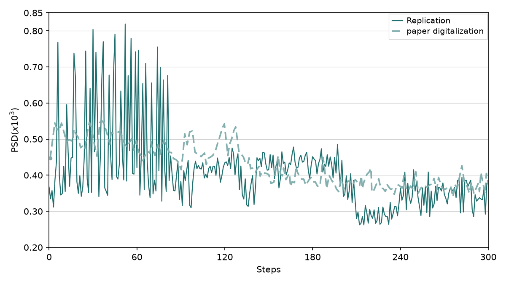
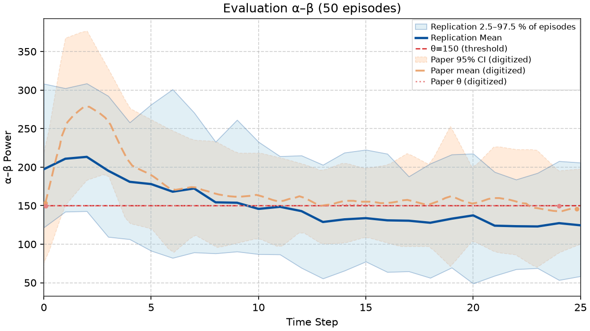

# rl-adaptive-dbs

[](LICENSING.md)

Independent replications of three reinforcement-learning papers on **adaptive deep brain stimulation (DBS)** for Parkinson's disease. The three controllers are rebuilt from each paper's text and figures (for Nguyen et al., also from the authors' later code release where the paper is silent). All three run on one shared simulated cortex–basal ganglia–thalamus circuit, the Kumaravelu et al. (2016) model, whose Python implementation is translated from the authors' MATLAB reference code rather than rebuilt from the paper; see [LICENSING.md](LICENSING.md) for its license status.

Every paper panel is scored against automated gates, and a panel counts as replicated only when all of its gates pass. Per-paper counts are below; the trackers have every gate. **[See the side-by-side showcase →](docs/figures/replication_showcase.md)**

| Paper | Controller | Panels passing | Tracker |
|-------|------------|:--------------:|---------|
| Mehregan et al., *Enhancing Adaptive Deep Brain Stimulation via Efficient Reinforcement Learning* | DDPG actor–critic, plus PTQ / QAT quantization | 7 / 9 (Fig 6a, 6b: QAT fails) | [mehregan](figures/mehregan/replications.md) |
| Ravivarapu et al., *Sample-Efficient Reinforcement Learning Controller for Deep Brain Stimulation in Parkinson's Disease* (SEA-DBS) | Sample-efficient actor–critic | 0 / 7 | [ravivarapu](figures/ravivarapu/replications.md) |
| Nguyen et al., *Closed-Loop Neuromorphic Deep Brain Stimulation using Deep Spiking Q-Networks* | Deep spiking Q-network | 4 / 5 (Fig 7: 13 of 14 gates) | [nguyen](figures/nguyen/replications.md) |

| Mehregan Fig. 4a: beta power during training (pass) | Ravivarapu Fig. 4a: SEA-DBS vs baseline (open) | Nguyen Fig. 7: 50-episode evaluation (open) |
|:---:|:---:|:---:|
|  |  |  |

> **Status:** active research code. Docs and scripts are still being consolidated, so expect some redundancy.

## The shared model

All three controllers run on one biophysical model of the cortex–basal ganglia–thalamus network in the parkinsonian rat (Kumaravelu, Brocker & Grill, 2016), set up as a reinforcement-learning environment the way Mehregan et al. describe it. Nguyen et al. and Ravivarapu et al. connect through adapters that match their papers' step lengths, observations, and rewards, so no paper gets its own copy of the dynamics. Specs: [docs/plant.md](docs/plant.md), [docs/environment.md](docs/environment.md). Where a replication departs from a paper or the published model, the panel's tracker labels the deviation; for Mehregan et al., [docs/development/replication-fidelity.md](docs/development/replication-fidelity.md) lists what matches and what diverges.

## How we check

Every figure panel has its own gates: numeric checks against curves digitized from the paper, like where a curve starts, which way it trends, and how two conditions are ordered. A panel counts as replicated only when all of its gates pass, so a panel that passes most of its gates is still open. Each tracker lists every gate with its current pass/fail state and the command that reproduces the panel.

## Progress reports

Dated progress reports live in [reports/](reports/) (`reports/YYYY-MM-DD.md`, with a PDF of each). They are snapshots: the October 2026 gate audits replaced some of their results, so the trackers above are the current state.

## Quick start

Requires Python 3.11+ and [uv](https://docs.astral.sh/uv/). MATLAB is optional; it's only needed for the reference-equivalence checks against the original Kumaravelu model.

The plant (the Kumaravelu et al. (2016) network that the RL environment runs on) needs the private `kumaravelu_plant` package, which holds the model-derived code, its MATLAB patches, and its generated data. Without it the rest of the repository still imports and runs, but any plant use raises `PlantUnavailableError` (see [LICENSING.md](LICENSING.md)). After any `uv sync`, run `bash scripts/plant/install_kumaravelu_plant.sh` again, because `uv sync` removes the package; `uv run` leaves it in place.

```bash
git clone https://github.com/nynxlabs/rl-adaptive-dbs.git
cd rl-adaptive-dbs
uv sync --group dev --group figures
bash scripts/plant/install_kumaravelu_plant.sh   # the plant needs the private kumaravelu_plant package (see below)

uv run pytest -m "not slow and not matlab"   # fast test tier, under a minute

# Regenerate Mehregan Fig. 1b from scratch with one seed (a few minutes).
# Drop --seeds to average all 10 seeds like the published replication.
uv run python scripts/figures/papers/mehregan/1b/plot.py --seeds 0
```

Each panel has its own `scripts/figures/papers/<paper>/<panel>/plot.py`; the trackers list the exact command for each.

Full install, verification, and day-to-day use: **[docs/setup.md](docs/setup.md)**.

## Current goals

**Primary success criterion:** qualitative **figure replication** — side-by-side paper panels vs our plots, with explicit gates per panel. Active work is organized around **open figure panels**, not “advance to the next roadmap phase.” Next: close the open panels (Ravivarapu, Mehregan's QAT panels, Nguyen Fig. 7), then compare the three controllers on the same model.

| Focus | Doc | Entry points |
|-------|-----|--------------|
| Mehregan et al. panel tracker | [figures/mehregan/replications.md](figures/mehregan/replications.md) | `scripts/figures/papers/mehregan/<panel>/plot.py` |
| Nguyen et al. panel tracker | [figures/nguyen/replications.md](figures/nguyen/replications.md) | `scripts/figures/papers/nguyen/<panel>/plot.py` |
| Ravivarapu et al. panel tracker | [figures/ravivarapu/replications.md](figures/ravivarapu/replications.md) | `scripts/figures/papers/ravivarapu/<panel>/plot.py` |
| What matches / diverges from the paper | [docs/development/replication-fidelity.md](docs/development/replication-fidelity.md) | Specs under `docs/plant.md`, `docs/environment.md`, `docs/controllers/` |

The **phase roadmap** ([docs/development/roadmap.md](docs/development/roadmap.md)) still describes long-term architecture — environment, controllers, benchmarking, fusion — but day-to-day priorities follow **figure gates** first. Suite runs (`mehregan_eval`), CLI/TUI, and fresh-VM validation support replication; they are not the main exit criterion on their own.

## Scope

Architecturally, the repo has three layers (built out in [docs/development/roadmap.md](docs/development/roadmap.md) phases 1–9):

1. **Environment (single source of truth)** — Replicate the **computational RL environment** from Mehregan et al., *Enhancing Adaptive Deep Brain Stimulation via Efficient Reinforcement Learning*: Kumaravelu et al. (2016) **cortex–basal ganglia–thalamus** dynamics, GPi **beta-band** biomarker, 2 s steps, reward Eq. (8), and a Gymnasium-style API that `ddpg` uses directly. Other papers connect through **adapters** on the same plant. Spec: [docs/environment.md](docs/environment.md). **Current focus:** the open panels: Ravivarapu Figs. 4a–7 and Table II ([figures/ravivarapu/replications.md](figures/ravivarapu/replications.md)), Mehregan Fig. 6a / 6b QAT ([figures/mehregan/replications.md](figures/mehregan/replications.md)), and Nguyen Fig. 7 ([figures/nguyen/replications.md](figures/nguyen/replications.md)). Plant panels 1b–2b gate on [docs/plant.md](docs/plant.md); Mehregan training panels on [docs/environment.md](docs/environment.md) + [docs/controllers/ddpg/replication.md](docs/controllers/ddpg/replication.md).

2. **Controllers (one per paper)** — Replicate each paper’s **learning-based controller** under `controllers/`, all driving the **same plant** (no duplicated CBGT dynamics):

   | Package | Paper | Uses `envs/` directly? | Phase (roadmap) |
   |---------|--------|-------------------------|-----------------|
   | `controllers/ddpg/` | Mehregan et al. — DDPG actor–critic with PTQ/QAT | Yes (Mehregan API) | 3 (FP), 4 (PTQ/QAT + benchmarks) |
   | `controllers/snn/` | Nguyen et al. — closed-loop neuromorphic DBS (deep spiking Q-network) | No — **adapter** (100 ms steps, spike obs, α–β) | 5 |
   | `controllers/sea_dbs/` | Ravivarapu et al. — SEA-DBS (sample-efficient actor–critic) | No — **adapter** (2 ms steps, binary pulse, Eq. (7) reward) | 6 |

   Per-paper specs: [docs/controllers/](docs/controllers/) (`replication.md`, `extensions.md` for post-replication ideas). **Fusion** (SEA-DBS + DSQN synthesis) is Phase 8: [docs/controllers/fusion.md](docs/controllers/fusion.md).

3. **Benchmarking & tooling** — **Per-paper suites** first (`mehregan_eval`, then `nguyen_eval`, `sea_dbs_eval`); optional **cross-paper** comparison on **plant-level** metrics (`cross_controller_plant`). Spec: [docs/benchmarking.md](docs/benchmarking.md). The **`benchmarks/`** package loads YAML from **`suites/`**, runs baselines and controllers, and writes **`results/`** (local, gitignored). **`uv run rl-dbs benchmark`** is the primary entry point ([docs/cli.md](docs/cli.md)); **`rl-dbs-tui`** monitors **`artifacts/`** and **`results/`** (six tabs: Run, Training, Eval, Benchmarks, Logs, Settings — [docs/tui.md](docs/tui.md)).

**Later (Phase 9+):** validated native Python plant (drop MATLAB after equivalence checks), modular plant/controller/benchmark layout, CI, and **full** CLI/TUI coverage for all controllers—see [docs/development/roadmap.md](docs/development/roadmap.md).

## Platform support

This repository is intended to work on **Windows**, **macOS**, and **Linux** (including WSL on Windows). Python setup uses [uv](https://docs.astral.sh/uv/) with a shared lockfile; see [docs/development/venv.md](docs/development/venv.md). Scripts and docs should stay portable unless a step is explicitly OS-specific.

## Layout

Python packages live under **`src/`** (editable install via `uv sync`):

- **`src/envs/`** — Shared Gymnasium-style RL environment (Mehregan et al. computational setup).
- **`src/controllers/`** — Per-paper controllers: `ddpg` (Mehregan), `snn` (Nguyen), `sea_dbs` (Ravivarapu).
- **`src/benchmarks/`** — Suite runner: YAML manifests → `results/` ([docs/benchmarking.md](docs/benchmarking.md)).
- **`suites/`** — Versioned eval configs (`mehregan_eval.yaml`, smoke variant for CI).
- **`src/rl_adaptive_dbs/`** — CLI (`rl-dbs`), TUI (`rl-dbs-tui`), and shared entry helpers.

- `docs/` — [setup.md](docs/setup.md) (setup & use), [development/](docs/development/) (roadmap, conventions, `uv`, pytest), [plant.md](docs/plant.md), [environment.md](docs/environment.md), [controllers/](docs/controllers/), [benchmarking.md](docs/benchmarking.md), [cli.md](docs/cli.md), [tui.md](docs/tui.md).
- `figures/<paper>/replications.md` — ship trackers (Mehregan / Nguyen / Ravivarapu).
- `reports/` — dated progress reports (`YYYY-MM-DD.md` + PDF); snapshots, not the current state.
- `results/` — benchmark outputs from `rl-dbs benchmark` (local, gitignored).
- `reference-material/` — Where third-party reference models go. The Kumaravelu et al. (2016) MATLAB network is **not included**: `python scripts/matlab/fetch_kumaravelu.py` downloads the pinned upstream revision into `reference-material/KumaraveluEtAl2016/` (gitignored) and applies our integration patches from the private `kumaravelu_plant` package, if it is installed ([`changes.md`](reference-material/KumaraveluEtAl2016/changes.md); license status in [LICENSING.md](LICENSING.md)). Only the optional MATLAB backend needs it.
- `scripts/` — layout in [`scripts/README.md`](scripts/README.md): panel ship scripts under **`scripts/figures/papers/`**, digitization/gates, MATLAB/plant helpers; **`scripts/probes/`** keeps only reusable extension diagnostics (see [`scripts/probes/README.md`](scripts/probes/README.md)).

```python
from envs import MehreganEnv
from controllers.ddpg import train
```

## Setup

**[docs/setup.md](docs/setup.md)** — install, verify, and day-to-day use.

**[docs/development/roadmap.md](docs/development/roadmap.md)** — phases and status. **[docs/development/conventions.md](docs/development/conventions.md)** — contributor rules.

Specs: [plant.md](docs/plant.md), [environment.md](docs/environment.md), [controllers/](docs/controllers/), [figures/mehregan/replications.md](figures/mehregan/replications.md), [benchmarking.md](docs/benchmarking.md), [cli.md](docs/cli.md), [tui.md](docs/tui.md). Tooling: [development/](docs/development/) (`venv.md`, `testing.md`).

## Benchmarking

Cross-controller comparison uses **per-paper eval suites** plus an optional **same-plant** suite; see [docs/benchmarking.md](docs/benchmarking.md) §3. Run suites with **`uv run rl-dbs benchmark`**, summarize with **`uv run rl-dbs summary`**, monitor with **`uv run rl-dbs-tui`** (launch jobs, training, eval drill-down, logs). **`rl-dbs train`** / **`eval`** wrap `ddpg` for now.

## References

### Computational environment and DDPG controller

- **Mehregan, J., et al.** *Enhancing Adaptive Deep Brain Stimulation via Efficient Reinforcement Learning.* Defines the shared computational RL environment (parkinsonian plant interface, GPi beta-band biomarker, 2 s steps, reward Eq. (8)) and the DDPG actor–critic with optional PTQ/QAT. Specs: [docs/environment.md](docs/environment.md), [docs/controllers/ddpg/replication.md](docs/controllers/ddpg/replication.md).

### Additional RL controllers (same plant, paper-specific adapters)

- **Nguyen, B., et al.** *Closed-Loop Neuromorphic Deep Brain Stimulation using Deep Spiking Q-Networks.* Deep spiking Q-network (DSQN); 100 ms steps, spike observations, α–β feedback. Spec: [docs/controllers/snn/replication.md](docs/controllers/snn/replication.md).
- **Ravivarapu, H., et al.** *Sample-Efficient Reinforcement Learning Controller for Deep Brain Stimulation in Parkinson's Disease* (SEA-DBS). Binary pulse actions, predictive reward model, Gumbel-Softmax exploration. Spec: [docs/controllers/sea_dbs/replication.md](docs/controllers/sea_dbs/replication.md).

### Biophysical plant model

- **Kumaravelu, K., Brocker, D. T., Grill, W. M.** (2016). *A biophysical model of the cortex–basal ganglia–thalamus network in the 6-OHDA lesioned rat model of Parkinson’s disease.* *Journal of Computational Neuroscience*, 40, 207–229. Spec: [docs/plant.md](docs/plant.md). Upstream MATLAB: [ModelDBRepository/206232](https://github.com/ModelDBRepository/206232) (not bundled; fetch it with `python scripts/matlab/fetch_kumaravelu.py`, which reads its `readme.txt` for citation and provenance; see [LICENSING.md](LICENSING.md) for license status).

## License

Our original code is released under the [MIT License](LICENSE). If you use it, please cite it using [CITATION.cff](CITATION.cff).

Not everything in this repository is ours or MIT-licensed. [LICENSING.md](LICENSING.md) maps each part to its status:

- **Kumaravelu et al. (2016) model** — no license found, so we don't redistribute it: `scripts/matlab/fetch_kumaravelu.py` downloads it from upstream and applies our own patches, which live in the private `kumaravelu_plant` package. It is not covered by our MIT License.
- **Native Python port of that model** (the private `kumaravelu_plant` package; the public `src/envs/plant/` keeps the config, DBS, and biomarker interfaces) — translated from the model, so the same permission is pending for the translated parts.
- **Chronux multitaper helpers** inside the fetched MATLAB files — GNU GPL v2 ([CHRONUX_LICENSE.txt](reference-material/KumaraveluEtAl2016/CHRONUX_LICENSE.txt)); not included in this repository.
- **Data generated by the model** (the initial-condition draws and the DBS current fixture, now in the private `kumaravelu_plant` package) — treated as pending with the model.
- **Figures from the replicated papers** — the published (IEEE) figures are not in this repository or its history; the comparisons show our own redraws of the digitized curves, and for Ravivarapu et al. crops of the CC BY 4.0 arXiv version with attribution. `scripts/digitization/paper_crops.py` builds local, gitignored crops from your own copy of each paper for re-digitizing.

