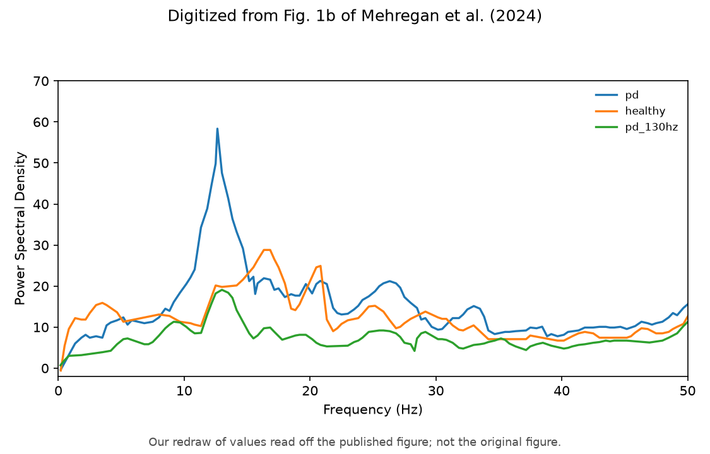

# Mehregan et al. Fig 1b — GPi PSD

[← DDPG / Mehregan et al. tracker](../README.md)

## What the paper shows

Mean GPi multitaper power spectral density (1–50 Hz) for three conditions: **healthy control**, **PD no treatment**, and **PD + 130 Hz STN cDBS**. Ordering gate: **PD > healthy** on beta power and **130 Hz cDBS < PD** (see [plant.md](../../../plant/README.md)).

## Status

**Current status:** the summary table in the [tracker](../README.md) (refreshed on every promote).

### Paper (Mehregan et al.): digitized, our redraw



### Replication


<!-- caption-1b:start -->
**Caption:** GPi PSD, 10 s sim, seeds 0–9 mean; β[13–35 Hz] healthy/PD/130 Hz = 13.3/22.2/8.1 (paper 15.3/17.7/7.9); PD peak 19 Hz (paper 13), v3, 2026-10-18

**Manifest:** `artifacts/figures/papers/mehregan/1b/manifest.json`
<!-- caption-1b:end -->

**Status:** Fail (upgraded gates, fresh run rep v3, Oct 18 2026, healthy runs now on pd=0 init draws) — beta-band ordering and the 130 Hz and healthy levels match (β healthy / PD / 130 Hz 13.3 / 22.2 / 8.1 vs paper 15.3 / 17.7 / 7.9), but our PD spectrum peaks at 18.5 Hz vs the paper's 12.6 Hz and its shape correlates poorly (r 0.19), the healthy/PD ratio sits at the 30% edge, and healthy / 130 Hz carry excess 1–12 Hz power. Seven spectral estimators (`scripts/probes/mehregan_fig1b_estimator.py`) and four candidate readings (`--dt-ms 0.02`, `--transient-s` on 30 s, seed 0 only, `--signal voltage`) all keep the PD peak at 18.4–18.8 Hz, so the gap is in our plant's PD dynamics, not the estimator or protocol — an author question.

## How to reproduce

**Run:**

```bash
uv run python scripts/figures/papers/mehregan/1b/plot.py
uv run python scripts/figures/papers/mehregan/1b/plot.py --plot-only
```

**Defaults:** seeds `0–9` (mean PSD), 10 s segment, Python plant.

## Gates

<!-- gates-1b:start -->
**Gates set** (`fig1b_gates` → manifest `gates` / `gates_pass`). Overall **`gates_pass`**: no (from `artifacts/figures/papers/mehregan/1b/curves.json`, 2026-10-18). Every row is required for exit.

| Key | Description | Pass |
|-----|-------------|------|
| `pd_gt_healthy` | beta-band PD > healthy | yes |
| `pd_130_lt_pd` | 130 Hz cDBS < untreated PD | yes |
| `suppression_ratio_near_paper` | pd_130/pd ratio vs digitized paper | yes |
| `healthy_beta_near_paper` | healthy level within 30% of paper | yes |
| `pd_130hz_beta_near_paper` | treated level within 30% of paper | yes |
| `healthy_pd_ratio_near_paper` | healthy/PD beta ratio within 30% of digitized paper | no |
| `pd_beta_near_paper` | PD beta level within 30% of digitized paper | yes |
| `pd_peak_freq_near_paper` | PD spectral peak (1.5 Hz smoothed) within ±4 Hz of digitized paper | no |
| `low_over_beta_near_paper` | every series' [1,12]/[13,35] Hz power ratio within 35% of digitized paper | no |
| `pd_shape_r` | Pearson r PD PSD vs digitized paper on a common 1–50 Hz grid ≥ 0.6 | no |
| `pd130_shape_r` | Pearson r 130 Hz PSD vs digitized paper on a common 1–50 Hz grid ≥ 0.3 | no |
<!-- gates-1b:end -->

## Deviations and conventions

None recorded yet.

## Tried so far

None recorded yet.

## Open questions

Questions for the authors are tracked privately.

## Notes

None recorded yet.
