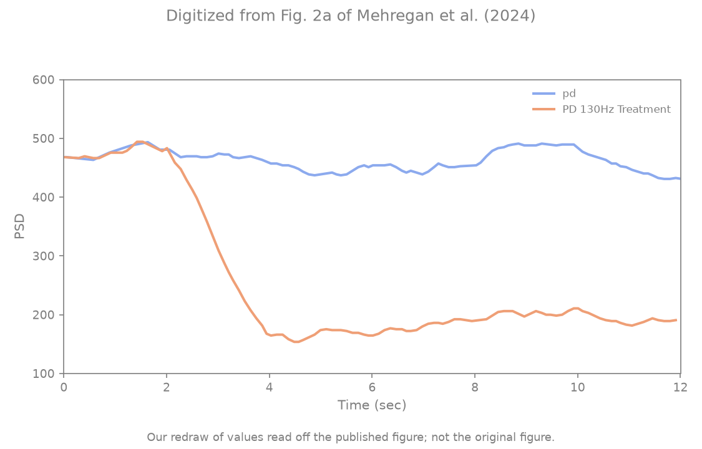
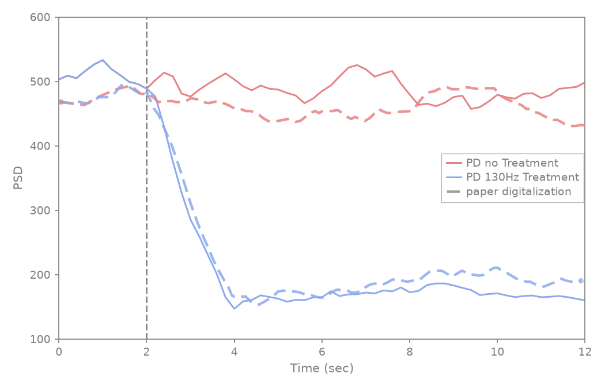

# Mehregan et al. Fig 2a — GPi $P_\beta$ time series

[← DDPG / Mehregan et al. tracker](../README.md)

## What the paper shows

GPi beta-band power ($P_\beta$, Eq. 1, 13–35 Hz) over **12 s**: **PD no treatment** (red) vs **PD + 130 Hz cDBS** (blue). Shared baseline 0–2 s; dashed vertical at **2 s** (cDBS onset for blue). After onset, blue falls to a low plateau; red stays elevated.

## Status

**Current status:** the summary table in the [tracker](../README.md) (refreshed on every promote).

### Paper (Mehregan et al.): digitized, our redraw



### Replication



<!-- caption-2a:start -->
**Caption:** Fig 5a eval protocol (2 s pre-roll, 2 s reset, five 2 s carried steps; 0.2 s trailing / 2 s window), seed 0 (2026-10-21)

**Manifest:** `artifacts/figures/papers/mehregan/2a/manifest.json`
<!-- caption-2a:end -->

**Status:** Pass — every upgraded gate (pre-onset level 510 vs paper 478, late ratio 0.35 vs 0.42, half-drop 2.76 s vs 2.90 s, treated and gap shape r ≥ 0.7). Since Oct 17 2026 the traces come from the Fig 5a eval protocol (`--protocol eval`, default): the paper's Fig 2a curves are its Fig 5a "PD no stim" / "Periodic 130Hz" curves (r 0.987 / 0.999), so ours are now identical to our Fig 5a no-stim / 130 Hz traces. `--protocol single` keeps the earlier 14 s integrate. Single seed (0).

## How to reproduce

**Run:**

```bash
uv run python scripts/figures/papers/mehregan/2a/plot.py
uv run python scripts/figures/papers/mehregan/2a/plot.py --plot-only
uv run python scripts/figures/papers/mehregan/2a/plot.py --protocol single   # earlier 14 s integrate
```

**Defaults:** seed `0`, `--protocol eval` (Fig 5a eval protocol: 2 s no-stim pre-roll, 2 s reset, five 2 s carried steps), 0.2 s trailing samples, 2 s window. Writes versioned `beta_power_vN.png`; promote copies it to the ship name `beta_power.png`.

## Gates

<!-- gates-2a:start -->
**Gates set** (`fig2_time_gates`, panel `2a`). Overall **`gates_pass`**: yes (from `artifacts/figures/papers/mehregan/2a/series.json`, 2026-10-21). Every row is required for exit.

| Key | Description | Pass |
|-----|-------------|------|
| `prestim_shared` | treated/untreated agree pre-onset (≤5% rel) | yes |
| `treated_below_untreated_late` | cDBS below no-treatment after t=2 | yes |
| `late_ratio_near_paper` | late treated/untreated ratio vs digitization | yes |
| `suppression_drop_near_paper` | drop magnitude vs digitization | yes |
| `untreated_flat` | untreated late (t ≥ 6 s) / pre within ±0.15 (absolute) of digitized paper | yes |
| `treated_late_over_pre_near_paper` | treated late / pre within 30% of digitized paper | yes |
| `prestim_level_near_paper` | untreated pre-onset level within 15% of digitized paper | yes |
| `treated_mid_ratio_near_paper` | treated/untreated mean on [4,7] s within 30% of digitized paper | yes |
| `t50_near_paper` | treated trace reaches half its pre→late drop within ±1 s of digitized paper | yes |
| `treated_shape_r` | Pearson r treated trace vs digitized paper on a common [0,12] s grid ≥ 0.7 | yes |
| `gap_shape_r` | Pearson r of the untreated − treated gap vs digitized paper on [0,12] s ≥ 0.7 | yes |
<!-- gates-2a:end -->

## Deviations and conventions

None recorded yet.

## Tried so far

None recorded yet.

## Open questions

Questions for the authors are tracked privately.

## Notes

None recorded yet.
