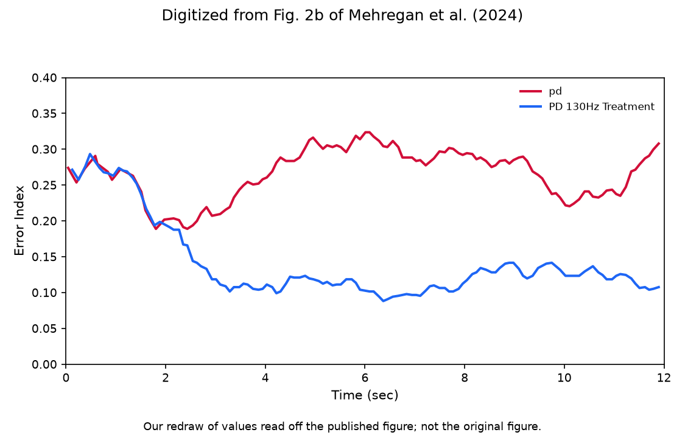
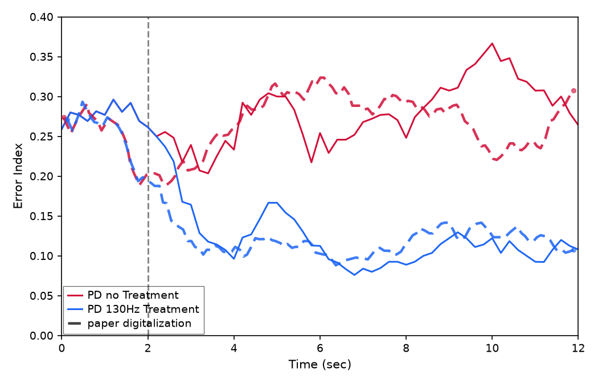

# Mehregan et al. Fig 2b — Error Index time series

[← DDPG / Mehregan et al. tracker](../README.md)

## What the paper shows

Windowed Error Index (EI, Eq. 2) over **12 s** with **So-style SMC pulses into TH** (path A): BoC inverse-gamma on **Iappth**, `iappth_baseline=0`, `ggith=0.112`. **PD no treatment** (red) vs **PD + 130 Hz cDBS** (blue). Same timing as Fig 2a. Y-axis **Error Index** (replication default **0.10–0.4**; paper panel reads ~0–0.4).

## Status

**Current status:** the summary table in the [tracker](../README.md) (refreshed on every promote).

### Paper (Mehregan et al.): digitized, our redraw

<picture><source media="(prefers-color-scheme: dark)" srcset="images/2b/digitized_v3_dark.png"></picture>

### Replication

<picture><source media="(prefers-color-scheme: dark)" srcset="images/2b/error_index_v21_dark.png"></picture>

<!-- caption-2b:start -->
**Caption:** 14 s sim (2 s pre-roll), plot = sim − 2 s, 0.2 s trailing / 2 s EI window (end sim 14 s), SMC BoC inv-gamma Iappth, backend python, seed 0, v21 (2026-10-23)

**Manifest:** `artifacts/figures/papers/mehregan/2b/manifest.json`
<!-- caption-2b:end -->

**Status:** Pass — every upgraded gate on a fresh run of the current plant (rep v18, Oct 17 2026). The earlier failure (pre-onset EI 0.33 vs paper 0.25) came from a cached July series replotted under the new gates; plant changes since then moved the EI trace. Eight candidate readings (thalamic baseline kept, T_ω 1 s / 4 s, periodic or 10 / 20 Hz SMC timing, 15 / 40 ms misfire windows) did not beat the shipped convention. Single seed (0).

## How to reproduce

**Run:**

```bash
uv run --group figures python scripts/figures/papers/mehregan/2b/plot.py
uv run --group figures python scripts/figures/papers/mehregan/2b/plot.py --plot-only
```

Each run writes a new ``docs/controllers/ddpg/figures/images/2b/error_index_vN.png`` (N auto-increments) and updates the replication image link above.

**Defaults:** seed `0`, `smc_site='thalamic'`, `iappth_baseline=0`, `ggith=0.112`, `smc_amplitude=3.5`, `smc_schedule='boc'`, `smc_pulse_source='drive'`, backend **python**.

## Gates

<!-- gates-2b:start -->
**Gates set** (`fig2_time_gates`, panel `2b`). Overall **`gates_pass`**: yes (from `artifacts/figures/papers/mehregan/2b/series.json`, 2026-10-23). Every row is required for exit.

| Key | Description | Pass |
|-----|-------------|------|
| `prestim_shared` | treated/untreated agree pre-onset (≤5% rel) | yes |
| `treated_below_untreated_late` | cDBS below no-treatment after t=2 | yes |
| `late_ratio_near_paper` | late treated/untreated ratio vs digitization | yes |
| `suppression_drop_near_paper` | drop magnitude vs digitization | yes |
| `untreated_flat` | untreated late (t ≥ 6 s) / pre within ±0.15 (absolute) of digitized paper | yes |
| `treated_late_over_pre_near_paper` | treated late / pre within 30% of digitized paper | yes |
| `prestim_level_near_paper` | untreated pre-onset level within 15% of digitized paper | yes |
| `treated_mid_ratio_near_paper` | treated/untreated mean on [4,7] s within 30% of digitized paper | yes |
| `t50_near_paper` | treated trace reaches half its pre→late drop within ±1 s of digitized paper | yes |
| `treated_shape_r` | Pearson r treated trace vs digitized paper on a common [0,12] s grid ≥ 0.7 | yes |
| `gap_shape_r` | Pearson r of the untreated − treated gap vs digitized paper on [0,12] s ≥ 0.7 | yes |
<!-- gates-2b:end -->

## Deviations and conventions

### Convention (path A, 2026-07-12)

**Citations (split roles):** Gao et al. (ICCPS 2020) define the **EI metric** Mehregan uses (exactly one TH spike in $(\mathrm{SMC}_\tau,\mathrm{SMC}_\tau{+}25\,\mathrm{ms})$; windowed $T_\omega{=}2\,\mathrm{s}$). So et al. (2012) define the **TH drive** for that metric (SMC current pulses into TH; TH not spontaneously active). Kumaravelu replaced those pulses with constant $I_{\mathrm{appth}}=1.2$; Fig 2b restores So-style drive: **pulses only** (`iappth_baseline=0`) plus BoC inverse-gamma timing (~14 Hz mean). Cortical `Iappco` SMC remains available but does **not** produce paper ordering (no Cor→TH synapse). Sweep: `artifacts/probes/fig2b_ei_so_path_a_sweep.json`.

## Tried so far

None recorded yet.

## Open questions

Questions for the authors are tracked privately.

## Notes

None recorded yet.
