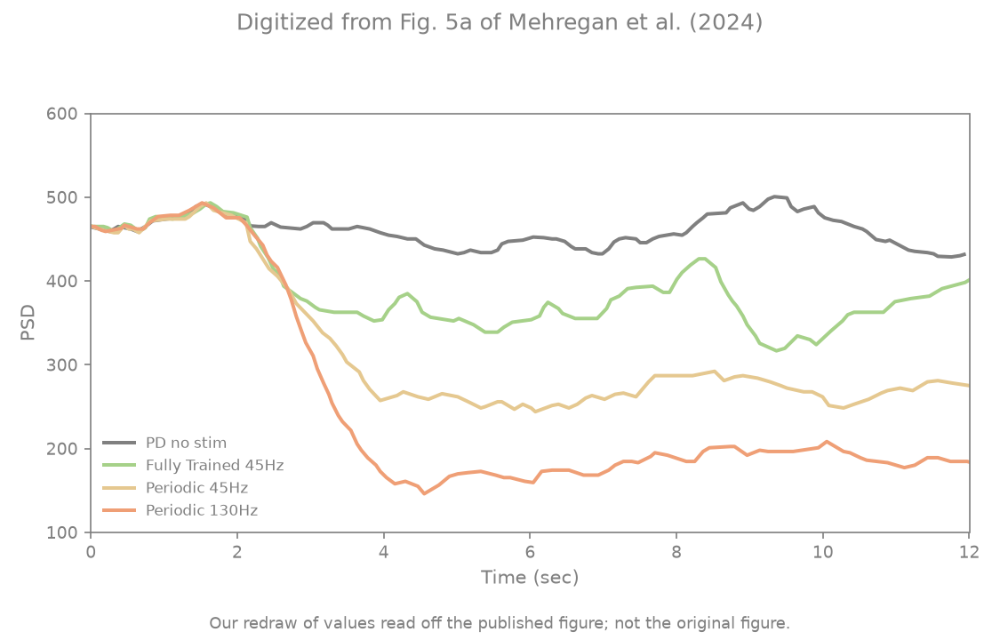
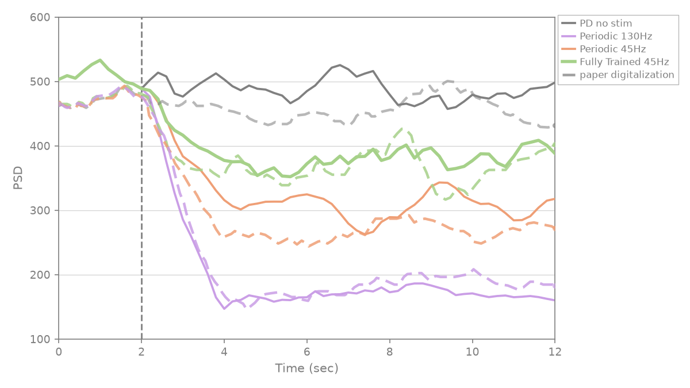

# Mehregan et al. Fig 5a — post-train efficacy @ 45 Hz

[← DDPG / Mehregan et al. tracker](../README.md)

## What the paper shows

Post-training evaluation of the **45 Hz** model (§IV.A.2) on a fixed seed: 2 s reset, then five 2 s steps of the trained policy, **closed loop** (each step plays $\arg\max$ of the actor on the previous step's $P_\beta$). Same seed for **PD no stim**, **fully trained 45 Hz**, **periodic 45 Hz** and **periodic 130 Hz**. Trace = trailing 2 s $P_\beta$ every 0.2 s (Fig 2a protocol). Paper: trained reduces beta vs no stim; periodic 45 Hz and 130 Hz are lower still.

## Status

**Current status:** the summary table in the [tracker](../README.md) (refreshed on every promote).

### Paper (Mehregan et al.): digitized, our redraw



### Replication



<!-- caption-5a:start -->
**Caption:** 45 Hz paper-protocol eval, seed 0, checkpoint=checkpoint.pt, 0.2s trailing, v27, trained_mean=379, no_stim_mean=486, periodic_mean=307, trained>periodic, gates pass (2026-10-21)

**Manifest:** `artifacts/figures/papers/mehregan/5a/manifest.json`
<!-- caption-5a:end -->

**Status:** Pass — every upgraded gate (rep v26). Evaluates the Fig 4a checkpoint (the paper's one 45 Hz model); the policy plays burst pattern 19: trained 379, periodic 45 Hz 307, no stim 486, 130 Hz 169 (late means, t ≥ 4 s); trained/no-stim 0.78 vs paper 0.81.

## How to reproduce

**Run:**

```bash
uv run python -m rl_adaptive_dbs.run scripts/figures/papers/mehregan/5a/plot.py --export-notes
uv run python -m rl_adaptive_dbs.run scripts/figures/papers/mehregan/5a/plot.py --plot-only --export-notes
```

**Defaults:** eval seed `0`, checkpoint `artifacts/figures/papers/mehregan/4a/checkpoint.pt`, `BurstPatternAlphabet`. Shared code: `scripts/figures/papers/mehregan/efficacy_panel.py`.

## Gates

<!-- gates-5a:start -->
**Gates set** (`efficacy_gates` / `fig5_efficacy_gates` → `eval.json`). Overall **`pass`**: yes (from `artifacts/figures/papers/mehregan/5a/eval.json`, 2026-10-21). Every row is required for exit.

| Key | Description | Pass |
|-----|-------------|------|
| `shared_baseline` | pre-onset spread across all series (incl. trained) ≤ 3% of the level | yes |
| `trained_closed_loop` | trained series runs the actor closed loop (no replayed actions) | yes |
| `trained_below_no_stim` | trained mean (t ≥ 4 s) < no stim | yes |
| `trained_above_periodic` | trained > periodic 45 Hz | yes |
| `cdbs_lowest` | 130 Hz cDBS lowest of four series | yes |
| `trained_no_stim_ratio_near_paper` | trained/no-stim late ratio (t ≥ 4 s) within 15% of digitized paper | yes |
| `periodic_no_stim_ratio_near_paper` | periodic/no-stim late ratio (t ≥ 4 s) vs digitized paper | yes |
| `prestim_level_near_paper` | mean pre-onset level within 10% of digitized paper | yes |
| `trained_onset_ratio_near_paper` | trained/no-stim on [2,4] s within 30% of digitized paper (onset speed) | yes |
| `trained_shape_r` | Pearson r trained trace vs digitized paper on a common [0,12] s grid ≥ 0.6 | yes |
| `periodic_shape_r` | Pearson r periodic trace vs digitized paper on a common [0,12] s grid ≥ 0.6 | yes |
| `trained_periodic_gap_near_paper` | (trained − periodic)/no-stim late within 0.4–2× digitized paper | yes |
| `cdbs_no_stim_ratio_near_paper` | 130 Hz/no-stim late ratio within 30% of digitized paper | yes |
<!-- gates-5a:end -->

## Deviations and conventions

None recorded yet.

## Tried so far

Variants tried for this panel's model are recorded in [4a.md](4a.md) § Tried so far (the same trained models feed Figs 4a–6b).

## Open questions

Questions for the authors are tracked privately.

## Notes

None recorded yet.
