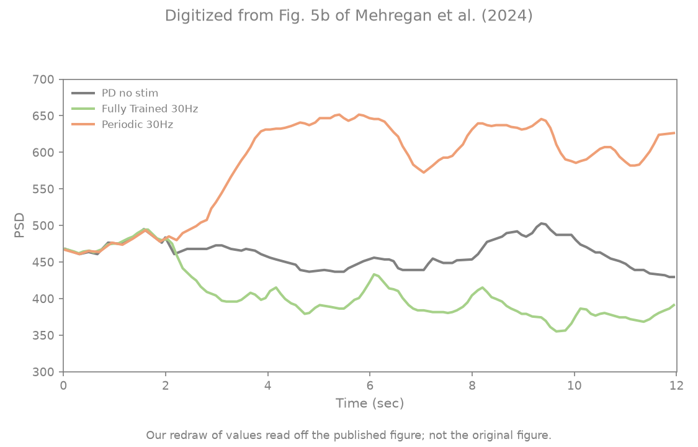
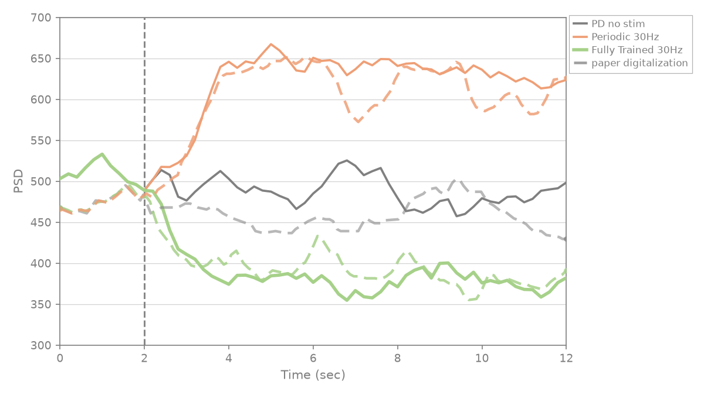
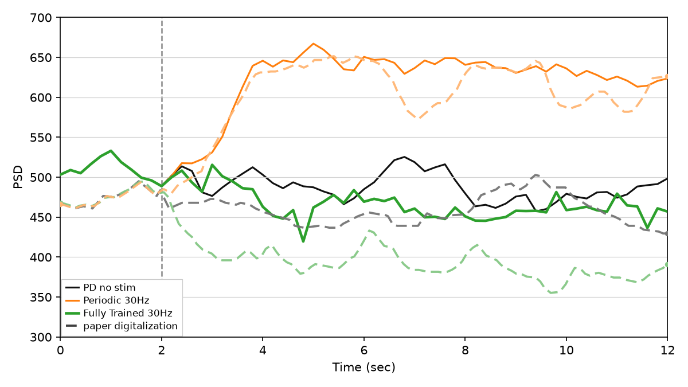

# Mehregan et al. Fig 5b — post-train efficacy @ 30 Hz

[← DDPG / Mehregan et al. tracker](../README.md)

## What the paper shows

Same closed-loop eval for the **30 Hz** model (§IV.A.2), trained with the Fig 4a recipe ("all other parameters fixed"). Series: **PD no stim**, **fully trained 30 Hz**, **periodic 30 Hz**. Paper: periodic 30 Hz *raises* beta (inside the beta band); the trained irregular pattern lowers it below both.

## Status

**Current status:** the summary table in the [tracker](../README.md) (refreshed on every promote).

### Paper (Mehregan et al.): digitized, our redraw



### Replication



<!-- caption-5b:start -->
**Caption:** 30 Hz paper-protocol eval, seed 0, checkpoint=checkpoint.pt, 0.2s trailing, v28, trained_mean=378, no_stim_mean=486, periodic_mean=638, trained<both, gates pass (2026-10-21)

**Manifest:** `artifacts/figures/papers/mehregan/5b/manifest.json`
<!-- caption-5b:end -->

**Status:** Pass — every upgraded gate (rep v27). Trained 378 < no stim 486 < periodic 30 Hz 638; the 30 Hz model plays burst pattern 14 (clusters with silence — instantaneous rate outside the beta band, as the paper argues).

## How to reproduce

**Run:**

```bash
uv run python -m rl_adaptive_dbs.run scripts/figures/papers/mehregan/5b/plot.py --train --export-notes
uv run python -m rl_adaptive_dbs.run scripts/figures/papers/mehregan/5b/plot.py --plot-only --export-notes
```

**Defaults:** train + eval seed `0`, 30 Hz `BurstPatternAlphabet` (21 patterns, 60 pulses each; on the pre-Oct 2026 menu the ±1/3 jitter family had 0/40 irregular 30 Hz patterns below no stim), same paper-silent knobs as Fig 4a. Writes `artifacts/figures/papers/mehregan/5b/checkpoint.pt` (fp32 actor for Fig 6b).

## Gates

<!-- gates-5b:start -->
**Gates set** (`efficacy_gates` / `fig5_efficacy_gates` → `eval.json`). Overall **`pass`**: yes (from `artifacts/figures/papers/mehregan/5b/eval.json`, 2026-10-21). Every row is required for exit.

| Key | Description | Pass |
|-----|-------------|------|
| `shared_baseline` | pre-onset spread across all series (incl. trained) ≤ 3% of the level | yes |
| `trained_closed_loop` | trained series runs the actor closed loop (no replayed actions) | yes |
| `trained_below_no_stim` | trained mean (t ≥ 4 s) < no stim | yes |
| `trained_below_periodic` | trained < periodic 30 Hz | yes |
| `periodic_above_no_stim` | periodic 30 Hz elevates beta vs no stim | yes |
| `trained_no_stim_ratio_near_paper` | trained/no-stim late ratio (t ≥ 4 s) within 15% of digitized paper | yes |
| `periodic_no_stim_ratio_near_paper` | periodic/no-stim late ratio (t ≥ 4 s) vs digitized paper | yes |
| `prestim_level_near_paper` | mean pre-onset level within 10% of digitized paper | yes |
| `trained_onset_ratio_near_paper` | trained/no-stim on [2,4] s within 30% of digitized paper (onset speed) | yes |
| `trained_shape_r` | Pearson r trained trace vs digitized paper on a common [0,12] s grid ≥ 0.6 | yes |
| `periodic_shape_r` | Pearson r periodic trace vs digitized paper on a common [0,12] s grid ≥ 0.6 | yes |
| `trained_periodic_gap_near_paper` | trained-below-periodic gap (/no-stim, late) within 0.4–2× digitized paper | yes |
<!-- gates-5b:end -->

## Deviations and conventions

None recorded yet.

## Tried so far

**Labelled candidate (Oct 20, deviates from paper — our best guess of what the authors may have done; not the default):** the per-pulse head with an inter-pulse-interval critic view (`pp_view=ipi`, Gumbel exploration) scores 9, 12, 12, 9, 11 / 12 over train seeds 0–4 (D3's offset view: 8, 8, 7); it does not learn at 45 Hz, so it is a rate-specific view, against "all other parameters fixed". `5b/candidates/ipi-s*`.



Variants tried for this panel's model are recorded in [4a.md](4a.md) § Tried so far (the same trained models feed Figs 4a–6b).

## Open questions

Questions for the authors are tracked privately.

## Notes

None recorded yet.
