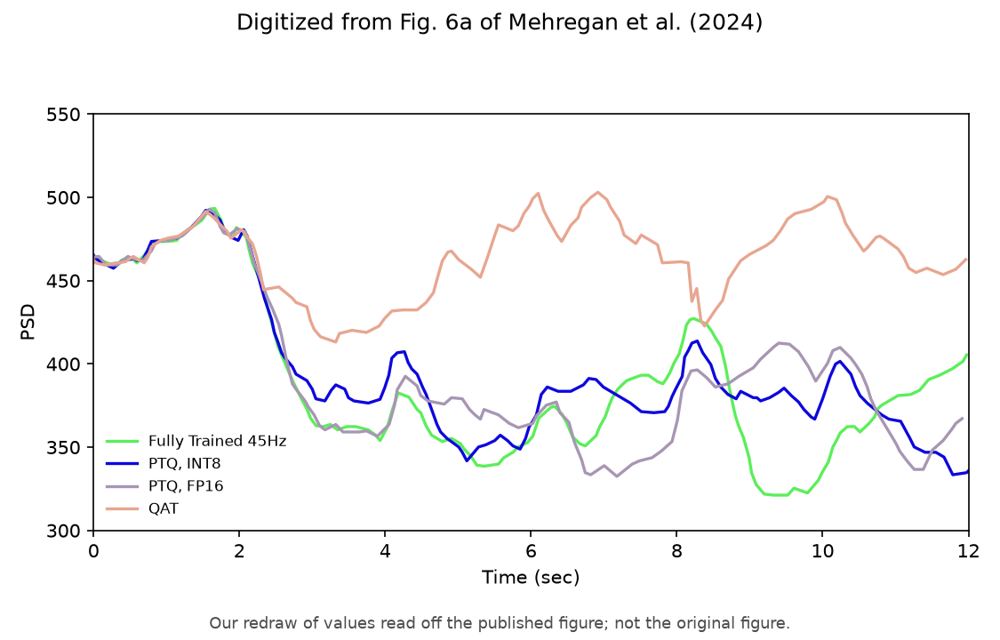

# Mehregan et al. Fig 6a — PTQ / QAT @ 45 Hz

[← DDPG / Mehregan et al. tracker](../README.md)

## What the paper shows

Quantization on the **45 Hz** model (§IV.A.3), same closed-loop eval and seed. **Fully trained** = Fig 4a fp32 checkpoint; **PTQ fp16** = fp16 cast; **PTQ int8** = PyTorch `quantize_dynamic`; **QAT** = separate 10-episode quantization-aware run with the same recipe (fake-quant stub on the input, dequant stub on the logits). Paper: PTQ tracks fp32 suppression; 10-episode QAT does not reduce beta (stays at or above the pre-stim level).

## Status

**Current status:** the summary table in the [tracker](../README.md) (refreshed on every promote).

### Paper (Mehregan et al.): digitized, our redraw



### Replication


<!-- caption-6a:start -->
**Caption:** 45 Hz paper-protocol eval, eval seed 0, fp32_post=379, QAT median post=307, QAT paper-like 1/15 train seeds, QAT median late/pre 0.60, PTQ tracks fp32, v71, 2026-10-17

**Manifest:** `artifacts/figures/papers/mehregan/6a/manifest.json`
<!-- caption-6a:end -->

**Status:** Fail (rep v71, 15 QAT training seeds) — fp32 / PTQ fp16 / PTQ int8 all 379 (every fp32 level/onset/shape gate passes). PTQ is byte-identical to fp32 (the menu argmax never flips), so `ptq_*_alters_trace` fail: the paper's PTQ traces differ from fp32 by 22 / 28 PSD units with the same mean. QAT: 1/15 seeds paper-like; 14/15 deploy the regular 45 Hz train (late/pre 0.60 vs paper 0.995) — 10-episode int8 QAT saturates its fake-quant head and never learns, so the tie keeps the regular-pulse init, which suppresses at 45 Hz. Root cause: the menu action space; the per-pulse head of Figure 3a cannot learn Fig 4a under Alg. 1 (open question). [4a.md](4a.md) § Fig 3a per-pulse head — bounded probe.

## How to reproduce

**Run:**

```bash
uv run python -m rl_adaptive_dbs.run scripts/figures/papers/mehregan/6a/plot.py --train-qat --export-notes   # 15 QAT seeds, 3 at a time
uv run python -m rl_adaptive_dbs.run scripts/figures/papers/mehregan/6a/plot.py --export-notes      # re-eval existing QAT seed checkpoints
uv run python -m rl_adaptive_dbs.run scripts/figures/papers/mehregan/6a/plot.py --plot-only --export-notes
```

**Defaults:** fp32 `artifacts/figures/papers/mehregan/4a/checkpoint.pt`, QAT `artifacts/figures/papers/mehregan/6a/qat/qat_checkpoint_seed{0..14}.pt` (train seeds `0-14`, `--qat-seeds`), eval seed `0`. Shared code: `scripts/figures/papers/mehregan/quant_panel.py`.

## Gates

<!-- gates-6a:start -->
**Gates set** (`fig6_quant_gates` → `eval.json`). Overall **`all_pass`**: no (from `artifacts/figures/papers/mehregan/6a/eval.json`, 2026-10-18). Every row is required for exit.

| Key | Description | Pass |
|-----|-------------|------|
| `all_closed_loop` | fp32, PTQ and every QAT seed each run their own actor closed loop | yes |
| `prestim_shared` | all series and QAT seeds share the pre-onset level (spread ≤ 1%) | yes |
| `fp32_suppresses_vs_baseline` | fp32 late mean (t ≥ 4 s) < its pre-onset mean | yes |
| `ptq_fp16_near_fp32` | PTQ fp16 late mean within 15% of fp32 | yes |
| `ptq_int8_near_fp32` | PTQ int8 late mean within 20% of fp32 | yes |
| `qat_elevated_vs_fp32` | median-seed QAT late mean > fp32 | no |
| `fp32_level_near_paper` | fp32 late/pre within 20% of digitized paper | yes |
| `ptq_fp16_level_near_paper` | PTQ fp16 late/pre within 20% of digitized paper | yes |
| `ptq_int8_level_near_paper` | PTQ int8 late/pre within 20% of digitized paper | yes |
| `qat_majority_not_below_paper` | QAT late/pre ≥ 80% of digitized paper in a strict majority of QAT training seeds | no |
| `qat_median_near_paper` | median-seed QAT late/pre within 20% of digitized paper (figure: same range) | no |
| `qat_late_sustained` | median QAT trace [10,12] s mean ≥ 90% of its [2,8] s mean (no late fade) | no |
| `fp32_onset_near_paper` | fp32 [2,4] s mean / pre-onset within 20% of digitized paper (onset speed) | yes |
| `fp32_shape_r` | Pearson r fp32 trace vs digitized paper on a common [0,12] s grid ≥ 0.6 | yes |
| `prestim_level_near_paper` | fp32 pre-onset level within 10% of digitized paper | yes |
| `qat_fp32_gap_vs_paper` | (median-seed QAT − fp32) late / pre ≥ 0.5× the digitized paper gap | no |
| `ptq_int8_alters_trace` | mean |PTQ int8 − fp32| over t ≥ 2 s ≥ 0.5× digitized paper (quantization alters outputs) | no |
| `ptq_fp16_alters_trace` | mean |PTQ fp16 − fp32| over t ≥ 2 s ≥ 0.5× digitized paper (quantization alters outputs) | no |
<!-- gates-6a:end -->

## Deviations and conventions

None recorded yet.

## Tried so far

Variants tried for this panel's model are recorded in [4a.md](4a.md) § Tried so far (the same trained models feed Figs 4a–6b).

## Open questions

Questions for the authors are tracked privately.

## Notes

None recorded yet.
