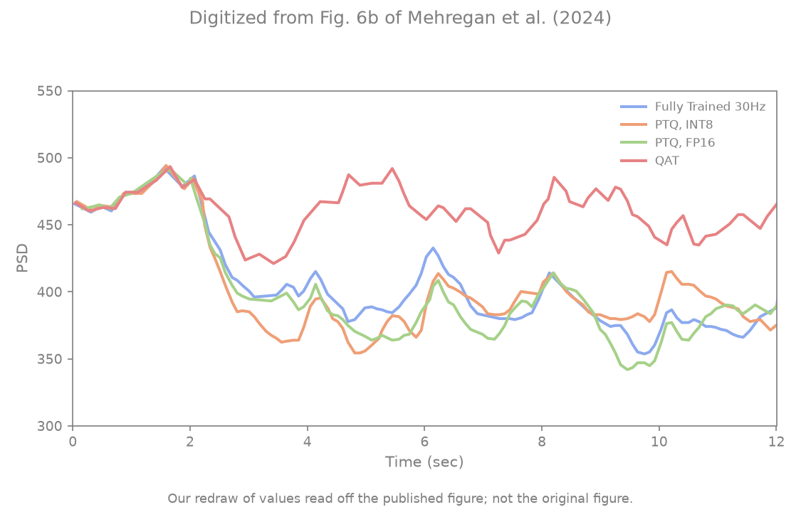
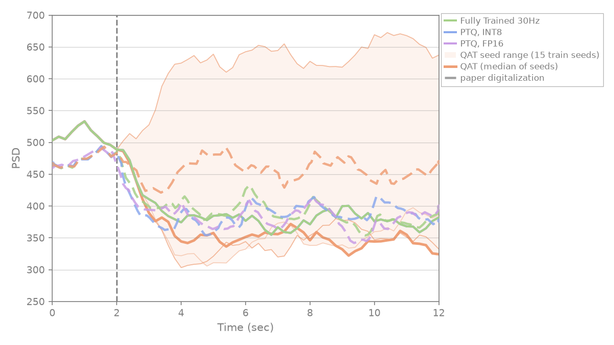
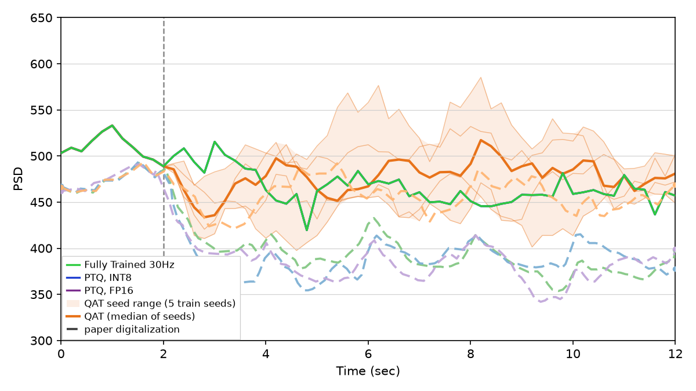

# Mehregan et al. Fig 6b — PTQ / QAT @ 30 Hz

[← DDPG / Mehregan et al. tracker](../README.md)

## What the paper shows

Same quantization panel for the **30 Hz** model (§IV.A.3): Fig 5b fp32 checkpoint, PTQ fp16 / int8, and a 10-episode QAT run with the same recipe.

## Status

**Current status:** the summary table in the [tracker](../README.md) (refreshed on every promote).

### Paper (Mehregan et al.): digitized, our redraw



### Replication



<!-- caption-6b:start -->
**Caption:** 30 Hz paper-protocol eval, eval seed 0, fp32_post=378, QAT median post=347, QAT paper-like 2/15 train seeds, QAT median late/pre 0.68, PTQ tracks fp32, v50, 2026-10-21

**Manifest:** `artifacts/figures/papers/mehregan/6b/manifest.json`
<!-- caption-6b:end -->

**Status:** Fail (rep v49, 15 QAT training seeds) — fp32 / PTQ fp16 / PTQ int8 all 378; PTQ byte-identical to fp32 (`ptq_*_alters_trace` fail). QAT: 2/15 seeds paper-like (the ones that keep the regular 30 Hz train, which raises beta as the paper's QAT does); median late/pre 0.68 vs paper 0.974. Same action-space root cause as Fig 6a.

## How to reproduce

**Run:**

```bash
uv run python -m rl_adaptive_dbs.run scripts/figures/papers/mehregan/6b/plot.py --train-qat --export-notes   # 15 QAT seeds, 3 at a time
uv run python -m rl_adaptive_dbs.run scripts/figures/papers/mehregan/6b/plot.py --plot-only --export-notes
```

**Defaults:** fp32 `artifacts/figures/papers/mehregan/5b/checkpoint.pt`, QAT `artifacts/figures/papers/mehregan/6b/qat/qat_checkpoint_seed{0..14}.pt` (train seeds `0-14`, `--qat-seeds`), eval seed `0`.

## Gates

<!-- gates-6b:start -->
**Gates set** (`fig6_quant_gates` → `eval.json`). Overall **`all_pass`**: no (from `artifacts/figures/papers/mehregan/6b/eval.json`, 2026-10-21). Every row is required for exit.

| Key | Description | Pass |
|-----|-------------|------|
| `all_closed_loop` | fp32, PTQ and every QAT seed each run their own actor closed loop | yes |
| `prestim_shared` | all series and QAT seeds share the pre-onset level (spread ≤ 1%) | yes |
| `fp32_suppresses_vs_baseline` | fp32 late mean (t ≥ 4 s) < its pre-onset mean | yes |
| `ptq_fp16_near_fp32` | PTQ fp16 late mean within 15% of fp32 | yes |
| `ptq_int8_near_fp32` | PTQ int8 late mean within 20% of fp32 | yes |
| `qat_elevated_vs_fp32` | median-seed QAT late mean > fp32 | no |
| `fp32_level_near_paper` | fp32 late/pre within 20% of digitized paper | yes |
| `ptq_fp16_level_near_paper` | PTQ fp16 late/pre within 20% of digitized paper | yes |
| `ptq_int8_level_near_paper` | PTQ int8 late/pre within 20% of digitized paper | yes |
| `qat_majority_not_below_paper` | QAT late/pre ≥ 80% of digitized paper in a strict majority of QAT training seeds | no |
| `qat_median_near_paper` | median-seed QAT late/pre within 20% of digitized paper (figure: same range) | no |
| `qat_late_sustained` | median QAT trace [10,12] s mean ≥ 90% of its [2,8] s mean (no late fade) | yes |
| `fp32_onset_near_paper` | fp32 [2,4] s mean / pre-onset within 20% of digitized paper (onset speed) | yes |
| `fp32_shape_r` | Pearson r fp32 trace vs digitized paper on a common [0,12] s grid ≥ 0.6 | yes |
| `prestim_level_near_paper` | fp32 pre-onset level within 10% of digitized paper | yes |
| `qat_fp32_gap_vs_paper` | (median-seed QAT − fp32) late / pre ≥ 0.5× the digitized paper gap | no |
| `ptq_int8_alters_trace` | mean |PTQ int8 − fp32| over t ≥ 2 s ≥ 0.5× digitized paper (quantization alters outputs) | no |
| `ptq_fp16_alters_trace` | mean |PTQ fp16 − fp32| over t ≥ 2 s ≥ 0.5× digitized paper (quantization alters outputs) | no |
<!-- gates-6b:end -->

## Deviations and conventions

None recorded yet.

## Tried so far

**Labelled candidate (Oct 20, deviates from paper; not the default):** on the IPI 30 Hz model (train seed 1) Fig 6b passes 15/18 (shipped 12/18): QAT paper-like in 5/5 seeds (late/pre 0.88–1.03 vs paper 0.974); fails `qat_fp32_gap_vs_paper` and both `ptq_*_alters_trace` (PTQ moves no pulse on this model). `6b/candidates/ipi-s1`.



Variants tried for this panel's model are recorded in [4a.md](4a.md) § Tried so far (the same trained models feed Figs 4a–6b).

## Open questions

Questions for the authors are tracked privately.

## Notes

None recorded yet.
