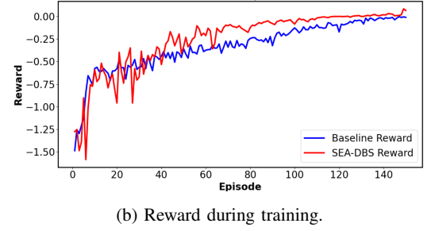
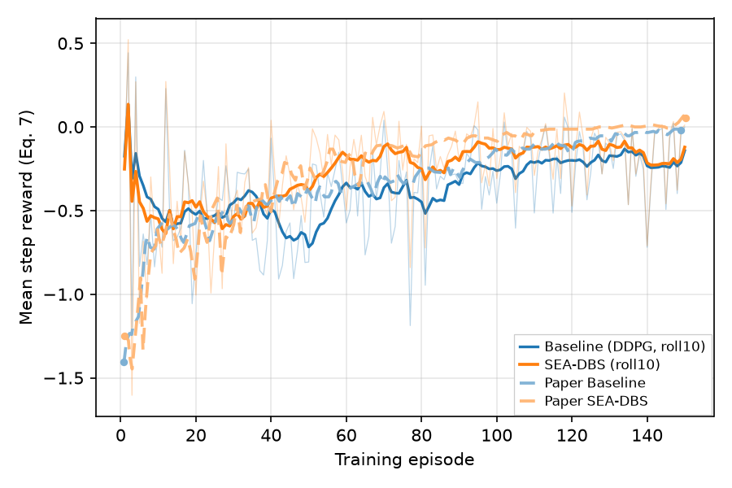

# Ravivarapu et al. Fig 4b — training reward vs episode

[← SEA-DBS / Ravivarapu et al. tracker](../README.md)

## What the paper shows

**Cumulative / episode reward** during the same training comparison as Fig 4a (§V.B / Fig. 4(b)). Paper claim: SEA-DBS reaches **higher** rewards with a **faster** early rise than Baseline.

## Status

**Current status:** the summary table in the [tracker](../README.md) (refreshed on every promote).

### Paper (Ravivarapu et al.): arXiv version, CC BY 4.0



### Replication



<!-- caption-4b:start -->
**Caption:** Training episode reward vs episode (seed 0); mean Eq. (7) reward per step; paired with Fig 4a cache; display roll10 (gates on raw). (v22)

**Manifest:** `artifacts/figures/papers/ravivarapu/4/manifest_4b.json`
<!-- caption-4b:end -->

**Status:** Fail (rep v22, 1 × 32 networks since oct 19 2026) — 16 of 20 gates pass (rep v21 on 2 × 64: 12). Newly passing: `pearson_sea_min` (0.60), `rise_timing_sea`, `sea_rise_vs_paper`, `sea_steeper_rise_than_baseline`; nothing regressed. Still failing: `shared_start_near_paper` (early reward −0.48 / −0.51 vs the paper's −0.89 / −0.92; root cause 3), `baseline_rise_vs_paper`, `pearson_baseline_min` (0.34), and `eq7_consistent_with_4a` (author question 15). Manifest `artifacts/figures/papers/ravivarapu/4/manifest_4b.json`.

## How to reproduce

**Run:**

```bash
uv run python -m rl_adaptive_dbs.run scripts/figures/papers/ravivarapu/4b/plot.py
uv run python -m rl_adaptive_dbs.run scripts/figures/papers/ravivarapu/4b/plot.py --plot-only
```

**Defaults:** paired Fig 4a cache / checkpoint; seed `0`; reward from Eq. (7) ($\beta_t = 0.35$), plotted as the mean per step.

## Gates

<!-- gates-4b:start -->
**Gates set** (`artifacts/figures/papers/ravivarapu/4/manifest_4b.json`; **`shape_pass`**: no, **`pass`**: no, 2026-10-19). Phase 1: **`shape_pass`** (trajectory shape / ordering). Ship exit: **`pass`** (adds digitization level polish).

| Key | Description | Shape | Full |
|-----|-------------|-------|------|
| `n_episodes_ok` | ≥ 150 training episodes | yes | yes |
| `shared_start` | baseline and SEA-DBS agree at episode start (ep 0–15, ≤ 25 %) | yes | yes |
| `baseline_rises` | baseline reward rises ≥ 25 % of paper's rise | yes | yes |
| `sea_rises` | SEA-DBS reward rises ≥ 25 % of paper's rise | yes | yes |
| `sea_above_baseline_late` | SEA-DBS ep 90–150 reward above baseline | yes | yes |
| `sea_steeper_rise_than_baseline` | SEA-DBS rise to ep 90–150 steeper than baseline | yes | yes |
| `paper_pull_ahead_mid` | SEA-DBS ahead in ep 40–80 | yes | yes |
| `sea_faster_initial_rise` | SEA-DBS covers more of its rise by ep 40–80 (paper 0.79 vs 0.66) | yes | yes |
| `rise_timing_baseline` | baseline rise not front-loaded by ep 50 vs paper | yes | yes |
| `rise_timing_sea` | SEA-DBS rise not front-loaded by ep 50 vs paper | yes | yes |
| `gradual_rise_baseline` | baseline mid→late rise ≥ 25 % of paper's | yes | yes |
| `gradual_rise_sea` | SEA-DBS mid→late rise ≥ 25 % of paper's | yes | yes |
| `pearson_baseline_min` | baseline trajectory shape vs paper (Pearson r ≥ 0.55) | no | no |
| `pearson_sea_min` | SEA-DBS trajectory shape vs paper (Pearson r ≥ 0.55) | yes | yes |
| `eq7_consistent_with_4a` | reward = Eq. (7) of the Fig 4a PSD, episode by episode (≤ 0.05; paper 0.038) | — | no |
| `shared_start_near_paper` | ep 0–15 reward within 30 % of paper (−0.88 / −0.94) | — | no |
| `baseline_rise_vs_paper` | baseline rise ≥ 40 % of paper's | — | no |
| `sea_rise_vs_paper` | SEA-DBS rise ≥ 40 % of paper's | — | yes |
| `late_gap_near_paper` | ep 90–150 gap ≥ 35 % of paper's (0.081) | — | yes |
| `midlate_gap_near_paper` | ep 70–110 gap ≥ 40 % of paper's (0.144) | — | yes |
<!-- gates-4b:end -->

### Paper readouts

#### Fig 4b — training reward, episodes 0–150

| Metric | Baseline | SEA-DBS | Paper look |
|--------|----------|---------|------------|
| Start | ~−1.1 to −1.5 | ~−1.0 to −1.5 | Both low |
| End | ~−0.05 to −0.10 | ~0.00 | SEA higher (near 0) |
| Late mean (2nd half) | lower | higher | SEA above Baseline |
| Pull-ahead | — | ~ep 40+ | Not “SEA higher in first 10%” — early both climb from floor; SEA **pulls ahead mid-run** |

### Gate design

**Episode reward** during the same training run as Fig 4a (§V.B / Fig. 4(b)).

**Qualitative gates:**

| # | Gate | Paper look | Fail if |
|---|------|------------|---------|
| 1 | **Series** | Baseline vs SEA-DBS | Missing either |
| 2 | **SEA higher late** | SEA above Baseline on 2nd half | SEA ≤ Baseline late |
| 3 | **Mid-run pull-ahead** | SEA pulls ahead by ~ep 40+ and stays ahead | Only wins on a tiny tail blip |
| 4 | **Both rise from low start** | Start near floor (~−1.5 to −1.0), climb toward 0 | Flat at 0 from episode 1 |
| 5 | **Paired with Fig 4a** | Same `series.json` / checkpoints | Different train |
| 6 | **Reward–PSD consistency** | Reward ↑ as PSD ↓ | Opposite with no note |

**Automated gates:** 20 keys (ordering, rise, timing, Pearson, absolute start and rise levels, and `eq7_consistent_with_4a`); the live table is in [this page](#gates) § Fig 4b, thresholds from the oct 14 2026 audit ([4a.md](4a.md) § Gate audit).

**Units (oct 12 2026):** both axes are the mean Eq. (7) reward per step, so `ravivarapu_fig4b_gates` compares levels, rises, and gaps to the digitized paper directly. It used to rescale every paper value by $|b_{\mathrm{early}} / p^{B}_{\mathrm{early}}|$ (our Baseline's early mean over the paper's), which let a run that started far above the paper's −1.3 pass the start and rise gates; `shared_start_near_paper` now checks both variants against the paper.

## Deviations and conventions

None recorded yet.

## Tried so far

Figs 4a and 4b share each training run, so every training-side variant and both gate counts are in [4a.md](4a.md) § Tried so far.

## Open questions

Questions for the authors are tracked privately.

## Notes

None recorded yet.
