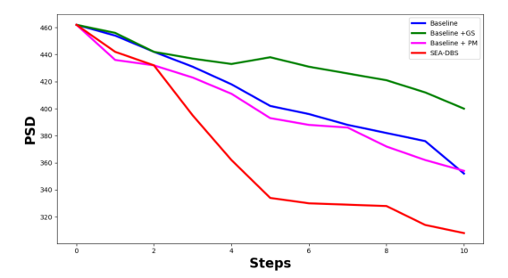

# Ravivarapu et al. Fig 7 — ablation (Baseline / +PM / +GS / SEA-DBS)

[← SEA-DBS / Ravivarapu et al. tracker](../README.md)

## What the paper shows

Ravivarapu et al. §V.B, Ablation Studies.

**PSD over 10 stimulation steps** for four variants (Fig. 7): **Baseline**, **Baseline+PM**, **Baseline+GS**, **SEA-DBS (PM+GS)**. Paper claim: SEA-DBS strongest / most stable suppression; +PM alone noisy early (~**4,500** samples cited); +GS alone limited gains.

### Paper target

Four variants over 10 stimulation steps at 50 Hz: Baseline, Baseline+PM (predictive model), Baseline+GS (Gumbel-Softmax, "guided sampling"), SEA-DBS (PM+GS). Digitized tails (steps 6–10, ÷1000): GS 0.419 > Baseline 0.380 ≈ PM 0.373 > SEA-DBS 0.323. Claim: SEA-DBS strongest and most stable; +PM a little better than Baseline (noisy early, ~4,500 samples); +GS limited gains. The paper's Baseline and SEA-DBS curves equal Figs 5a / 6 to digitization precision.

Gates (`ravivarapu_fig7_gates`): shared start (near paper ~0.462), early MAE vs paper Baseline / SEA-DBS ≤ 0.03, Baseline ≥ Baseline+PM on steps 0–4, and the tail ordering with at least 0.005 of separation (SEA-DBS lowest, GS highest, PM closer to Baseline than to SEA-DBS). Ties fail.

## Status

**Current status:** the summary table in the [tracker](../README.md) (refreshed on every promote).

### Paper (Ravivarapu et al.): arXiv version, CC BY 4.0



### Replication


<!-- caption-7:start -->
**Caption:** Ablation GPi beta PSD over 10 steps @ 50 Hz (seed 0, argmax actions); pass=False; Baseline vs +PM vs +GS vs SEA-DBS, one shared training config. (v31)

**Manifest:** `artifacts/figures/papers/ravivarapu/7/manifest.json`
<!-- caption-7:end -->

**Status:** Fail (rep v31, 1 × 32 networks; +PM / +GS retrained) — 7 of 17 gates pass, unchanged from rep v30. All four variants deploy as always-on, so their traces coincide (root cause 1). Manifest `artifacts/figures/papers/ravivarapu/7/manifest.json`.

## How to reproduce

**Entry point:** `scripts/figures/papers/ravivarapu/7/plot.py`. Baseline and SEA-DBS reuse the Fig 4 checkpoints; Baseline+PM and Baseline+GS train here with the identical `fig4_ravivarapu_config` (only `variant` differs).

Map to trainer `variant`: `baseline`, `baseline-pm`, `baseline-gs`, `paper` ([sea-dbs/replication.md](../method.md) §12).

**Run:**

```bash
uv run python -m rl_adaptive_dbs.run scripts/figures/papers/ravivarapu/7/plot.py --export-notes
uv run python -m rl_adaptive_dbs.run scripts/figures/papers/ravivarapu/7/plot.py --plot-only --export-notes
```

**Defaults:** seed `0`; Baseline / SEA-DBS checkpoints from Fig 4; +PM / +GS train 150 episodes with the same `fig4_ravivarapu_config`; Fig 5a rollout (50 Hz, argmax, 11 PSD samples).

## Gates

<!-- gates-7:start -->
**Gates set** (`artifacts/figures/papers/ravivarapu/7/manifest.json`; overall **`pass`**: no, 2026-10-19). Every row is required for exit.

| Key | Description | Pass |
|-----|-------------|------|
| `four_variants_present` | baseline / +PM / +GS / SEA-DBS | yes |
| `n_steps_ok` | 11 PSD samples (t=0 + 10 stim steps) | yes |
| `shared_start` | baseline and SEA-DBS agree at step 0 | yes |
| `shared_start_near_paper` | step 0 within 0.02 of paper (~0.46) | yes |
| `early_mae_baseline` | steps 0–5 MAE vs paper Baseline ≤ 20 % of its drop (0.021) | no |
| `early_mae_sea` | steps 0–5 MAE vs paper SEA-DBS ≤ 20 % of its drop (0.030) | yes |
| `mae_pm` | steps 0–10 MAE vs paper +PM ≤ 20 % of its drop (0.020) | no |
| `mae_gs` | steps 0–10 MAE vs paper +GS ≤ 20 % of its drop (0.012) | no |
| `fp32_matches_fig5a` | Baseline / SEA-DBS equal the Fig 5a rollout (≤ 0.005) | yes |
| `baseline_above_pm_early` | Baseline above Baseline+PM early (steps 0-4) | no |
| `sea_dbs_lowest_tail` | SEA-DBS tail ≥ 0.005 below every other variant | no |
| `gs_highest_tail` | Baseline+GS tail ≥ 0.005 above every other variant | no |
| `pm_not_sea` | PM closer to baseline than to SEA-DBS | no |
| `baseline_tail_near_paper` | Baseline steps 6–10 within 0.02 of paper (0.380) | no |
| `pm_tail_near_paper` | +PM steps 6–10 within 0.02 of paper (0.373) | no |
| `gs_tail_near_paper` | +GS steps 6–10 within 0.02 of paper (0.419) | no |
| `sea_tail_near_paper` | SEA-DBS steps 6–10 within 0.02 of paper (0.323) | yes |
<!-- gates-7:end -->

### Paper readouts

#### Fig 7 — ablation @ 50 Hz, steps 0–10

Shared start ~462–484. End ordering (paper): **SEA-DBS ≪ Baseline ≈ Baseline+PM < Baseline+GS**. GS is the **worst** suppressor (ends ~400+), not a mild Baseline upgrade.

### Gate design

**PSD over 10 steps.** Variants: `baseline`, `baseline-pm`, `baseline-gs`, `paper`.

**Qualitative gates:**

| # | Gate | Paper look | Fail if |
|---|------|------------|---------|
| 1 | **Four series** | All four | Missing variant |
| 2 | **SEA lowest** | SEA most suppressed | Any other below SEA late |
| 3 | **GS worst / limited** | Baseline+GS **highest** PSD (least suppression) | +GS matches SEA or beats Baseline strongly downward |
| 4 | **+PM ≈ Baseline class** | +PM near Baseline, not SEA | +PM identical to full SEA |
| 5 | **Shared start + 10 steps** | — | Wrong protocol |

**Automated gates:** 17 keys — `sea_dbs_lowest_tail`, `gs_highest_tail`, `pm_not_sea`, `baseline_above_pm_early`, tails within 0.02 of the paper for each variant, full-trace MAE for +PM / +GS, early MAE, and `fp32_matches_fig5a`. Live table: [this page](#gates) § Fig 7.

### Gate audit (oct 14 2026)

Fig 7 went from 6/10 to 7/17 gates (rep v29): the tails are anchored on the paper, +PM / +GS curves are checked by MAE (a flat +GS used to pass), and Baseline / SEA-DBS must equal the Fig 5a rollout. Full audit: [4a.md](4a.md) § Gate audit.

## Deviations and conventions

None recorded yet.

## Tried so far

Every variant tried on this panel, rejected ones first. Check here (and [4a.md](4a.md) § Tried so far for training-side variants that touch every panel) before running anything new; add a row after every run.

| Variant (flags) | Seeds | Gates | Verdict — why | Date / commit | Evidence |
|---|---|---|---|---|---|
| Removed version: per-variant Gumbel eval seeds (offsets 225 / 141 / 586 / 5) and +PM / +GS trained on a different plant config | offsets 225 / 141 / 586 / 5 | — | rejected — shortcut, faked the paper's shown behavior (removed oct 12 2026) | removed oct 12 2026 | — |
| Cached +PM / +GS checkpoints reused after a shared-config change (rep v26) | — | — | rejected — mixed run left +PM / +GS on the old setup; superseded by the oct 12 fix that retrains a checkpoint whose config differs | oct 12 2026 | — |
| n_obs=5 eval (oct 12 convention screen) | — | 4 of 10 (both early-MAE gates fail) | screen — rejected; n_obs=10 is used | oct 12 2026 | — |
| Open-loop patterns on independent and continuous plants (always-on optimal under Eq. (7)) | — | — | screen — pointer: always-on beats every fixed intermittent pattern, see [4a.md](4a.md) § Open-question probes | — | [4a.md](4a.md) § Open-question probes |
| Training-side candidates (stim cost, episode updates, entropy bonus, actor/critic lr, PM lr, Polyak τ, update count, depth/width, state inputs, seed averaging) | — | — | rejected — every candidate actor still stimulates on every inference step, so this panel didn't move — see [4a.md](4a.md) § Tried so far | — | [4a.md](4a.md) § Tried so far |
| Convention screen: Mehregan logits-critic Baseline, Gumbel-max, slow τ annealing, 2048-wide network | — | — | rejected — all deploy as always-on — see [4a.md](4a.md) § Convention screen | oct 12 2026 | [4a.md](4a.md) § Convention screen |
| Honest pass: 150 episodes, seed 0 (rep v28); eval n_obs=10, 50 Hz, untreated t=0 plus 10 argmax actions, plant seed 0 | seed 0 (training); plant seed 0 (eval) | 6 of 10 (fails baseline_above_pm_early and the three tail-ordering gates) | shipped (oct 12) — Fail, gap documented: ties on tail ordering; superseded by the oct 17 rerun | oct 12 2026 | [this page](#status) § Fig 7 |
| Rerun at the paper's 0.02 ms plant step (rep v30): +PM / +GS retrained | — | 7 of 17, unchanged | shipped — Fail, gap documented: +PM trains like Baseline (PSD 0.400 / 0.405 / 0.374), +GS like SEA-DBS (0.396 / 0.370 / 0.366); all four deploy as always-on (0.452 → 0.291) | oct 17 2026 | [this page](#status) § Fig 7 |
| Network size 1 × 32 (`hidden_layers=1`, `hidden_size=32`; shipped default since oct 19 2026) — a network size the paper doesn't state, our best guess of what the authors may have done | plant seed 0 | 7 / 17 → 7 / 17 (rep v30 → v31) | **shipped** — unchanged — all four variants (+PM / +GS retrained) deploy as always-on; full row in [4a.md](4a.md) § Tried so far | 2026-10-19 | [this page](#status) § Fig 7 |

### Honest replication (oct 12 2026) — **Fail, gap documented**

Eval protocol as Fig 5a: training plant setup ($n_{\mathrm{obs}} = 10$ since the oct 12 convention screen), 50 Hz, plant seed 0, untreated t=0 plus 10 argmax actions.

**Training (150 episodes each, seed 0, rep v28):**

| Variant | PSD early / mid / late | stim duty early / mid / late |
|---------|------------------------|------------------------------|
| Baseline | 0.399 / 0.402 / 0.373 | 0.53 / 0.67 / 0.92 |
| Baseline+PM | 0.399 / 0.402 / 0.373 | 0.53 / 0.67 / 0.92 |
| Baseline+GS | 0.393 / 0.369 / 0.366 | 0.56 / 1.00 / 1.00 |
| SEA-DBS | 0.391 / 0.369 / 0.366 | 0.59 / 1.00 / 1.00 |

In training the ablation splits by exploration rule, not by the predictive model: the two ε-greedy variants match each other, and the two Gumbel-Softmax variants match each other. The ε-greedy pair is identical, not just close: seed 0's random init already makes stimulation the greedy action and it never flips, so both play the same ε draws ([4a.md](4a.md) § Convention screen).

**Eval:** all four variants stimulate on every step (stim margins ~18 / 20 / 556 / 577), so all four traces are the Fig 5a trace (0.449 falling to 0.295 at step 10). 6 of 10 gates pass (`four_variants_present`, `n_steps_ok`, `shared_start`, `shared_start_near_paper`, early MAE Baseline 0.025 / SEA-DBS 0.016). Fail: `baseline_above_pm_early` and all three tail-ordering gates (ties). With $n_{\mathrm{obs}} = 5$ it was 4 of 10 (both early-MAE gates failed).

**Fixed (oct 12 2026):** `plot.py` reused any cached +PM / +GS checkpoint, so a change to the shared config left them on the old setup (rep v26 was such a mixed run and is superseded). It now retrains a cached checkpoint whose config differs from `fig4_ravivarapu_config` and refuses stale Fig 4 checkpoints.

**Why it can't be closed faithfully:** Eq. (7) rewards lower beta without a stimulation cost, so all four learners converge to always-on and their deterministic rollouts coincide. The paper's +GS ending highest (0.419) means its deployed +GS policy skips stimulation often; nothing in the stated method makes skipping better here. The removed version picked a separate Gumbel eval seed for each variant (offsets 225 / 141 / 586 / 5) and trained +PM / +GS on a different plant config. Author questions 8–10. The second-pass convention screen ([4a.md](4a.md) § Convention screen) found no paper-silent knob that keeps any variant from deploying as always-on.

**Rerun at the paper's 0.02 ms plant step (oct 17 2026, rep v30):** +PM / +GS retrained. +PM trains identically to the Fig 4 Baseline (PSD 0.400 / 0.405 / 0.374, duty 0.53 / 0.67 / 0.92) and +GS like SEA-DBS (0.396 / 0.370 / 0.366, duty 1.00 from mid-run); all four deploy as always-on (0.452 → 0.291). 7 of 17 gates, unchanged. Open-loop patterns confirm always-on is optimal under Eq. (7) on independent and continuous plants alike ([4a.md](4a.md) § Open-question probes); author question 20 asks how the paper trained and deployed +PM / +GS.

## Open questions

Questions for the authors are tracked privately.

## Notes

None recorded yet.
