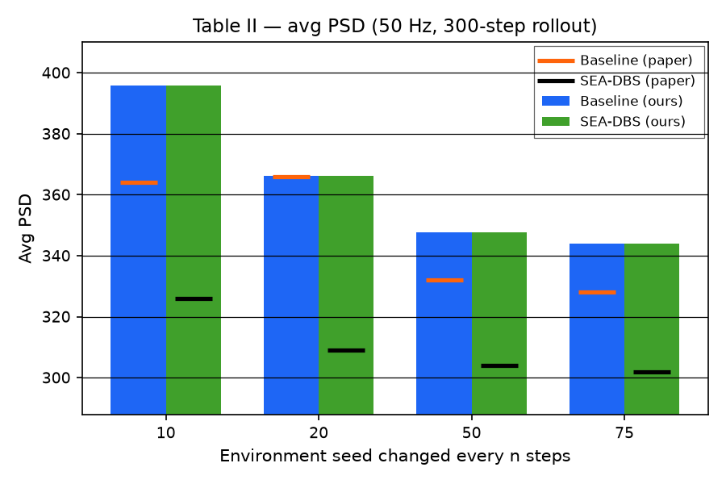

# Ravivarapu et al. Table II — avg PSD with the plant reseeded every n steps

[← SEA-DBS / Ravivarapu et al. tracker](../README.md)

## What the paper shows

**Table II** (§V.B): average PSD and average reward for Baseline and SEA-DBS when the environment seed changes every $n \in \{10, 20, 50, 75\}$ steps (simulated PD progression). Paper claim: SEA-DBS has the lower PSD at every $n$ (Baseline 364 / 366 / 332 / 328 vs SEA-DBS 326 / 309 / 304 / 302). The Avg Reward column is Eq. (7) of Avg PSD / 1000 in all eight cells, so only PSD is gated.

## Status

**Current status:** the summary table in the [tracker](../README.md) (refreshed on every promote).

### Replication

<picture><source media="(prefers-color-scheme: dark)" srcset="images/table2/avg_psd_v5_dark.png"></picture>

<!-- caption-t2:start -->
**Caption:** Table II avg PSD (×1000 normalized) with the plant reseeded every n steps; plant seeds 0–29 once per n (30 blocks of n steps), argmax rollout @ 50 Hz on the Fig 4 checkpoints; pass=False; bars ours, dashes paper. (v5)

**Manifest:** `artifacts/figures/papers/ravivarapu/table2/manifest.json`
<!-- caption-t2:end -->

**Status:** Fail (rep v5) (`sea_below_baseline_every_n, gap_near_paper_every_n, baseline_near_paper_every_n, sea_near_paper_every_n`). Manifest `artifacts/figures/papers/ravivarapu/table2/manifest.json`.

## How to reproduce

**Run:**

```bash
uv run python -m rl_adaptive_dbs.run scripts/figures/papers/ravivarapu/table2/plot.py --export-notes
uv run python -m rl_adaptive_dbs.run scripts/figures/papers/ravivarapu/table2/plot.py --plot-only --export-notes
```

**Defaults:** seed `0`; carrier **50 Hz**; argmax actions from the Fig 4 Baseline / SEA-DBS actors; 30 blocks of n steps per interval, block seeds 0–29 for every n.

## Gates

<!-- gates-t2:start -->
**Gates set** (`artifacts/figures/papers/ravivarapu/table2/manifest.json`; overall **`pass`**: no, 2026-10-23). Every row is required for exit.

| Key | Description | Pass |
|-----|-------------|------|
| `all_intervals_present` | rows for n = 10, 20, 50, 75 | yes |
| `sea_below_baseline_every_n` | SEA-DBS avg PSD below Baseline at every n | no |
| `gap_near_paper_every_n` | Baseline − SEA-DBS gap in [0.5, 1.6] × paper (38 / 57 / 28 / 26) | no |
| `baseline_near_paper_every_n` | Baseline avg PSD within 20 of paper (364 / 366 / 332 / 328) | no |
| `sea_near_paper_every_n` | SEA-DBS avg PSD within 20 of paper (326 / 309 / 304 / 302) | no |
| `psd_falls_with_interval` | avg PSD lower at n = 75 than n = 10 (both) | yes |
<!-- gates-t2:end -->

### Paper readouts

None recorded yet.

### Gate design

None recorded yet.

## Deviations and conventions

Protocol convention (the paper gives only the interval): one deterministic rollout of 30 blocks of $n$ steps per variant and $n$ at 50 Hz on the Fig 4 checkpoints, the plant reset with the next seed (0–29) at each block (which re-prefills the Eq. (5) window), so every $n$ visits the same plant seeds; Avg PSD = mean Eq. (5) observation × 1000 ([sea-dbs/replication.md](../method.md) §14.13).

## Tried so far

**Candidate — partial window carry (oct 19 2026; deviates from the paper as we read it — our best guess of what the authors may have done):** keep the newest share of the Eq. (4) window across a reseed and re-prefill only the rest with the new seed's untreated level (`evaluate_reseeded(keep_window_frac=…)`, shipped checkpoints). The share sets the per-reseed transient: A ≈ 596 / 286 / 158 / 55 PSD·steps at keep 0 / 0.3 / 0.5 / 0.8 (n = 10 vs 75 fit; paper SEA-DBS 273). At 0.3 — picked after fitting A at the other shares, so tuned toward the paper's number — avg PSD is 365 / 351 / 342 / 340 for n = 10 / 20 / 50 / 75, inside 20 of the paper's Baseline at every n: 3 of 6 gates (adds `baseline_near_paper_every_n`). The SEA-DBS gates still fail because both policies stimulate every step (root cause 1). Not promoted ([4a.md](4a.md) § Candidate screen (oct 19 2026); author question 14).

The Table II variants table is in [4a.md](4a.md) § Tried so far.

## Open questions

Questions for the authors are tracked privately.

## Notes

None recorded yet.
