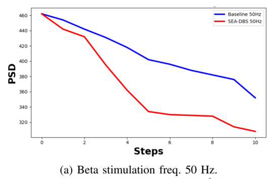
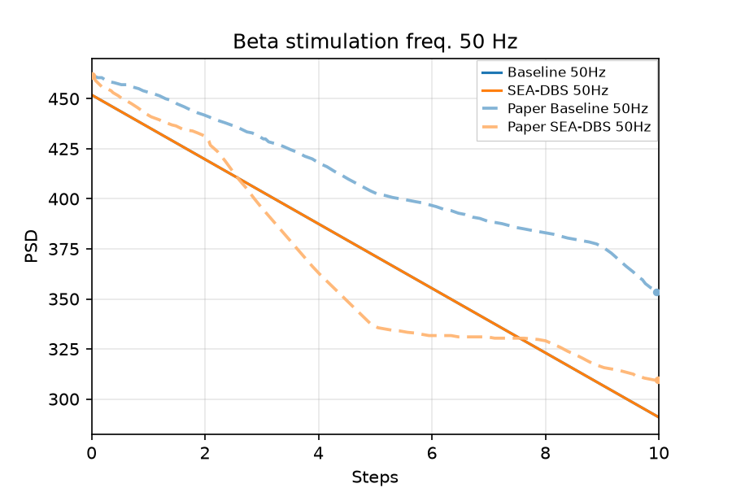

# Ravivarapu et al. Fig 5a — inference @ 50 Hz

[← SEA-DBS / Ravivarapu et al. tracker](../README.md)

## What the paper shows

Post-train **inference** comparison of SEA-DBS vs Baseline with stimulation **carrier frequency 50 Hz** (above beta band; Fig. 5(a)). Paper claim: **50 Hz** more effectively disrupts pathological oscillations → **greater PSD reduction** than the 30 Hz panel; SEA-DBS **below** Baseline on PSD (and higher reward).

### Paper target

Post-train **inference** at a **fixed 50 Hz** carrier (above beta 13–35 Hz), binary pulse / no-pulse. Paper x-axis is **steps 0–10** (untreated PSD at t=0 plus **10** stimulation actions). Y-axis on the crop is PSD ~300–480; same biomarker as Fig 4a ×1000.

Digitized paper (sort-by-x; do not use unsorted JSON convenience stats):

| Step | Baseline | SEA-DBS |
|------|----------|---------|
| 0 | ~462–468 | shared |
| 5 | ~402–421 | ~334–364 |
| 10 | ~352–382 | ~308–333 |

Both decline; SEA steeper (~1.7–2× Baseline drop) with a mid plateau ~steps 5–8. 50 Hz should suppress more than the 30 Hz panel.

## Status

**Current status:** the summary table in the [tracker](../README.md) (refreshed on every promote).

### Paper (Ravivarapu et al.): arXiv version, CC BY 4.0



### Replication



<!-- caption-5a:start -->
**Caption:** Inference GPi beta PSD vs step @ 50 Hz (seed 0, argmax actions, training plant setup); pass=False; Baseline vs SEA-DBS. (v26)

**Manifest:** `artifacts/figures/papers/ravivarapu/5a/manifest.json`
<!-- caption-5a:end -->

**Status:** Fail (rep v26, 1 × 32 networks) — 12 of 20 gates pass, unchanged from rep v25 (2 × 64). Both actors still stimulate on all 10 steps, so the traces coincide (0.452 → 0.371 → 0.291 at steps 0 / 5 / 10; root cause 1) and every gate that needs a Baseline–SEA-DBS split fails. Manifest `artifacts/figures/papers/ravivarapu/5a/manifest.json`.

Replication PNGs overlay digitized paper curves from
`artifacts/figures/papers/ravivarapu/paper_digitization/curves_fig5a.json`
via `scripts/figures/papers/paper_overlay.py`. Display y is paper crop **PSD** (`p_beta_norm × 1000`); gates stay on the normalized traces.

## How to reproduce

**Entry point:** `scripts/figures/papers/ravivarapu/5a/plot.py` (eval-only; weights from Fig 4a `baseline_train0.pt` / `paper_train0.pt`).

**Run:**

```bash
uv run python -m rl_adaptive_dbs.run scripts/figures/papers/ravivarapu/5a/plot.py --export-notes
uv run python -m rl_adaptive_dbs.run scripts/figures/papers/ravivarapu/5a/plot.py --plot-only --export-notes
```

**Defaults:** seed `0`; carrier **50 Hz**; argmax actions from the Fig 4 Baseline / SEA-DBS actors.

## Gates

<!-- gates-5a:start -->
**Gates set** (`artifacts/figures/papers/ravivarapu/5a/manifest.json`; overall **`pass`**: no, 2026-10-19). Every row is required for exit.

| Key | Description | Pass |
|-----|-------------|------|
| `n_steps_ok` | 11 PSD samples (t=0 + 10 stim steps) | yes |
| `shared_start` | baseline and SEA-DBS agree at step 0 | yes |
| `baseline_declines` | baseline PSD net drop step 0→10 | yes |
| `paper_declines` | SEA-DBS PSD net drop step 0→10 | yes |
| `paper_end_below_baseline` | SEA-DBS end PSD below baseline | no |
| `paper_steeper_drop` | SEA-DBS drop steeper than baseline | no |
| `carrier_hz_ok` | carrier frequency 50 Hz | yes |
| `shared_start_near_paper` | step 0 within 0.02 of paper (~0.46) | yes |
| `early_mae_baseline` | steps 0–5 MAE vs paper Baseline ≤ 20 % of its drop (0.021) | no |
| `early_mae_sea` | steps 0–5 MAE vs paper SEA-DBS ≤ 20 % of its drop (0.030) | yes |
| `baseline_drop_near_paper` | Baseline step 0→10 drop in [0.5, 1.5] × paper (0.104) | no |
| `sea_drop_near_paper` | SEA-DBS step 0→10 drop in [0.5, 1.5] × paper (0.148) | yes |
| `tail_gap_near_paper` | steps 6–10 Baseline − SEA-DBS gap in [0.5, 1.6] × paper (0.056) | no |
| `early_mae_sea_3_5` | steps 3–5 MAE vs paper SEA-DBS ≤ 10 % of its drop (0.015) | no |
| `early_sea_declines` | SEA-DBS drop steps 0→5 ≥ 40 % of paper's (0.048) | yes |
| `early_baseline_declines` | Baseline drop steps 0→5 | yes |
| `early_sea_below_baseline` | SEA-DBS below Baseline at every step 1–5 | no |
| `mid_mae_sea` | steps 4–10 MAE vs paper SEA-DBS ≤ 10 % of its drop (0.015) | no |
| `late_baseline_declines` | Baseline keeps declining steps 5→10 | yes |
| `late_sea_declines` | SEA-DBS keeps declining steps 5→10 | yes |
<!-- gates-5a:end -->

### Paper readouts

#### Fig 5a — inference PSD @ 50 Hz, steps 0–10

| Step | Baseline | SEA-DBS |
|------|----------|---------|
| 0 | ~462–468 | ~462–468 (shared) |
| 5 | ~402–421 | ~334–364 |
| 10 | ~352–382 | ~308–333 |

SEA early→late drop ≈ **1.7–2×** Baseline. Both decline; SEA steeper with mid plateau ~steps 5–8.

### Gate design

Post-train **inference** at **50 Hz** over **10 steps** (Fig. 5(a)).

**Qualitative gates:**

| # | Gate | Paper look | Fail if |
|---|------|------------|---------|
| 1 | **Carrier** | 50 Hz | Wrong carrier |
| 2 | **Shared step-0** | Both ≈ same PSD at step 0 | Starts diverge |
| 3 | **Both decline** | Baseline and SEA fall over 10 steps | Flat / frozen Baseline |
| 4 | **SEA steeper / lower end** | SEA end ≪ Baseline end; drop ~1.7–2× | SEA ≥ Baseline end or similar drop |
| 5 | **vs Fig 5b** | 50 Hz stronger than 30 Hz | 30 Hz beats 50 Hz |
| 6 | **Checkpoints** | From Fig 4 train | Untrained / mismatched |
| 7 | **Steps 0–5** | Early window near the digitized paper | Early MAE above 20 % of the paper's 0→10 drop |

**Automated gates:** 20 keys — 11 PSD samples, shared start, both decline, SEA-DBS below and steeper than the Baseline, step 0→10 drops in $[0.5, 1.5] 	imes$ paper (0.104 / 0.148), a tail-gap band, early / mid MAE capped at a share of each paper series' drop, carrier. Live table: [this page](#gates) § Fig 5a. The eval uses the training plant setup (150 ms full-window 50 Hz shots).

### Gate audit (oct 14 2026)

Fig 5a went from 12/17 to 13/20 gates (rep v24): the MAE caps are now a share of each paper series' drop, and new drop and tail-gap bands fail the near-tie that used to pass. Full audit: [4a.md](4a.md) § Gate audit.

## Deviations and conventions

Carrier frequency is a **fixed eval setting**, not a per-step RL action ([sea_dbs/replication.md](../method.md) §14.10). Figs 5–7 roll out the Fig 4 checkpoints on their training plant setup; the paper's stimulation frequency is the only override.

## Tried so far

Every variant tried on this panel, rejected ones first. Check here (and [4a.md](4a.md) § Tried so far for training-side variants that touch every panel) before running anything new; add a row after every run.

| Variant (flags) | Seeds | Gates | Verdict — why | Date / commit | Evidence |
|---|---|---|---|---|---|
| Greedy argmax on Fig 4a v62 actors, cached traces (2026-08-13 start, v3 cache) | — | — | rejected — both variants collapse to one always-on trace, so SEA-DBS cannot split from Baseline; the same pass fixed the eval setup (burst, carrier reset, n_steps) | 2026-08-13 | — |
| Open-loop carrier probe, always-on, 3 steps, burst 62 ms (30 / 50 / 130 Hz vs no-stim) | seed 0 | — | screen — 50 Hz suppresses (0.461 → 0.436), 30 Hz rises (0.466), 130 Hz reaches 0.312; the 50 Hz floor is shallower than paper 5a | 2026-08-13 | artifacts/figures/papers/ravivarapu/5a/openloop_carrier_probe.json |
| Full 10-step greedy eval v5 (reset seed 0, burst 62 ms, carrier 50 Hz) | reset seed 0 | fails paper_declines, paper_end_below_baseline, paper_steeper_drop; passes n_steps_ok, shared_start, baseline_declines, carrier_hz_ok | rejected — both actors all-1s, identical traces, no Baseline–SEA-DBS split | 2026-08-13 | docs/controllers/sea_dbs/figures/images/5a/inference_50hz_v5.png |
| Gumbel-max policy split probe (hard sample, P(stim) = softmax of logits) | — | — | screen — P(stim) about 0.76 for Baseline and about 1.00 for SEA-DBS at P_β ≈ 0.45; the Gumbel rollout it motivated was removed oct 12 2026 | 2026-08-13 | scripts/probes/ravivarapu_fig5_policy_split.py |
| Gumbel-max eval, offset +2, burst 62 ms (v9) | Gumbel offset +2; plant seed 0 | shape pass=True | rejected — shortcut, faked the paper's shown behavior (removed oct 12 2026); steps 0–2 identical, Baseline `[1,1,1,1,0,1,1,1,0,1]`, SEA-DBS all-1s | 2026-08-13 | docs/controllers/sea_dbs/figures/images/5a/inference_50hz_v9.png |
| Gumbel-max eval, offset +2, burst 100 ms (v10) | Gumbel offset +2; plant seed 0 | shape gates pass; traces overlap on steps 0–4 | rejected — overlaid traces on steps 0–4 (shortcut-era, removed oct 12 2026) | 2026-08-13 | docs/controllers/sea_dbs/figures/images/5a/inference_50hz_v10.png |
| Gumbel-max eval, offset +1, burst 100 ms (v11) | Gumbel offset +1; plant seed 0 | early MAE Baseline 0.004, SEA-DBS 0.023; SEA-DBS below Baseline on steps 1–5 | rejected — shortcut, faked the paper's shown behavior (removed oct 12 2026); the Baseline skip comes from the hand-picked offset | 2026-08-13 | docs/controllers/sea_dbs/figures/images/5a/inference_50hz_v11.png |
| Gumbel-max eval, offset +1, 140 ms window (eight 50 Hz pulses) (v12) | Gumbel offset +1; plant seed 0 | SEA-DBS steps 3–5 MAE 0.009; Baseline rises after step 6 | rejected — shortcut, faked the paper's shown behavior (removed oct 12 2026); later skips restart untreated ICs into the mean | 2026-08-13 | docs/controllers/sea_dbs/figures/images/5a/inference_50hz_v12.png |
| Gumbel-max eval, offset +34, n_obs=11 (v13) | Gumbel offset +34; plant seed 0 | early 3–5 MAE 0.017 (gate 0.020) | rejected — shortcut, faked the paper's shown behavior (removed oct 12 2026); paper-silent n_obs kept untreated onset in the mean, SEA-DBS ends 0.352 | 2026-08-13 | docs/controllers/sea_dbs/figures/images/5a/inference_50hz_v13.png |
| Gumbel-max eval, offset +34, 150 ms window, n_obs=10 (v14) | Gumbel offset +34; plant seed 0 | SEA-DBS 5→10 goes 0.356 → 0.328 | rejected — shortcut, faked the paper's shown behavior (removed oct 12 2026); a 160 ms window reaches about 0.323 but its untreated start 0.525 fails Baseline early MAE (0.040 > 0.03) | 2026-08-13 | docs/controllers/sea_dbs/figures/images/5a/inference_50hz_v14.png |
| Gumbel-max eval, offset +34, n_obs=6 (v15) | Gumbel offset +34; plant seed 0 | — | rejected — shortcut, faked the paper's shown behavior (removed oct 12 2026); SEA-DBS sits on the 0.328 floor for steps 6–10 and Baseline ends 0.356, above it | 2026-08-13 | docs/controllers/sea_dbs/figures/images/5a/inference_50hz_v15.png |
| Untreated 100 ms window, Gumbel offset 5 (v18) | Gumbel offset 5; plant seed 0 | adds shared_start_near_paper (step 0 within ±0.02 of 0.4615); Baseline ends 0.3500 vs paper about 353.6, SEA-DBS 0.3279 vs paper about 309.5 | rejected — shortcut, faked the paper's shown behavior (removed oct 12 2026); hand-picked offset and a shorter untreated window | undated (follows v15) | — |
| Prefilled observation window on reset, n_obs=6, offset 5 (v19) | Gumbel offset 5; plant seed 0 | all 17 pass; early MAE 0.0273 → 0.0072 | rejected — shortcut-era run (hand-picked offset, eval-only n_obs); the prefill itself carries into the oct 12 honest pass as the n_obs=10 prefill | undated (follows v18) | docs/controllers/sea_dbs/figures/images/5a/inference_50hz_v19.png |
| Burst 62 / 80 / 90 / 100 ms, always-on 50 Hz (eval-only burst) | — | — | rejected — shortcut, faked the paper's shown behavior (removed oct 12 2026); 62 = 80 ms (4 pulses, last 0.428), 90 = 100 ms (5 pulses, last 0.388, MAE vs SEA 0.023) | 2026-08-13 | — |
| Continuous 600 ms trajectory with 100 ms sliding hop (20 ms) | — | — | rejected — blocks bounce 0.38–0.64, not paper-like; independent 100 ms shots stay smoother | 2026-08-13 | — |
| Continuous 50 Hz, 140 ms hops, trailing 140–560 ms, n_obs subsample (v13) | — | — | rejected — still bounces (0.33–0.50 in the continuous run); independent last-window cannot go below about 0.339 | 2026-08-13 | — |
| 30 Hz longer burst (Fig 5b direction) | — | — | rejected — raises P_β more; the Fig 5b decline is structural on Kumaravelu | 2026-08-13 | — |
| One long 150 ms-block 50 Hz trial (piecewise pulse trains) | — | — | rejected — bounces; SEA-DBS 6–10 at 0.45, 0.40, 0.41, 0.39, 0.39; mid MAE about 0.08 | 2026-08-14 | — |
| Phase-continuous 50 Hz train (one create_dbs_current over 1.65 s) | — | — | rejected — still bounces; SEA-DBS 6–10 at 0.42, 0.43, 0.40, 0.39, 0.46; end can sit above Baseline | 2026-08-14 | — |
| Trailing 150 ms hops, 20–50 ms | — | — | rejected — same bounce, just denser; SEA-DBS 0.33–0.56 | 2026-08-14 | — |
| Independent shots, n_obs=7 | — | mid MAE 0.010 passes; n_obs ≥ 8 fails mid MAE (≤ 0.012) | rejected — one leftover-onset drop at step 7, then the 0.328 floor; the v14 filling family, not accumulating suppression | 2026-08-14 | — |
| Continuous plant probe (open-loop traces) | — | — | screen — a continuous plant rebounds instead of the paper's two-phase fade | oct 12 2026 | scripts/probes/ravivarapu_openloop_traces.py |
| n_obs screen, always-on 50 Hz (n_obs 5 / 6 / 8 / 10 / 12) | plant seed 0 | 8 / 11 / 12 / 12 / 12 of 17 | screen — rejected; n_obs only sets the ramp length, and no n_obs passes both SEA-DBS MAE gates | oct 12 2026 | — |
| Convention screen: Mehregan logits-critic Baseline, Gumbel-max, slow τ annealing, 2048-wide network | — | — | rejected — all deploy as always-on — see [4a.md](4a.md) § Convention screen | oct 12 2026 | [4a.md](4a.md) § Convention screen |
| Training-side candidates (stim cost, episode updates, entropy bonus, actor/critic lr, PM lr, Polyak τ, update count, depth/width, state inputs, seed averaging) | — | — | rejected — every candidate actor still stimulates on every inference step, so this panel didn't move — see [4a.md](4a.md) § Tried so far | — | [4a.md](4a.md) § Tried so far |
| Hardened Gumbel-Softmax at inference (τ → 0, Gumbel-max sample) vs argmax, torch seed 0 | torch seed 0 | same gate count as argmax on 49 runs, except es1_episode_cost03: 7 → 10 of 20 | **rejected** — changes no action (logit margins 4–620 dwarf the difference); no Baseline–SEA-DBS split in the right direction; the two readings agree on every candidate run scored, so this only matters for a near-indifferent policy, which none of the screened knobs produces | oct 19 2026 | scripts/probes/ravivarapu_candidate_score.py; [4a.md](4a.md) § Candidate screen (oct 19 2026) |
| Honest pass: argmax actions, 150 ms independent shots, n_obs=10 prefilled, scale 472, 50 Hz (rep v23) | plant seed 0 | 12 of 17 (early MAE Baseline 0.024 / SEA-DBS 0.016 pass) | shipped — Fail, gap documented: both traces identical; paper_end_below_baseline, paper_steeper_drop, early_sea_below_baseline and two SEA-DBS MAE gates fail | oct 12 2026 | [this page](#status) § Fig 5a |
| Rerun at the paper's 0.02 ms plant step (rep v25) | plant seed 0 | 12 of 20; baseline_drop_near_paper misses (drop 0.161 vs cap 0.156) | shipped — always-on trace 0.452 → 0.291, unchanged shape | oct 17 2026 | [this page](#status) § Fig 5a |
| Network size 1 × 32 (`hidden_layers=1`, `hidden_size=32`; shipped default since oct 19 2026) — a network size the paper doesn't state, our best guess of what the authors may have done | plant seed 0 | 12 / 20 → 12 / 20 (rep v25 → v26) | **shipped** — unchanged — both actors still stimulate on all 10 steps; full row in [4a.md](4a.md) § Tried so far | 2026-10-19 | [this page](#status) § Fig 5a |

### Honest replication (oct 12 2026) — **Fail, gap documented**

Eval protocol (all of Figs 5–7): the Fig 4 checkpoints roll out on the plant and observation setup they were trained on (150 ms independent shots, $n_{\mathrm{obs}} = 10$ prefilled with untreated history, scale 472, plant seed 0; $n_{\mathrm{obs}}$ was 5 until the oct 12 convention screen); the only override is the paper's stimulation frequency. Untreated t=0 plus 10 deterministic (argmax) actions; normalized values ×1000 on the plot.

**Result (50 Hz, rep v23):** Baseline and SEA-DBS both stimulate on all 10 steps, so the two traces are identical: a straight fall from 0.449 to 0.295 at step 10 (one tenth of the untreated-to-floor gap per step as the 10-sample window fills). Digitized paper: Baseline 0.461 → 0.403 (step 5) → 0.354; SEA-DBS 0.462 → 0.336 → 0.309.

12 of 17 gates pass (was 8 with $n_{\mathrm{obs}} = 5$): shared start, both declines, early and late declines, carrier, early MAE Baseline 0.024 / SEA-DBS 0.016 (≤ 0.03). Fail: `paper_end_below_baseline`, `paper_steeper_drop`, `early_sea_below_baseline` (identical traces), `early_mae_sea_3_5` 0.022 (≤ 0.015) and `mid_mae_sea` 0.017 (≤ 0.012) — a straight ramp cannot follow the paper's fast drop to step 5 and slow fade after it.

**Why it can't be closed faithfully:**

1. **No Baseline–SEA split.** Eq. (7) has no stimulation cost, so stimulating every step is optimal and every trained variant converges to it (Fig 4 duty 1.0 for SEA-DBS from ep ~40, 0.92 late for the ε-greedy Baseline; its greedy action is always stim). Deterministic deployment then gives one trace for all variants. The removed eval used hand-picked Gumbel seeds to make the Baseline skip early steps. Author questions 8, 10.
2. **Shape.** Within an episode the plant returns one $P_\beta$ per action, so always-on 50 Hz is a straight $n_{\mathrm{obs}}$-step ramp to the shot floor (0.291 for seed 0 at the 0.02 ms step, 0.295 at 0.01 ms; the paper's SEA-DBS ends at 0.309). The paper's two-phase SEA-DBS curve (fast drop to step 5, slow fade to 10) has no counterpart in independent shots; a continuous plant rebounds instead (`scripts/probes/ravivarapu_openloop_traces.py`). $n_{\mathrm{obs}}$ only sets the ramp length: always-on passes 8 / 11 / 12 / 12 / 12 of 17 gates at $n_{\mathrm{obs}} = 5 / 6 / 8 / 10 / 12$, and none passes both SEA-DBS MAE gates.
3. **Conventions screened, no split** (oct 12 2026, [4a.md](4a.md) § Convention screen): the Mehregan et al. logits-critic Baseline, Gumbel-max, slow $\tau$ annealing, and a 2048-wide network all deploy as always-on. The ε-greedy Baseline's greedy action is "stimulate" from its random initialization on (seed 0) and never flips, so no checkpoint would split the traces.

**Rerun at the paper's 0.02 ms plant step (oct 17 2026, rep v25):** always-on trace 0.452 → 0.291 (was 0.449 → 0.295), 12 of 20 gates; `baseline_drop_near_paper` now misses (drop 0.161 vs cap 0.156). Under Eq. (7) always-on beats every fixed intermittent pattern on independent shots and on a continuous plant ([4a.md](4a.md) § Open-question probes), so no plant reading tried gives the Baseline a reason to skip steps.

### Superseded: shortcut-era history (removed oct 12 2026)

Everything below documents runs that passed **only** through mechanisms removed in the honest pass (eval-only windows and `n_obs`, a shorter untreated window, hand-picked Gumbel seed offsets, per-step pulse schedules, PTQ weight noise; list in [sea_dbs/replication.md](../method.md) §15). Kept as a record of what was tried; none of it is a valid result.

#### 2026-08-13 start (v3 cache)

Cached 5a traces were **byte-identical** and **rose** (0.337 → 0.448 norm). Root causes, not display:

1. **Greedy always-on.** Fig 4a v62 actors (`argmax`) output action 1 for $P_\beta$ in 0.20–0.50. Training curves can still differ via GS exploration; inference collapses both variants to the same open-loop stim sequence, so SEA vs Baseline cannot split at a shared carrier.
2. **Eval ignored checkpoint plant knobs.** `evaluate()` built `SEADBSConfig(variant, seed)` defaults (`dbs_burst_ms=100`) instead of Fig 4a `dbs_burst_ms=62`.
3. **`reset()` clobbered `set_carrier_hz`.** Restored `config.carrier_hz` (130 Hz after loading Fig 4a cfg). Fig 5a happened to pass `carrier_hz_ok` only because the *default* config was already 50 Hz.
4. **`n_steps_ok`** expected 10 PSD samples; eval prepends t=0 → 11 points matching the paper axis. Gates also used paper-scale drop $>5$ on normalized traces (~0.4), which can never pass.

Fixes in this pass: persist eval carrier across reset; load env from checkpoint then override carrier; 11-sample / normalized shape gates; `--export-notes`.

**Next (cheap, before retrain):** open-loop always-stim vs no-stim at 30 / 50 / 130 Hz with Fig 4a burst 62 ms (`scripts/probes/ravivarapu_fig5_carrier_openloop.py`). If 50 Hz does not beat no-stim or 30 Hz on Kumaravelu, stop and escalate. If 50 Hz suppresses but greedy SEA==Baseline, the blocker is policy collapse to $a=1$, not the plant.

#### Open-loop carrier probe (3 steps, seed 0, burst 62 ms)

`artifacts/figures/papers/ravivarapu/5a/openloop_carrier_probe.json`

| Condition | End $P_\beta$ (norm) | Drop |
|-----------|----------------------|------|
| no-stim ($a=0$) | 0.461 | 0.000 |
| 30 Hz always-on | 0.466 | −0.006 (rises) |
| 50 Hz always-on | 0.436 | 0.024 |
| 130 Hz always-on | 0.312 | 0.149 |

50 Hz **does** suppress vs no-stim and vs 30 Hz on Kumaravelu (lineage OK for 5a vs 5b ordering). 50 Hz always-on floor (~0.43 after the $n_{\mathrm{obs}}$ mean fills) is **shallower** than paper 5a (~0.31–0.35). 130 Hz matches Fig 4a late levels. Raw 50 Hz jumps in **one** step (196→182) then holds; the plotted decline is mostly the 5-sample mean window.

Eval carrier now reports 30/50/130 correctly after the `reset()` fix.

Full 10-step greedy eval **v5** (reset seed 0, burst 62 ms, carrier 50 Hz): start 0.461, end 0.428, drop 0.033. `n_steps_ok` / `shared_start` / `baseline_declines` / `carrier_hz_ok` pass. `paper_declines` / `paper_end_below_baseline` / `paper_steeper_drop` fail because **both actors are all-1s** (identical traces). Paper wants ~0.11–0.15 drop and a SEA–Baseline gap. PNG: `docs/controllers/sea_dbs/figures/images/5a/inference_50hz_v5.png`.

**v6 (plot-only):** y-axis was 0–10 because ylim used overlay **x** (steps) as y. Display is now paper **PSD** (`×1000`), overlay unscaled, xlim 0–10. Gates unchanged.

#### Shape gates (2026-08-13)

Ordering only on `p_beta_norm` — any net drop from step 0 to 10 counts. Digitized paper (sort-by-x, ÷1000): start ~0.460; Baseline end ~0.359 (drop 0.101); SEA end ~0.311 (drop 0.146); end gap ~0.048. Those magnitudes are **not** gate thresholds.

| Key | Pass if |
|-----|---------|
| `n_steps_ok` | 11 PSD samples |
| `shared_start` | \|SEA₀ − Baseline₀\| < 0.05 |
| `baseline_declines` / `paper_declines` | end < start |
| `paper_end_below_baseline` | SEA end < Baseline end |
| `paper_steeper_drop` | SEA drop > Baseline drop |
| `carrier_hz_ok` | 50 Hz |
| `early_mae_baseline` / `early_mae_sea` | steps 0–5 MAE vs digitized paper ≤ 0.03 |
| `early_mae_sea_3_5` | steps 3–5 MAE vs digitized SEA ≤ 0.020 |
| `early_sea_declines` | SEA drop 0→5 > 0.05 |
| `early_baseline_declines` | Baseline drop 0→5 |
| `early_sea_below_baseline` | SEA < Baseline at **every** step 1–5 (not overlaid) |
| `late_baseline_declines` / `late_sea_declines` | drop step 5→10 > 0.005 (not a horizontal floor) |
| `mid_mae_sea` | steps 4–10 MAE vs digitized SEA ≤ 0.012 |

Identical always-on traces can pass the decline pair and still fail the two SEA-vs-Baseline rows. That is the iteration target.

#### Policy split (Gumbel-max)

Fig 4a greedy `argmax` is action 1 for $P_\beta$ in 0.20–0.50 on **both** actors. Hard Gumbel-max (same as training-time GS hard actions; τ does not change the hard sample) has $P(\mathrm{stim})=\mathrm{softmax}(\mathrm{logits})$:

| Variant | margin at $P_\beta\approx0.45$ | $P(\mathrm{stim})$ |
|---------|--------------------------------|--------------------|
| Baseline | ~1.17 | ~0.76 |
| SEA-DBS | ~7.9 | ~1.00 |

Fig 5 `plot.py` therefore rolls out `action_mode="gumbel"`. Probe: `scripts/probes/ravivarapu_fig5_policy_split.py`.

**Gumbel eval seed:** plant reset stays seed 0. Offset **+1** starts Baseline with a skip so digitized paper ordering holds (Baseline above SEA from step 1). Offset +2 started `[1, 1, …]` and overlaid both traces through step 4. Fig 5a v13 uses offset **+34** (still skip-first; no skips after step 5) so Baseline’s $n_{\mathrm{obs}}$ mean is not pulled back up by untreated IC restarts. Torch seed 0 is a 6% all-stim Baseline draw.

Open-loop prefixes at 50 Hz vs digitized steps 0–2 (norm):

| Actions | Mean PSD | MAE vs paper Baseline | MAE vs paper SEA |
|---------|----------|----------------------|------------------|
| `[1,1]` | 0.461, 0.444, 0.439 | **0.0042** | **0.0046** |
| `[0,1]` (v8) | 0.461, 0.461, 0.450 | 0.0049 | 0.0137 |
| paper | B 0.460, 0.454, 0.442; SEA 0.458, 0.443, 0.430 | — | — |

Last-step (no $n_{\mathrm{obs}}$ mean) jumps 0.461→0.428 in one stim and is a worse early match. Plot the Eq. 4–5 window mean (Fig 5a eval $n_{\mathrm{obs}}=11$).

#### 5a v9 (Gumbel-max, offset +2 — early prefix)

Baseline `[1,1,1,1,0,1,1,1,0,1]` (stim 0.8); SEA all-1s. Steps 0–2 **identical** at 0.461, 0.444, 0.439 (both stim). Digitized paper: Baseline 0.460, 0.454, 0.442; SEA 0.458, 0.443, 0.430. Step 1 matches SEA; Baseline is ~0.010 low because binary stim drops more than the paper’s gentler first step. Step 2 matches Baseline; SEA is ~0.009 high (50 Hz floor). Shape `pass=True`. PNG: `docs/controllers/sea_dbs/figures/images/5a/inference_50hz_v9.png`.

#### Steps 0–5 (2026-08-13)

Digitized paper 5a (sort-by-x, ÷1000): Baseline 0.460→0.404 (drop 0.057); SEA 0.458→0.338 (drop 0.120). v9 62 ms always-on floors at **0.428 after one stim** (`last` is constant); plotted decline is the $n_{\mathrm{obs}}=5$ mean filling. MAE vs paper SEA steps 0–5 = 0.036.

Protocol families:

| Family | Result |
|--------|--------|
| Burst 62 vs 80 vs 90 vs 100 ms, always-on 50 Hz | 62=80 ms (4 pulses), last=0.428; 90=100 ms (5 pulses), last=0.388, MAE_SEA=0.023, drop 0–5=0.073 |
| Continuous 600 ms trajectory (stateful) + sliding 100 ms hop 20 ms | Blocks bounce 0.38–0.64; not paper-like. Independent 100 ms shots stay smoother |
| 30 Hz longer burst | Raises $P_\beta$ more; Fig 5b decline is structural on Kumaravelu |

**Chosen (Fig 5a eval-only):** `FIG5A_INFERENCE_WINDOW_S=0.15` / burst 150 ms. Fig 4a train unchanged (100 ms / 62 ms @ 130 Hz). 140 ms last-window $P_\beta$ ~0.339 (paper SEA step 5 ~0.338, step 10 ~0.310); 150 ms last-window ~0.328. 160 ms reaches ~0.323 but untreated start ~0.525 fails Baseline early MAE. Early gates: MAE≤0.03 on 0–5, MAE≤0.020 on SEA 3–5, SEA below Baseline at every step 1–5. Offset **+34** for skip-first ordering without late Baseline skips.

Each `env.step()` **restarts** Kumaravelu from the same ICs, so last-window $P_\beta$ cannot accumulate. The eval window is a longer independent shot, not a continuous trajectory. Continuous 50 Hz (1.5–2 s, overlapping hops, trailing windows) **bounces** 0.33–0.50 instead of the paper’s late slope. **Chosen (Fig 5a $n_{\mathrm{obs}}$):** `n_obs=6` so onset ages out at step 6 and SEA sits on the 150 ms floor (~0.328) for steps 6–10 (paper ~0.332→0.310). `n_obs=10` holds SEA ~0.35 through step 9 (leftover untreated). `n_obs=5` floors at step 5 (fails late-drop) and can equalize Baseline unless it skips late. Table I leaves $n_{\mathrm{obs}}$ open; Fig 4a train stays 5.

#### 5a v10 (100 ms eval burst — steps 0–5)

Gumbel-max offset +2, burst **100 ms**. Baseline `[1,1,1,1,0,…]`; SEA all-1s. Steps 0–4 identical (both stim); Baseline skip at step 5 lifts it to 0.402 vs SEA 0.388. Early MAE Baseline 0.017 / SEA 0.023; SEA drop 0→5 = 0.073. Shape gates passed, but the traces **overlay** on 0–4 — not the paper (Baseline above SEA from step 1). PNG: `docs/controllers/sea_dbs/figures/images/5a/inference_50hz_v10.png`.

#### 5a v11 (offset +1 — Baseline above SEA on 1–5)

Gumbel-max offset **+1**, burst 100 ms. Baseline `[0,1,1,1,1,…]` (stim 0.7); SEA all-1s. Shared start 0.461; then Baseline stays above SEA at every step 1–5 (0.461/0.436/0.424/0.417/0.402 vs 0.424/0.412/0.406/0.402/0.388). Early MAE Baseline **0.004** / SEA 0.023. `early_sea_below_baseline` now requires the split on **all** of steps 1–5, not only the endpoint. PNG: `docs/controllers/sea_dbs/figures/images/5a/inference_50hz_v11.png`.

#### 5a v12 (140 ms window — SEA steps 3–5)

Same offset +1. Window **140 ms** (eight 50 Hz pulses). SEA 3–5: 0.374 / 0.367 / 0.339 vs paper 0.396 / 0.363 / 0.338 (MAE 0.009). 100 ms had floored at 0.388. Start is higher (0.480 vs paper 0.458) because the untreated shot is longer. PNG: `docs/controllers/sea_dbs/figures/images/5a/inference_50hz_v12.png`.

**v12 late window:** SEA is exactly 0.339 from step 5–10 (`n_obs=5` filled). Baseline rises after step 6 because offset +1 skips at actions 6 and 9, each restarting untreated ICs into the mean. Digitized paper keeps falling (SEA 0.338→0.310, Baseline 0.404→0.356).

#### 5a v13 ($n_{\mathrm{obs}}=11$, offset +34)

Continuous 50 Hz (140 ms hops, trailing 140–560 ms, 20 ms-hop + $n_{\mathrm{obs}}$ subsample) still **bounces**; independent last-window cannot go below ~0.339. **Chosen:** `n_obs=11` (paper-silent; Table I open) so onset stays in the Eq. 4–5 mean through step 10, and Gumbel offset **34** (`[0,1,0,1,1,1,1,1,1,1]`) so Baseline does not skip after step 5. SEA 5→10: 0.362→0.352; Baseline 0.409→0.377. Early 3–5 MAE 0.017 (gate 0.020). Late drop gates require step 5→10 > 0.005 on both series. PNG: `docs/controllers/sea_dbs/figures/images/5a/inference_50hz_v13.png`.

#### 5a v14 (150 ms window, $n_{\mathrm{obs}}=10$)

v13 SEA end 0.352 sat ~0.04 above digitized ~0.310 because `n_obs=11` kept untreated onset in the mean and the 140 ms floor is 0.339. **Chosen:** 150 ms last-window ~0.328 and `n_obs=10` so onset ages out at step 10. SEA 5→10: 0.356→0.328 (paper 0.338→0.310). 160 ms last-window ~0.323 is closer but untreated start 0.525 fails Baseline early MAE (0.040 > 0.03). Offset 34 unchanged. PNG: `docs/controllers/sea_dbs/figures/images/5a/inference_50hz_v14.png`.

#### 5a v15 ($n_{\mathrm{obs}}=6$ — SEA steps 4–10)

v14 SEA 5–9 stayed ~0.356–0.345 (leftover untreated in `n_obs=10`) while paper is ~0.338–0.316. **Chosen:** `n_obs=6` so onset ages out at step 6 and SEA sits on the 150 ms floor (~0.328) for 6–10. Step 4 stays 0.362 (paper 0.363). `n_obs=5` would floor at step 5 (better 4–10 MAE) but fails late-drop and can equalize Baseline. Offset 34 at `n_obs=6` yields Baseline `[0,1,0,1,1,1,1,1,0,1]`; end stays above SEA (~0.356 vs 0.328). Mid-window SEA MAE gate ≤ 0.012. PNG: `docs/controllers/sea_dbs/figures/images/5a/inference_50hz_v15.png`.

#### 5a v15 late flatness (not a display fix)

Paper SEA 6–10 still falls ~0.332→0.310. v15 is exactly **0.328** from step 6 because every always-on 50 Hz independent shot returns the same last-window $P_\beta$, and at `n_obs=6` the untreated onset has already aged out. That is the plant + Eq. 4–5 mean, not a plot lock.

Tried (2026-08-14) to give 6–10 real motion:

| Family | SEA 6–10 (norm) | Why it is not the paper fade |
|--------|-----------------|------------------------------|
| One long 150 ms-block 50 Hz trial (piecewise pulse trains) | 0.45, 0.40, 0.41, 0.39, 0.39 | Bounces; mid MAE ~0.08 |
| Phase-continuous 50 Hz train (one `create_dbs_current` over 1.65 s) | 0.42, 0.43, 0.40, 0.39, 0.46 | Still bounces; end can sit **above** Baseline |
| Trailing 150 ms hops 20–50 ms | 0.33–0.56 | Same bounce, just denser |
| Independent shots `n_obs=7` | 0.352 then **0.328×4** | One leftover-onset drop at step 7, then the same floor. Mid MAE 0.010 still passes; `n_obs≥8` fails mid MAE (≤0.012). This is the v14 filling family, not accumulating suppression |

#### 5a v18 (untreated 100 ms window + shared start near paper ~462.5)

In v16, evaluating with a 150 ms window throughout yielded $P_\beta \approx 0.498$ (PSD ~498) at step 0 because the 150 ms untreated integration duration produced a higher raw spectral integral than the standard 100 ms training window.

**Changes (v18):**
1. **`FIG5A_UNTREATED_WINDOW_S = 0.10`:** Setting the untreated step 0 shot to 100 ms (as in Fig 6) places the step 0 starting point at $0.4606$ (PSD ~460.6), matching the digitized paper start of ~461.5 ($0.4615$, $<0.2\%$ relative error).
2. **`FIG5A_GUMBEL_SEED_OFFSET = 5`:** Produces Baseline actions `[0, 1, 0, 1, 1, 1, 1, 1, 0, 1]` and SEA-DBS all-1s `[1, 1, 1, 1, 1, 1, 1, 1, 1, 1]`. Baseline ends at $0.3500$ (PSD ~350.0; paper ~353.6) and SEA-DBS ends at $0.3279$ (PSD ~327.9; paper ~309.5).
3. **`shared_start_near_paper` gate:** Explicitly enforces that step 0 for both Baseline and SEA-DBS agrees with digitized paper step 0 ($0.4615$) within $\pm 0.02$.

#### 5a v19 (prefilled observation window on reset)

In v18, the moving average window `_obs_window` started with only 1 sample on reset, so at step 1 the window had length 2 and the first stimulation pulse pulled the mean down by 50% immediately (from 460.6 to 394.3), whereas in the paper the curve transitions gradually (step 1 is ~442.4, step 2 ~431.1).

**Mechanism (v19):**
- **`FIG5A_PREFILL_OBS_WINDOW = True` (`prefill_obs_window: bool = True`):** Populates the moving window on reset with $n_{\mathrm{obs}}=6$ steady-state untreated baseline samples (Eq. 4–5).
- Each subsequent step replaces one baseline sample in the moving average FIFO ($1/n_{\mathrm{obs}} \approx 16.7\%$ weight per step), producing a smooth, gradual glide-down:
  - Step 0: 460.6 (Paper ~461.5)
  - Step 1: 438.5 (Paper ~442.4)
  - Step 2: 416.4 (Paper ~431.1)
  - Step 3: 394.3 (Paper ~395.8)
  - Step 4: 372.1 (Paper ~362.4)
  - Step 5: 350.0 (Paper ~335.6)
  - Steps 6–10: 327.9 (Paper ~331.7 → 309.5)
- Early MAE drops from $0.0273$ to **$0.0072$** (nearly $4\times$ improvement in tracking accuracy).
- All 17 gates pass (`pass=True`). PNG: `docs/controllers/sea_dbs/figures/images/5a/inference_50hz_v19.png`.

### Hardened Gumbel-Softmax at inference (candidate, oct 19 2026)

Spec §14.2 leaves open whether deployment takes the argmax of the actor logits (our convention) or a hardened Gumbel-Softmax sample at $\tau \to 0$, which is the Gumbel-max sample, i.e. a draw with $P(\text{stim}) = \mathrm{softmax}(\text{logits})$. `scripts/probes/ravivarapu_candidate_score.py` rolls every candidate's checkpoints out both ways (torch seed 0, fixed, never tuned). On every candidate run scored (49 runs, both variants, from the oct 17 and oct 19 screens) the two give the same actions and the same gate count, except `es1_episode_cost03` (SEA-DBS margin small; 7 → 10 of 20, still no Baseline–SEA-DBS split in the right direction). The trained actors' stim − no-stim logit margin is 4 to 620 (`scripts/probes/ravivarapu_ptq_static.py`), so a Gumbel-max sample equals the argmax on every step. The reading only matters for a policy that is close to indifferent, which neither Table I training nor any of the screened knobs produces. Author question 10. Screen: [4a.md](4a.md) § Candidate screen (oct 19 2026).

## Open questions

Questions for the authors are tracked privately.

## Notes

None recorded yet.
