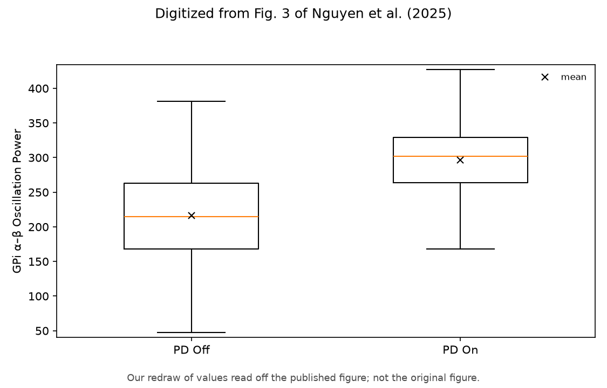
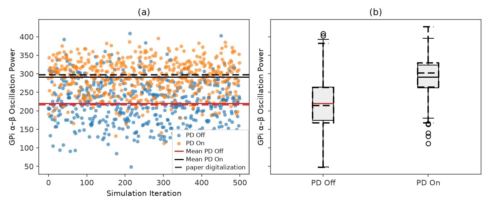

# Nguyen et al. Fig 3 — GPi α–β oscillation power distribution

[← SNN / Nguyen et al. tracker](../README.md)

## What the paper shows

Distribution of GPi **α–β** oscillation power (**7–35 Hz**) for **PD On** vs **PD Off** (no DBS). **PD On** = parkinsonian (`pd=1`); **PD Off** = healthy (`pd=0`). Reward threshold θ = 150 is **not** drawn on this panel.

## Status

**Current status:** the summary table in the [tracker](../README.md) (refreshed on every promote).

### Paper (Nguyen et al.): digitized, our redraw



### Replication



<!-- caption-3:start -->
**Caption:** GPi α–β (7–35 Hz), 500 iters × 0.1 s; PD On mean=290.8, PD Off mean=219.5, PD Off Q1=174.6 (paper 167.8); pass=True (v24)

**Manifest:** `artifacts/figures/papers/nguyen/3/manifest.json`
<!-- caption-3:end -->

**Status:** Pass — 500 × 100 ms samples; see `alpha_beta_dist_v24.png`.

## How to reproduce

**Run:**

```bash
uv run rl-dbs panel run nguyen/3 -- --export-notes
uv run python -m rl_adaptive_dbs.run scripts/figures/papers/nguyen/3/plot.py --n-iterations 50
uv run python -m rl_adaptive_dbs.run scripts/figures/papers/nguyen/3/plot.py --plot-only --export-notes
```

**Defaults:** 500 iterations per condition, 0.1 s per sample, seeds `0…499`. Writes `alpha_beta_dist_vN.png`.

## Gates

<!-- gates-3:start -->
**Gates set** (`artifacts/figures/papers/nguyen/3/manifest.json`; overall **`pass`**: yes, 2026-10-18). Every row is required for exit.

| Key | Description | Pass |
|-----|-------------|------|
| `ordering_pd_on_above_pd_off` | PD On median above PD Off median | yes |
| `paper_pd_off_q1_near_paper` | digitization — PD Off Q1 within ±10% of paper | yes |
| `paper_pd_off_median_near_paper` | digitization — PD Off median within ±10% of paper | yes |
| `paper_pd_off_q3_near_paper` | digitization — PD Off Q3 within ±10% of paper | yes |
| `paper_pd_off_mean_near_paper` | digitization — PD Off mean within ±10% of paper | yes |
| `paper_pd_on_q1_near_paper` | digitization — PD On Q1 within ±10% of paper | yes |
| `paper_pd_on_median_near_paper` | digitization — PD On median within ±10% of paper | yes |
| `paper_pd_on_q3_near_paper` | digitization — PD On Q3 within ±10% of paper | yes |
| `paper_pd_on_mean_near_paper` | digitization — PD On mean within ±10% of paper | yes |
| `paper_pd_off_q1_marginally_above_theta` | PD Off Q1 in (150, 187.5] — §IV: Q1 "marginally higher than 150" (paper 167.8) | yes |
<!-- gates-3:end -->

## Deviations and conventions

Conventions shared by the whole recipe are in the [tracker § Conventions](../README.md#conventions).

## Tried so far

None recorded yet.

## Open questions

Questions for the authors are tracked privately.

## Notes

None recorded yet.
