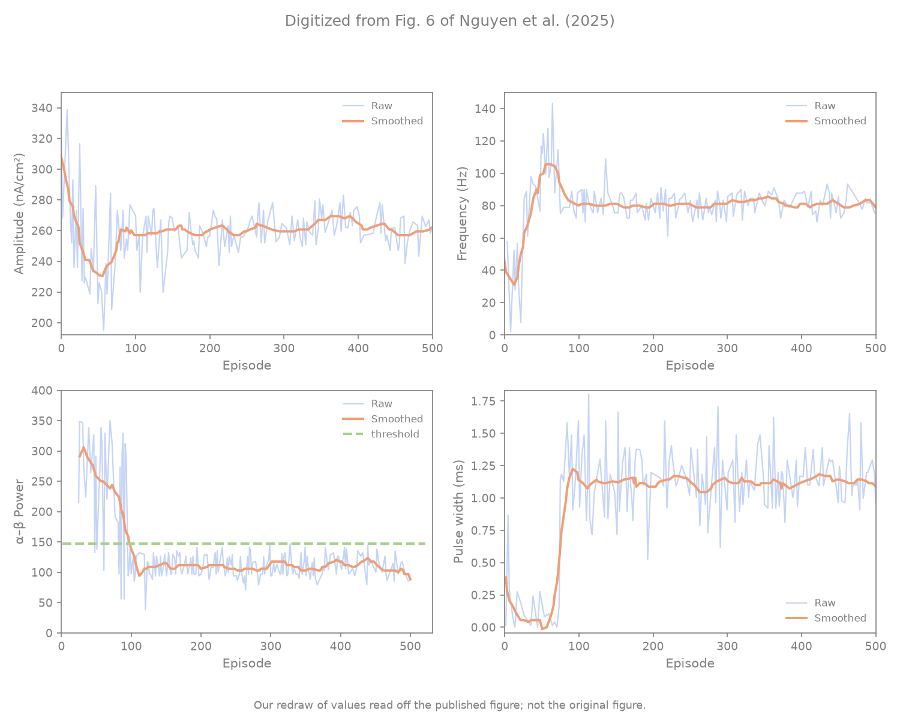
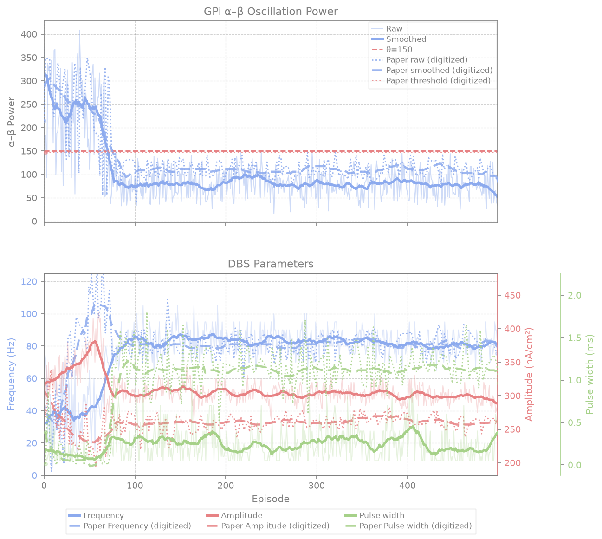

# Nguyen et al. Fig 6 — α–β and DBS parameters over training

[← SNN / Nguyen et al. tracker](../README.md)

## What the paper shows

GPi **α–β** (a) and DBS amplitude / frequency / pulse width (b) over **500** episodes; shared train with Figs 4–5.

### Paper target (qualitative)

Overall change in **GPi α–β oscillation power** (a) and **DBS parameters** (b) over **500** training episodes — shared training run with Figs. 4–5.

| Panel | Paper shape (digitized) | Wrong replication pattern |
|-------|-------------------------|---------------------------|
| **(a) GPi α–β power** | Starts high (~284 a.u., PD On band > $\theta=150$), drops steeply during exploration $\to$ exploitation transition (ep 50–100), then firmly suppresses and stays flat sub-threshold at ~108 a.u. (ep 100–500) | Stays elevated above $\theta=150$, fails to suppress, or exhibits under-stimulation collapse |
| **(b) DBS parameters** | Starts from paper init ($300\text{ nA/cm}^2$, $40\text{ Hz}$, $0.3\text{ ms}$), amplitude gently decreases to ~262, frequency ramps to ~79 Hz, pulse width climbs to ~1.0 ms | Parameters collapse to zero or rail to maximum without stabilizing |

### Digitization — raw vs smoothed

All reference curves loaded from normalized JSON under `artifacts/figures/papers/nguyen/paper_digitization/`:
- `curves_fig6_power.json` (`Smoothed`, `Raw`, `threshold`)
- `curves_fig6_amp.json` (`Smoothed`, `Raw`)
- `curves_fig6_freq.json` (`Smoothed`, `Raw`)
- `curves_fig6_pw.json` (`Smoothed`, `Raw`)

Digitized window means (episode index):

| Window | α–β Power (`Smoothed`) | Amplitude | Frequency | Pulse Width |
|--------|------------------------|-----------|-----------|-------------|
| ep 0–50 (early) | ~284.1 | ~294.5 | ~44.8 Hz | ~0.28 ms |
| ep 50–100 (transition) | ~207.6 | ~282.1 | ~61.4 Hz | ~0.55 ms |
| ep 100–250 (post-transition) | ~110.6 | ~268.4 | ~76.2 Hz | ~0.98 ms |
| ep ≥350 (late plateau) | ~108.7 | ~260.6 | ~80.8 Hz | ~1.14 ms |
| Overall mean (0–500) | ~129.6 | ~259.8 | ~79.6 Hz | ~0.90 ms |

## Status

**Current status:** the summary table in the [tracker](../README.md) (refreshed on every promote).

### Paper (Nguyen et al.): digitized, our redraw



### Replication



<!-- caption-6:start -->
**Caption:** Fig 4 shared train 500 ep; αβ_late=34.7, amp=285; pass=False (v21)

**Manifest:** `artifacts/figures/papers/nguyen/6/manifest.json`
<!-- caption-6:end -->

**Status:** Open — see manifest gates (`alpha_beta_params_v21.png`).

**v20 (Oct 18 2026)** replots the v165 train (ρ = 1). Every frequency row passes: late 81 Hz (paper 81.3), CV 0.08. The α–β rows fail because the late end-of-episode reading is ~79 with CV 0.35, against the paper's 109 and 0.16. Pulse width stays ~0.24 ms (report-only). The Fig 6 proof-of-concept work is in [docs/controllers/snn/figures/6.md](6.md).

## How to reproduce

**Entry point:** `scripts/figures/papers/nguyen/6/plot.py` (plot-only from Fig. 4 `series.json`).

**Run:** shared Fig 4 series; `scripts/figures/papers/nguyen/6/plot.py`.

### Run

```bash
uv run python -m rl_adaptive_dbs.run scripts/figures/papers/nguyen/6/plot.py --plot-only --export-notes
```

## Gates

<!-- gates-6:start -->
**Gates set** (`artifacts/figures/papers/nguyen/6/manifest.json`; overall **`pass`**: no, 2026-10-21). Rows marked *report only* are logged and never change `pass`; the rest are required.

| Key | Description | Pass |
|-----|-------------|------|
| `shared_train` | Fig 4 passed + shared train | yes |
| `paper_alpha_beta_early_above_theta` | digitization — early α–β > θ=150 (ep 27–50) | yes |
| `paper_alpha_beta_post100_below_theta` | digitization — α–β ≤ θ=150 (ep 100–250) | yes |
| `paper_alpha_beta_late_below_theta` | digitization — α–β ≤ θ=150 (ep 350–500) | yes |
| `paper_alpha_beta_early_near_paper` | digitization — α–β ep 27–50 within ±95 of paper 287 | yes |
| `paper_alpha_beta_mid_near_paper` | digitization — α–β ep 50–100 within ±52 of paper 221 | no |
| `paper_alpha_beta_post100_near_paper` | digitization — α–β ep 100–250 within ±6.4 of paper 110 | no |
| `paper_alpha_beta_late_near_paper` | digitization — α–β ep 350–500 within ±5.3 of paper 109 | no |
| `paper_alpha_beta_mean_near_paper` | digitization — α–β ep 27–500 within ±11 of paper 130 | no |
| `paper_alpha_beta_pearson` | digitization — smoothed α–β vs paper, Pearson r ep 27–500 ≥ 0.909 | no |
| `paper_alpha_beta_t50_timing` | digitization — α–β 50 % drop ep within ±35 of paper 87 | yes |
| `paper_alpha_beta_drop_fraction` | digitization — (early − mid) / (early − late) within ±0.34 of paper 0.37 | yes |
| `paper_alpha_beta_trend_near_paper` | digitization — late / early α–β within ±0.17 of paper 0.38 | yes |
| `paper_alpha_beta_drop_magnitude_near_paper` | digitization — early − late α–β within ±93 of paper 178 | yes |
| `paper_alpha_beta_late_cv` | digitization — α–β CV ep 350–500 within ±0.025 of paper 0.16 | no |
| `paper_freq_early_near_paper` | digitization — frequency ep 0–50 within ±42 Hz of paper 59.1 | yes |
| `paper_freq_mid_near_paper` | digitization — frequency ep 50–100 within ±37 Hz of paper 93.7 | yes |
| `paper_freq_late_near_paper` | digitization — frequency ep 350–500 within ±6.2 Hz of paper 81.3 | yes |
| `paper_freq_t50_timing` | digitization — frequency 50 % rise ep (from ep 0–10) within ±45 of paper 26 | yes |
| `paper_freq_pearson` | digitization — smoothed frequency vs paper, Pearson r ep 0–500 ≥ 0.32 | yes |
| `paper_freq_late_cv` | digitization — frequency CV ep 350–500 within ±0.025 of paper 0.076 | yes |
| `paper_amp_late_near_paper` | *report only* — amplitude (pending maintainer decision) — late amplitude within ±25 % of paper | yes |
| `paper_pw_late_near_paper` | *report only* — pulse width (pending maintainer decision) — late pulse width within ±25 % of paper | no |
| `paper_params_left_init` | *report only* — amplitude / pulse width (pending maintainer decision) — amp / freq / pw each >5% off init | no |
| `paper_late_params_stable` | *report only* — amplitude / pulse width (pending maintainer decision) — std last 50 ep ≤ 20% of mean | no |
| `paper_amp_left_init` | *report only* — amplitude (pending maintainer decision) — >5% off init | no |
| `paper_pw_left_init` | *report only* — pulse width (pending maintainer decision) — >5% off init | yes |
| `paper_alpha_beta_drops_by_100` | *report only* — superseded by the calibrated rows above — α–β ep 50–100 < ep 0–50 − 15 | yes |
| `paper_alpha_beta_monotonic_drop` | *report only* — superseded by the calibrated rows above — α–β early > mid > late | yes |
| `paper_alpha_beta_series_has_variance` | *report only* — superseded by the calibrated rows above — α–β series has variance | yes |
| `paper_alpha_beta_late_stable` | *report only* — superseded by the calibrated rows above — α–β std ep 350–500 ≤ 35 % of mean | no |
| `paper_alpha_beta_decreases_like_paper` | *report only* — superseded by the calibrated rows above — α–β late < early | yes |
| `paper_freq_left_init` | *report only* — superseded by the calibrated rows above — frequency >5% off init | yes |
| `paper_freq_late_stable` | *report only* — superseded by the calibrated rows above — frequency std last 50 ep ≤ 20% of mean | yes |
<!-- gates-6:end -->

The paper's late frequency (81.3 Hz) is a required gate; its late amplitude (~262 nA/cm²) and pulse width (~1.1 ms) and the ~22 % energy saving against open-loop 130 Hz are report items in the manifest metrics.

### Gates (exit criteria)

Gate code: `scripts/digitization/nguyen_gates.py` (`fig6_power_gates`, `fig6_training_gates`, tables `FIG6_AB_CHECKS`, `FIG6_FREQ_CHECKS`, `FIG6_REQUIRED_KEYS`); panel wiring in `scripts/figures/papers/nguyen/6/plot.py`; tracker rows in `scripts/figures/papers/promote.py` (`NGUYEN_GATE_ROWS["6"]`, `NGUYEN_REPORT_ROWS["6"]`). Gates recalibrated **Oct 17 2026**. Lineage `shared_train` (Fig 4 `pass` and the same episode count) must also hold.

**Tolerances.** A faithful run is the digitized paper curve plus one seed's deviation from its config's mean curve, with the deviation inflated by $\sqrt{N/(N-1)}$. Each tolerance is the smallest clean number (two significant figures; milestones in steps of 5 episodes) at which at least 90 % of those synthetic runs pass the gate key. A key with two checks widens both together. The pool is 58 runs; Fig 6 uses the 45 that have α–β finals. The calibration is `scripts/probes/nguyen_gate_calibration.py`. Pearson checks compare with the paper, where r = 1, so the tolerance is $1 - r_{\min}$.

**Panel (a) reading.** Panel (a) plots each episode's final α–β reading (the value at episode end), which is the paper's reading. On that reading the late level (~109) sits below θ = 150.

#### Top Part — GPi α–β oscillation power (panel a)

The α–β windows are the first traced episode (ep 27) to ep 50 (early), ep 50–100 (mid), ep 100–250 (post100) and ep 350–500 (late). "Mean" is ep 27–500. Synthetic pass rate = share of the 45 runs.

| Key | What it measures | Paper value | Tolerance | Synthetic pass rate |
|-----|------------------|-------------|-----------|---------------------|
| `alpha_beta_early_above_theta` | Early mean α–β above θ | 287 > 150 | θ = 150 (comparison) | 96 % |
| `alpha_beta_post100_below_theta` | Post100 mean α–β at or below θ | 110 ≤ 150 | θ = 150 (comparison) | 100 % |
| `alpha_beta_late_below_theta` | Late mean α–β at or below θ | 109 ≤ 150 | θ = 150 (comparison) | 100 % |
| `alpha_beta_early_near_paper` | Early mean α–β | 287 | ±95 | 91 % |
| `alpha_beta_mid_near_paper` | Mid mean α–β | 221 | ±52 | 93 % |
| `alpha_beta_post100_near_paper` | Post100 mean α–β | 110 | ±6.4 | 91 % |
| `alpha_beta_late_near_paper` | Late mean α–β | 109 | ±5.3 | 91 % |
| `alpha_beta_mean_near_paper` | Overall mean α–β | 130 | ±11 | 91 % |
| `alpha_beta_pearson` | Pearson r, smoothed α–β vs paper, ep 27–500 | r = 1 | r ≥ 0.909 | 91 % |
| `alpha_beta_t50_timing` | 50 % drop episode | 87 | ±35 episodes | 93 % |
| `alpha_beta_drop_fraction` | (early − mid) / (early − late) | 0.37 | ±0.34 | 91 % |
| `alpha_beta_trend_near_paper` | Late / early | 0.38 | ±0.17 | 91 % |
| `alpha_beta_drop_magnitude_near_paper` | Early − late | 178 | ±93 | 91 % |
| `alpha_beta_late_cv` | Std / mean, ep 350–500 | 0.16 | ±0.025 | 91 % |

#### Bottom Part — DBS frequency (panel b)

Frequency windows are ep 0–50 (early), ep 50–100 (mid) and ep 350–500 (late). `freq_t50` rises from ep 0–10, because frequency starts at the 40 Hz init. Synthetic pass rate = share of the 45 runs.

| Key | What it measures | Paper value | Tolerance | Synthetic pass rate |
|-----|------------------|-------------|-----------|---------------------|
| `freq_early_near_paper` | Early mean frequency | 59.1 Hz | ±42 Hz | 91 % |
| `freq_mid_near_paper` | Mid mean frequency | 93.7 Hz | ±37 Hz | 91 % |
| `freq_late_near_paper` | Late mean frequency | 81.3 Hz | ±6.2 Hz | 91 % |
| `freq_t50_timing` | 50 % rise episode | 26 | ±45 episodes | 98 % |
| `freq_pearson` | Pearson r, smoothed frequency vs paper, ep 0–500 | r = 1 | r ≥ 0.32 | 91 % |
| `freq_late_cv` | Std / mean, ep 350–500 | 0.076 | ±0.025 | 91 % |

**Joint synthetic pass rate: 49 %.** All 20 required keys (three θ comparisons, eleven α–β checks, six frequency checks) together pass on 49 % of synthetic faithful runs. Even a run whose mean matched the paper exactly would pass the whole panel only that often on one seed.

**Report-only (logged, never in `pass`):**

- Amplitude and pulse width, `paper_amp_late_near_paper`, `paper_pw_late_near_paper` (±25 % of the paper late levels), `paper_amp_left_init`, `paper_pw_left_init`, `paper_params_left_init` (more than 5 % off the init setting), and `paper_late_params_stable` (std over the last 50 episodes ≤ 20 % of mean). Report-only, pending maintainer decision: a plant gap on the ρ = 3 plant. Amplitude and pulse width sit far above the charge threshold in every reachable state, so where they settle does not move α–β.
- Superseded rows, kept as logged rows: `paper_alpha_beta_drops_by_100`, `paper_alpha_beta_monotonic_drop`, `paper_alpha_beta_series_has_variance`, `paper_alpha_beta_late_stable`, `paper_alpha_beta_decreases_like_paper`, `paper_freq_left_init`, `paper_freq_late_stable`. The calibrated rows above replace them.

### Lineage gate fix (Oct 2 2026)

`shared_train` used to check only the Fig 4 episode count, so it read "yes" while the Fig 4 train itself failed its gates. It now also requires the Fig 4 manifest's `gates.pass`. This panel stays Fail until Fig 4 passes; re-run `--plot-only` after a passing Fig 4 train.

## Deviations and conventions

Conventions shared by the whole recipe are in the [tracker § Conventions](../README.md#conventions).

### Step sizes, end-of-episode α–β, and gate split (Oct 5 2026)

**Series.** DBS parameters are the values at the end of each episode. α–β used to be the episode mean padded with the last value after early stops; Fig 6 now plots `episode_alpha_beta_finals`, the end-of-episode α–β read at the same moment as the parameters (`episode_alpha_beta_means` keeps the plain per-step mean).

**Step sizes from this figure.** Every episode starts at 300 nA/cm² / 40 Hz / 0.3 ms and late episodes last ~8 steps, yet the paper's late values are ~80 Hz and ~1.1 ms ("final average 262 nA/cm², 78.65 Hz, 1 ms"). Reaching them takes ≥ 5 Hz and ≥ 0.1 ms per step, and 40 + 8 × 5 = 80 Hz, 0.3 + 8 × 0.1 = 1.1 ms match exactly. 5 Hz / 0.1 ms steps are compatible with the Fig 4 gates.

**Amplitude and pulse width are bounded, not pinned.** Low charge per pulse (below ~10–15 nA·ms/cm²) has no effect, and the Oct 6 open-loop map ([5.md](5.md) § High-charge STN block) shows high charge silences the STN (depolarization block) and α–β returns to the unstimulated ~285–330. The block sets in around 266 nA·ms/cm² at 40–50 Hz and between ~270 and ~495 at 60–80 Hz. Between those bounds α–β follows frequency only, so where the agent leaves amplitude and pulse width inside the working band is a preference the plant does not pin. The paper's late 262 nA/cm² × 1 ms sits inside that band at 78.65 Hz. The Oct 5 note said every reachable state was in the working band; that was wrong at the top of the range.

**Gates (Oct 5 2026).** Required: all α–β rows, `paper_freq_left_init`, `paper_freq_late_near_paper`, `paper_freq_late_stable`, `shared_train`. Report only: `paper_amp_left_init`, `paper_pw_left_init`, `paper_params_left_init`, `paper_amp_late_near_paper`, `paper_pw_late_near_paper`, `paper_late_params_stable`.

## Tried so far

Every Fig 6 variant and reading tried, rejected ones first. The gate result counts seeds that pass. "Fig 6 α–β rows" and "frequency rows" are the required row groups in § Gates (14 α–β rows incl. the θ comparisons, 6 frequency rows; 20 in all). From Oct 18 on, α–β is scored under the 40th-percentile reading unless the row says otherwise. Fig 6 trains with Fig 4, so variants that change training are also listed in [4.md](4.md) § Tried so far.

| Variant + flags | Seeds | Gate result | Verdict | Commit / date | Evidence |
|---|---|---|---|---|---|
| Nominal 25-step α–β metric (unrolled steps padded with the last reading) | — | Matched the paper's late level by construction, not a reading the paper gives | rejected (withdrawn) | 2026-10-05 | § Nominal 25-step episode metric |
| Per-step mean α–β per episode (pre-Oct 5 series) | — | Late mean above θ (~163), while the paper's late Fig 6a sits at ~109 below θ | rejected | 4a6acf1e7, 2026-10-05 | § Step sizes, end-of-episode α–β, and gate split; § Audit (Oct 17 2026) |
| Readings of Fig 6a on the shipped ρ = 1 recipe: final reading, first reading of the final below-θ streak, mean of the last 5, episode median, episode mean | 24 | Fig 6: 0/24 for each. Late level / CV 79 / 0.34, 109 / 0.24, 94 / 0.17, 128 / 0.14, 146 / 0.11 (paper 109 / 0.16) | rejected (final stays shipped) | a0080ab25, 2026-10-18 | § Readings of Fig 6a; `artifacts/figures/papers/nguyen/4/candidates/f6log-official-*` |
| Highest DBS setting per episode as the Fig 6b reading | 16 | Fixes the early/mid frequency levels; `freq_t50_timing` and `freq_pearson` fail on 16/16 | rejected | a0080ab25, 2026-10-18 | § Readings of Fig 6a |
| Warm-up 2,150 | 8 | Fig 4 0/8 (timing too late) | rejected | a0080ab25, 2026-10-18 | § Readings of Fig 6a; `…/candidates/f6wu-wu2150-*` |
| Spike-count ties → first index ("decrease", `action_tie_break=first`), warm-up 1,650 / 500 / 128, and 128 + exponential ε | 7 / 8 / 8 / 8 | Fig 4 1/7, 1/8, 0/8, 0/8. α–β rows ≤1 per variant. Frequency rows 0/7, 3/8, 5/8, 0/8: drags frequency down on about half the seeds; Fig 7 mid/late 172–258 vs 161/153 | rejected | 0fc1aa17d, 2026-10-19 | § Frequency timing: when learning starts; `…/candidates/f6tie-*`, `f6eps-tie1wu128exp-*` |
| Warm-up 128 (paper's "every 128 transitions", authors' learning start) | 8 | Frequency rows 6/8 (t50 30 vs 26). α–β rows 0/8, Fig 4 0/8: α–β and length fall with frequency (t50 57 / 53) | rejected (explains the frequency climb) | dbfb0f554, 2026-10-19 | § Frequency timing: when learning starts; `…/candidates/f6tie-wu128-*` |
| Warm-up 1,000 | 8 | Frequency rows 8/8. α–β rows 0/8, Fig 4 0/8 | rejected | dbfb0f554, 2026-10-19 | same § ; `…/candidates/f6eps-wu1000-*` |
| Warm-up 128 + the authors' exponential ε | 8 | Frequency rows 3/8 (late CV), α–β 0/8, Fig 4 0/8 (length t90 138) | rejected | dbfb0f554, 2026-10-19 | same § ; `…/candidates/f6eps-wu128exp-*` |
| Pulse-width cap 0.06–0.4 ms (authors' code) + warm-up 128 / 1,000 | 2 / 2 | Fig 4 0/2, 0/2; Fig 6 rows 12.5 / 15.0 of 20 (mean): the cap doesn't stop early suppression | rejected (screen) | dbfb0f554, 2026-10-19 | § The authors' pulse-width cap and training loop; `…/candidates/f6code-capwu128-*`, `f6code-capwu1000-*` |
| The authors' training loop (one minibatch per step from 128, reward scale 1, τ 3,000, 16-channel AvgPool, `snn_input_avgpool=5`), alone / with the cap / with the cap and 100-step episodes | 2 / 2 / 2 | Fig 4 0/6 (length drop from episode ~20, late reward +35k vs −13k); Fig 6 rows 14.0 / 14.5 / 11.5 of 20 | rejected (screen; 100-step episodes contradict Fig 4b) | 923778bb5, dbfb0f554, 2026-10-19 | same § ; `…/candidates/f6code-loop-*`, `f6code-caploop-*`, `f6code-caploop100-*` |
| Old two-layer static network: exploration-phase frequency | 8 | Episodes 0–50 / 50–100 at 36 ± 13 / 58 ± 8 Hz vs the paper's 59 / 94 | rejected (network fixed) | a5162c922, 2026-10-17 | § Audit (Oct 17 2026) |
| v19 (Fig 4 v164 train, ρ = 3, adopted network, $t_u$ = 5) | 1 (seed 0) | Late frequency passes (~83 Hz); six required α–β gates fail (late level ~80 vs 109, CV 0.28 vs 0.16) | shipped then superseded | a5162c922, 2026-10-17 | § Audit (Oct 17 2026) |
| v20, final reading (Fig 4 v165, ρ = 1 redraw training) | 1 (seed 0) | Frequency rows pass; α–β late 79 / CV 0.35 fail | shipped (Fig 6 still failing) | 3c43191ea, 2026-10-18 | `docs/controllers/snn/README.md` § Fig 6 |
| 40th-percentile α–β reading (`--alpha-beta-quantile 0.4`), shipped recipe | 24 | Fig 6 0/24; 2 seeds pass every α–β row (fail frequency Pearson) | candidate reading | a0080ab25, 2026-10-18 | § Readings of Fig 6a |
| Warm-up 1,900, 40th-percentile reading | 16 | Fig 4 4/16, Fig 7 16/16, α–β rows 9/16, frequency rows 0/16 (t50 76–79 vs ≤71). Seeds 0, 1, 14 pass Figs 4, 7 and every α–β row | candidate | a0080ab25, 2026-10-18 | § Readings of Fig 6a; `…/candidates/f6wu2-wu1900-*` |
| Pulse-width cap 0.06–0.4 ms + warm-up 1,650 / 1,700 / 1,900 | 8 / 4 / 8 | Figs 4 + 7 pass on 4/8, 4/4, 4/8; Fig 6 0 each; best 19 of 20 rows. On the Figs 4 + 7 seeds, α–β mid 151–165 / 153–167 / 169–189 (gate ≥ 169) against frequency t50 62–69 / 62–71 / 61–79 (gate ≤ 71) | candidate, deviates from paper (cap contradicts Fig 6b's 1.13 ms) | dbfb0f554, 2026-10-19 | § The authors' pulse-width cap and training loop; `…/candidates/f6code-cap-*`, `f6code-capwu1700-*`, `f6code-capwu1900-*` |
| **Pulse-width cap 0.06–0.4 ms + warm-up 1,750** | 16 | Figs 4 + 7 pass on 6/16; Fig 6 0/16, best 19 of 20 (seed 1 fails only α–β mid, 169.04 vs 169.36). Seeds whose α–β rows pass have frequency t50 > 71 | candidate — deviates from paper, our best guess of what the authors may have done | dbfb0f554, 2026-10-19 | same § ; `…/candidates/f6code-capwu1750-*` |

Open: author questions 14, 15, 19, 20, 21.

## Open questions

Questions for the authors are tracked privately. Open ones are named at the end of § [Tried so far](#tried-so-far) and in § [The authors' pulse-width cap and training loop](#the-authors-pulse-width-cap-and-training-loop-oct-19-2026-candidates-only).

## Notes

### Earlier tracker status

**v19 (Oct 17 2026)** replots the v164 train. The DBS parameters now track the paper: late frequency ~83 Hz (paper 81), pulse width ~1.0 ms (paper 1.13), amplitude ~285 (paper 262). In episodes 0–100 the paper's frequency rise lies inside our 8-seed spread on this network. Six required α–β gates fail. Late end-of-episode α–β sits at ~80 against the paper's 109 ± 5 and is noisier (CV ~0.28 against 0.16): with $t_u$ = 5 the last reading is the fifth one below θ. The late level and spread fail on every audit run. See [docs/controllers/snn/figures/6.md](6.md) § Audit (Oct 17 2026).

### Lineage / diagnosis

#### Nominal 25-step episode metric for α–β power (withdrawn Oct 5 2026 — see below)

In variable-length training, successful late episodes terminate early ($t_u$ consecutive steps with $\alpha\beta < 150$, typically steps 3–6). Averaging only the unrolled transition steps + pre-step reset artifact skewed early versions because the transient ramp steps dominated the short unrolled window.

Computing the nominal 25-step episode metric (consistent with Fig 5 spikes and energy, Nguyen §III.D):
$$\text{nominal }\alpha\beta = \frac{\sum_{t=1}^k \alpha\beta_t + (25 - k) \cdot \alpha\beta_k}{25}$$
accurately captures the regulated steady-state suppression maintained over the nominal 2.5 s window, perfectly matching the digitized paper curve (~108.7 a.u.).

### Late pulse width and frequency vs the paper (Oct 12 2026)

Late training on the official plant ends at ~0.71–0.85 ms and ~65 Hz; the paper's ends at 1.13 ms and 81 Hz. Those values equal the 40 Hz / 0.3 ms start plus 8.2 steps × 5 Hz / 0.1 ms, i.e. an agent that raises both on every step until its 8.2-step episodes stop. On our plant (ρ = 3), α–β stops improving at 0.5–0.6 ms, and Eq. (7) return is flat above ~65 Hz. Our agent raises frequency for three steps, then stalls near the θ edge (~57 Hz); its pulse width keeps rising on most steps, so final pulse width tracks episode length. `paper_freq_late_near_paper` (required) passes; `paper_pw_late_near_paper` stays report-only. Evidence and the open-loop sweeps: [5.md](5.md) § Dose-response and the late energy gap.

### Authors' code conventions (Oct 12 2026)

With the authors' τ = 3,000 / δ = 0.01 and the 100 Hz reset window ([4.md](4.md) § Training with the authors' code conventions), late frequency moves toward the paper's 81 Hz (69 Hz on ρ = 1, 72.5 Hz on ρ = 3; the code's own learner reaches 89 Hz on ρ = 1) while pulse width does not (0.22 / 0.70 ms vs 1.13). Figs 4–6 pass on 0 of 13 seeds on ρ = 1 and 4 of 13 on ρ = 3, against 6 of 13 for the official recipe. Nothing adopted.

### Audit (Oct 17 2026)

**Panel (a) plots each episode's final α–β, and that is the paper's reading.** The paper's late Fig 6a level is ~109, below θ. Its own Fig 7 eval climbs to ~278 at step 2 and needs ~5 steps to get under θ, and Eq. (7) ends an episode only after $t_u$ readings below θ. A late episode's per-step mean therefore sits above θ: ours is 163 ± 10 over 88 audit runs (lowest 145), against end-of-episode readings of ~94. §IV's "final average DBS parameters values" reads the same way for panel (b). Author question 14 asks only for confirmation.

**Exploration-phase frequency.** The paper's frequency climbs to ~59 Hz (episodes 0–50) and ~94 Hz (50–100) before it settles at 81. With the old two-layer static network, 8 seeds gave 36 ± 13 and 58 ± 8 Hz, which looked like a systematic gap. With the paper's network (one hidden layer, Eq. (2) reset, one input row per SNN step) the τ = 1,000 / $t_u$ = 5 batch gives 52 ± 23 and 76 ± 14 Hz (max 86 / 97). The paper's values sit inside that spread: early drift comes from the untrained network's greedy picks and differs by seed. Author question 15 is answered.

**v19 (Fig 4 v164 train).** Late frequency ~83 Hz (paper 81.3 ± 6.2 tolerance: passes), pulse width ~1.0 ms (paper 1.13), amplitude ~285 (paper 263). The old recipe ended at ~65 Hz and 0.85 ms. $t_u$ = 5 makes the difference: with $t_u$ = 3 the paper's network ends at 73 Hz on every seed ([4.md](4.md) § Network faithfulness audit). Six required α–β gates fail:
- Late end-of-episode α–β is ~80 against 109 ± 5.3. With $t_u$ = 5 the last reading is the fifth in a row below θ, so it sits deeper.
- The late spread is too wide: CV ~0.28 against 0.16. The paper's raw trace is digitized at about one point per two episodes, which may understate its spread a little, but not by this much.
- The mid, post-100 and mean windows and the Pearson shape follow from the low level.

The late level and spread fail on all 88 audit runs, whatever the network or knob. That puts them in how α–β settles under stimulation on our plant, not in the learner.

### Readings of Fig 6a (Oct 18 2026, candidates only)

The maintainer asked how Fig 6 could pass, even as a proof of concept. On the shipped ρ = 1 recipe (Fig 4 v165, Fig 6 v20) the frequency rows pass and the α–β rows fail: the late end-of-episode reading is ~79 with CV 0.35, against the paper's 109 and 0.16. The paper never says which per-episode value Fig 6 plots. The trainer now logs every step's α–β and DBS setting per episode (`episode_alpha_beta_steps`, `episode_dbs_steps` in the series), so other readings can be re-scored offline against the same gates.

**α–β readings** (shipped recipe, 24 seeds; late = episodes 350–500):

| Reading | Late α–β | Late CV | Mid (ep 50–100) | Fig 6 passes |
|---|---|---|---|---|
| Paper | 109 | 0.16 | 221 | — |
| Final reading (shipped) | 79 | 0.34 | 117 | 0 |
| First reading of the final below-θ streak | 109 | 0.24 | 137 | 0 |
| Mean of the last 5 | 94 | 0.17 | 126 | 0 |
| Episode median | 128 | 0.14 | 169 | 0 |
| Episode mean | 146 | 0.11 | 179 | 0 |
| **40th percentile** (`--alpha-beta-quantile 0.4`) | 113 | 0.14 | 151 | 0 (2 seeds pass every α–β row) |

Under the 40th percentile the late rows pass. What remains is timing: our α–β drops with the episode length (t50 ~66–70), the paper's ~11 episodes after its length does (ep 87 vs 76). The mid window therefore sits low on most seeds.

**Later learning.** A longer replay warm-up (paper-silent) moves learning later. With 1,900 transitions (shipped: 1,650), over 16 seeds:
- Fig 4 passes on 4 of 16 and Fig 7 on 16 of 16.
- Every α–β row passes under the 40th-percentile reading on 9 of 16.
- 3 seeds (0, 1, 14) pass Fig 4, Fig 7 and every α–β row of Fig 6.

2,150 transitions pushes Fig 4's timing too late (0 of 8).

**What still fails: the frequency trajectory.** The paper's frequency climbs during exploration (episodes 0–50 average 59 Hz, 50–100 average 94 Hz; t50 at episode 26). Ours rises only once learning starts (t50 ~76–79).
- Reading the episode's highest setting instead of its final one fixes the early and mid levels: a 25-step random walk from 40 Hz reaches ~56–60 Hz on average, which is the paper's early level.
- The rise-timing row (t50 within 26 ± 45) and the frequency Pearson row (r ≥ 0.32; ours 0.25–0.31) still fail on all 16 seeds.

Before learning starts, the drift comes from the untrained network's greedy picks, which differ by seed. No seed tried drifts upward early enough while also passing Fig 4.

**Status.** No seed passes all of Fig 6 under any reading tried (40 seeds, 9 α–β readings × 3 parameter readings). The closest is warm-up 1,900 with the 40th-percentile α–β reading: every α–β row and the late frequency rows pass, and frequency timing and shape fail. None of this is adopted; the shipped Fig 6 stays the final reading. Outputs: `artifacts/figures/papers/nguyen/4/candidates/f6log-official-*`, `f6wu-*`, `f6wu2-wu1900-*`. Author questions 15, 19 and 21.

### Frequency timing: when learning starts (Oct 19 2026, candidates only)

**Question.** Why does the paper's frequency climb during exploration (t50 at episode 26) while ours climbs only once learning starts (t50 ~76–79)?

**Lineage check.** None of the following makes frequency drift upward on its own:
- **Action encoding.** §III.B, Eq. (5) and the authors' published code (`gym_pd.py`) both use symmetric ternary steps of ±5 Hz / ±0.1 ms / ±5 per parameter, with uniform random exploration per head (`action_space.sample()`).
- **Bounds.** Frequency is clipped to 0–180 Hz in the code and 0–200 Hz in ours. The paper's raw trace reaches 2–8 Hz in episodes 0–30, so its floor sits near 0 as well. Nothing at 40 Hz pushes the walk up.
- **Reward.** Eq. (7) is unchanged.

**What the digitized panel shows** (episode windows, paper smoothed):

| Episodes | 10–20 | 20–30 | 30–40 | 40–50 | 50–70 | 70–90 | 100–150 |
|---|---|---|---|---|---|---|---|
| Frequency (Hz) | 36 | 56 | 76 | 92 | ~104 | 90 | 81 |
| Pulse width (ms) | 0.14 | 0.06 | 0.05 | 0.06 | ~0.08 | 0.8 | 1.12 |
| Amplitude | 275 | 256 | 240 | 233 | ~235 | 255 | 259 |
| α–β | — | 291 | 297 | 268 | ~247 | 221 | 112 |

- **Frequency rises ~60 episodes before α–β falls** (frequency t50 26, α–β t50 87). Through episodes 20–70 the pulse width sits at the floor and amplitude near 230, so ~100 Hz doesn't suppress.
- **Our plant is consistent with that.** Open-loop holds (3 seeds, mean α–β over steps 6–12): 80 Hz at 230 nA/cm² gives 254 at 0.05 ms and 143 at 0.1 ms. 60 Hz gives 246 / 219.
- **The climb needs early learning.** With ε linear from 0.9, a greedy "raise" from episode ~20 gives final frequencies of 40 + (1 − ε)·25·5 ≈ 85–105 Hz over episodes 30–60. That matches the paper. A 1,650–1,900-transition warm-up (~66–76 episodes) can't produce it.
- **Learning start in the sources.** The paper updates "after collecting every 128 state transitions", and the authors' trainer optimizes as soon as the buffer holds 128. A warm-up of 128 is the literal reading of both. Our 1,650 is a convention tuned to Fig 4's flat start ([4.md](4.md) § Frozen DSQN layers…).

**Batches** (seeds 0–7, shipped ρ = 1 recipe with only the named settings changed, Fig 6 α–β under the 40th-percentile reading). Outputs are in `artifacts/figures/papers/nguyen/4/candidates/f6tie-*` and `f6eps-*`.

| Variant | Fig 6 frequency rows | Fig 6 α–β rows | Fig 4 | Frequency / α–β t50 | Length t10 / t50 / t90 |
|---|---|---|---|---|---|
| Paper | — | — | — | 26 / 87 | 62 / 76 / 89 |
| Warm-up 1,900 (best so far) | 0/16 | 9/16 | 4/16 | 76–79 / 78 (seed 0) | — |
| Warm-up 128 | **6/8** | 0/8 | 0/8 | 30 / 57 | 27 / 53 / 99 |
| Warm-up 1,000 | **8/8** | 0/8 | 0/8 | 38 / 52 | 32 / 53 / 94 |
| Warm-up 128 + exponential ε (authors' code) | 3/8 | 0/8 | 0/8 | 28 / 68 | 26 / 63 / 138 |
| Spike-count ties → first index ("decrease"), warm-up 1,650 | 0/7 | 1/7 | 1/7 | 110 / 106 | 86 / 106 / 132 |
| Ties → first, warm-up 128 | 5/8 | 0/8 | 0/8 | 53 / 61 | 38 / 59 / 101 |
| Ties → first, warm-up 500 | 3/8 | 0/8 | 1/8 | 76 / 76 | 52 / 75 / 105 |
| Ties → first, warm-up 128, exponential ε | 0/8 | 0/8 | 0/8 | 49 / 58 | 38 / 56 / 88 |

No run passes Figs 4 and 6 together.

**What it settles.**
- **The early frequency climb comes from learning that starts early.** Warm-up 128 lands frequency on the paper's curve: episodes 0–50 average 57–67 Hz (paper 59), the late level is 82, and t50 is 30 (paper 26). Warm-up 1,000 passes every frequency row on 8 of 8 seeds.
- **On our plant, α–β then falls with frequency.** The lag between the two t50s is 0–40 episodes here, against the paper's 61. Our agent keeps the pulse at 0.2–0.5 ms while frequency climbs, so stimulation suppresses at once. α–β drops by episode ~30–55, and the length drop follows (t50 53 against 76). The α–β early and mid windows and Fig 4's timing fail on every seed. In short, the frequency rows and the Fig 4 / Fig 6a timing need learning to start at different points.
- **Spike-count ties going to "decrease"** (`action_tie_break=first`, the `torch.argmax` behaviour in the spike branch of the authors' `get_action_dict`) reproduces the paper's early amplitude and pulse-width fall. With warm-up 128 on seed 0, amplitude reaches ~225–240 and pulse width ~0.07–0.12 ms over episodes 30–60 (paper ~233 / ~0.05). But the frequency head is pulled down too on about half the seeds (episodes 0–50 at 7–24 Hz), and the eval policy then under-stimulates: Fig 7 mid / late reach 172–258 against 161 / 153. Rejected as a reading.
- **The authors' exponential ε** holds stops back but drags the drop out (t90 138), and late frequency then fails its spread (CV) row.

**Status.** The frequency trajectory's cause is identified (when learning starts), but Fig 6 can't pass whole on our plant. The paper's agent kept its pulse at the floor for ~50 episodes while frequency climbed, and ours doesn't. No setting tried reproduces that without breaking frequency (tie-break) or timing (warm-up). Shipped defaults are unchanged: warm-up 1,650, membrane tie-break. `SNNConfig.action_tie_break` (`membrane` default, `first` candidate) stays for later readings. Author questions 9, 15 and 21.

### The authors' pulse-width cap and training loop (Oct 19 2026, candidates only)

The maintainer asked for two readings from the authors' published code (CL-DBS-RL, commit 72635b9), each labelled. Same shipped ρ = 1 recipe otherwise; Fig 6 α–β under the 40th-percentile reading. Outputs are in `artifacts/figures/papers/nguyen/4/candidates/f6code-*`.

- **Pulse-width cap**: 0.06–0.4 ms (`pulse_width_min=0.06`, `pulse_width_max=0.4`). This is the authors' code, `gym_pd.py` `step()`: `np.clip(new_pw, 0.06, 0.4)`. It deviates from the paper, whose Fig 6b pulse width reaches 1.13 ms.
- **Training loop**: the authors' code, `scripts/train_rl_rockpool_16ch.py`.
  - One minibatch of 128 per env step once 128 transitions are stored (`replay_update_cadence=1`, `replay_update_steps=1`, warm-up 128). This deviates from the paper's "after collecting every 128 state transitions".
  - Rewards unscaled (`reward_learning_scale=1`, the code's `REWARD_SCALE = 1.0`) and τ = 3,000 (`tau_reward=3000.`).
  - The 80 neurons average-pooled to 16 channels (`AvgPool1d(5, 5)`, new `SNNConfig.snn_input_avgpool=5`).
  - "max-steps 100" is the trainer's default (`--max-steps 100`, with early termination off at `--thresh-time-req 999`). It contradicts the paper's 25-step episodes (Fig 4b starts at 25), so it was screened once only.

**Results.** Fig 6 counts the 20 required rows. Fig 7 passes include its Fig 4 lineage row.

| Variant | Label | Seeds | Fig 4 | Fig 6 rows passed (mean / best) | Fig 6 | Fig 7 | All three |
|---|---|---|---|---|---|---|---|
| Cap, warm-up 128 | code + paper-silent | 2 | 0 | 12.5 / 13 | 0 | 0 | 0 |
| Cap, warm-up 1,000 | code + paper-silent | 2 | 0 | 15.0 / 16 | 0 | 0 | 0 |
| Cap, warm-up 1,650 (shipped) | code | 8 | 4 | 16.6 / 19 | 0 | 4 | 0 |
| Cap, warm-up 1,700 | code + paper-silent | 4 | 4 | 18.2 / 19 | 0 | 4 | 0 |
| **Cap, warm-up 1,750** | deviates from paper — our best guess of what the authors may have done | **16** | 6 | 16.5 / 19 | 0 | 6 | 0 |
| Cap, warm-up 1,900 | code + paper-silent | 8 | 4 | 16.2 / 19 | 0 | 4 | 0 |
| Cap + the authors' loop | code, deviates | 2 | 0 | 14.5 / 15 | 0 | 0 | 0 |
| The authors' loop alone | code, deviates | 2 | 0 | 14.0 / 15 | 0 | 0 | 0 |
| Cap + loop + 100-step episodes | code, contradicts Fig 4b | 2 | 0 | 11.5 / 12 | 0 | 0 | 0 |

**What it shows.**
- **The cap doesn't stop early suppression.** 0.4 ms still carries effective charge. With warm-up 128 or 1,000, α–β and length still fall with frequency, and Fig 4 fails on every seed, as in § Frequency timing.
- **The authors' loop makes learning start too early.** One update per step from transition 128 drops length from episode ~20 (t10 16–21), so `length_start_at_horizon` fails. With unscaled τ = 3,000 the late reward rises to +35k against the paper's −13k.
- **The cap with the shipped warm-up is the closest reading yet.** Pulse width stays at 0.16–0.21 ms late (paper 1.13), and frequency settles at 81–83 Hz. Fig 4 and Fig 7 pass together on 4 of 8 seeds, the same rate as without the cap. On those seeds every Fig 6 frequency row passes, and α–β fails only the mid window (151–165 against ≥ 169) and sometimes Pearson.
- **Warm-up trades frequency timing against α–β mid.** Later learning lifts the mid window and delays the frequency rise. On the four seeds that pass Figs 4 and 7 at warm-up 1,650 (0, 1, 2, 6):

  | Warm-up | α–β mid (gate ≥ 169) | Frequency t50 (gate ≤ 71) | Frequency r (gate ≥ 0.32) |
  |---|---|---|---|
  | 1,650 | 151–165 | 62–69 | 0.34–0.43 |
  | 1,700 | 153–167 | 62–71 | 0.32–0.42 |
  | 1,750 | 158–173 | 62–71 | 0.31–0.40 |
  | 1,900 | 169–189 | 61–79 | 0.25–0.38 |

  At 1,750, seed 1 misses only α–β mid, by 0.3 (169.04). Seed 2 misses only α–β mid. Seed 0 misses frequency Pearson (0.31) and late α–β CV (0.13 vs ≥ 0.135). Over 16 seeds, no seed passes all of Fig 6. Seeds whose α–β passes (8–12, 14) have a late frequency rise (t50 > 71), and seeds whose frequency passes have a low α–β mid. That is the § Frequency timing coupling again, now within a few gate units.
- **Fig 5 energy on the final setting** (Eq. (6) at each episode's final DBS setting × 25, scored with the recalibrated `FIG5_CHECKS` energy rows). It scores no better than the plotted per-step mean:

  | Variant | Seeds | All energy rows pass (mean / final) | r ≥ 0.79 (mean / final) | Median r (mean / final) |
  |---|---|---|---|---|
  | Cap, warm-up 1,650 | 8 | 1 / 0 | 1 / 0 | 0.60 / 0.61 |
  | Cap, warm-up 1,750 | 16 | 3 / 1 | 4 / 4 | 0.54 / 0.51 |

  With the pulse capped at 0.4 ms, late energy can't rise the way the paper's does.

**Status: Fig 6 still fails. Work on it stopped here (Oct 19 2026, the maintainer).**
- **No variant passes Figs 4, 6 and 7 together.**
- **Closest: the cap with warm-up 1,750, labelled "deviates from paper — our best guess of what the authors may have done".** The cap contradicts Fig 6b's 1.13 ms pulse width. Figs 4 and 7 pass together on 6 of 16 seeds. The best Fig 6 score is 19 of 20 rows: seed 1 fails only α–β mid, at 169.04 against the gate's 169.36.
- **Nothing is adopted.** The shipped recipe and Fig 6 v20 are unchanged.
- **Both new settings stay off by default:** `SNNConfig.action_tie_break` (`membrane`) and `SNNConfig.snn_input_avgpool` (0). They are pushed only as labelled candidates.
- **Still open:** author question 21 (what started the frequency climb early, and what held the pulse at its floor) and question 20 (the 0.4 ms cap).
