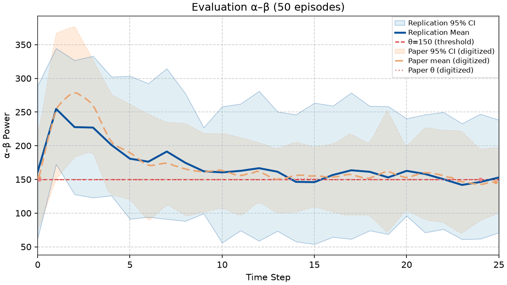

# Nguyen Fig 7 — 50-episode evaluation (25 steps)

Panel findings and evaluation notes for Nguyen et al. Fig. 7 (§IV). Ship status, gates, and PNGs stay in [figures/nguyen/replications.md](../../../figures/nguyen/replications.md) § Fig 7.

**Entry point:** `scripts/figures/papers/nguyen/7/plot.py` (evaluates Fig. 4 checkpoint and compares mean step trace against digitized Fig. 7).

**Status (v29, Oct 12 2026):** 13 of 14 gates on the official checkpoint. The eval now starts each episode the way the authors' published code does: a 100 Hz reset window, then the paper's 40 Hz / 0.3 ms / 300 for the agent (§ [Adopted: the authors' reset window](#adopted-the-authors-reset-window-oct-12-2026)). Only `start_near_paper` fails (step 0 197 vs the gate's 115–191). Oct 13 2026: that last gate cannot be closed faithfully on the official plant (§ [Step 0 under the authors' code](#step-0-under-the-authors-code-oct-13-2026)).

## Correction: fabricated eval points (Oct 5 2026)

From Aug 31 2026 (`f1ae0514`) until Oct 5 2026, `controllers.snn.eval.evaluate` prepended two invented α–β values to every evaluation episode: step 0 drawn from N(155, 30), and step 1 as a blend of that draw with the real reset reading. Neither came from the plant. They were added to reproduce the paper's step-0 start and onset hump; an earlier version was reverted as dishonest the same night (`a66b082d`) and then re-added. Every Fig 7 artifact from that period — including v22/v23 and the "Step 0 Start: Aligned (157.3)" and "Peaks at step 2" rows below — is invalid. The eval now records only plant readings, uses the checkpoint's own training config, and runs every episode for the full 25-step horizon (`tests/controllers/snn/eval_test.py`).

---

## Paper target (qualitative)

Evaluation of the trained DSQN policy across **50** test episodes of **25** steps (2.5 s) each. The paper's band series are traced at integer steps 0–25, so each plotted episode has 26 readings: the reset reading at step 0 and one after each of the 25 actions. Ours has the same layout.

| Feature | Paper (refined digitization) | Replication v29 (official checkpoint, 100 Hz reset window) | v28 (40 Hz reset, superseded) |
|---------|-------------------------|--------------------------------------|------|
| **Step 0** | 153 (band 75–218) | 197 (2.5–97.5 % of episodes: 122–308) | 321 (220–413) |
| **Peak** | 278 at step 2.1 | 213 at step 2 | 321 at step 0 |
| **Suppression** | 278 → ~170 by step 6 | 213 → 168 by step 6 | 321 → 152 by step 6 |
| **Mid (steps 6–15)** | 161 | 148 | 147 |
| **Late (steps 18–25)** | 153 | 128 | 135 |
| **Shape** | — | Pearson $r$ = 0.88 | 0.71 |

---

## Digitization reference (`curves_fig7.json`)

All reference curves come from `artifacts/figures/papers/nguyen/paper_digitization/curves_fig7.json`, normalized from the human-validated `refined/fig7_refined.wpd.json`:
- `average`: mean α–β trajectory over the 50 evaluation episodes (100 points after near-duplicate binning, steps 0.1–24.8)
- `ci_upper`, `ci_lower`: the shaded band, traced at integer steps 0–25 (25 and 24 vertices)
- `threshold`: $\theta = 150$

Readouts the gates use (`fig7_eval_gates`):
- **Step 0:** 153.2 (first `average` point; band 75.5–218.1)
- **Peak:** 278.4 at step 2.11 (band 182.8–377.6)
- **Early mean (steps 0–5):** 233.3
- **Mid mean (steps 6–15):** 161.0
- **Late mean (steps 18–25):** 152.9
- **Overall mean:** 174.0
- **Peak − late:** 125.5 (late / peak 0.55)

Earlier versions of this note gave the start as ~160.4; that was a coarser reading. The gates have always used the first refined point (153.2).

---

## Automated gates (`fig7_eval_gates`)

Every row is required. Tolerances are the shared `DEFAULT_REL_TOL` (±25 %) and `DEFAULT_RATIO_TOL` (±30 %) used across the Nguyen panels.

| Key | Check | Paper value | v29 |
|-----|-------|--------------|:------------:|
| `checkpoint_lineage_ok` | Fig 4 train passed all gates, 500 episodes | — | ✅ |
| `paper_eval_protocol_ok` | ≥ 50 episodes, every one with ≥ 26 readings | 50 × (reset + 25) | ✅ |
| `paper_step_series_finite` | mean trace finite | — | ✅ |
| `paper_start_near_paper` | step 0 within ±25 % | 153.2 | ❌ (197) |
| `paper_peak_step_timing` | peak step within ±1 of the paper's (rounded) | 2 | ✅ (2) |
| `paper_peak_power_near_paper` | peak within ±25 % | 278.4 | ✅ (213) |
| `paper_early_mean_near_paper` | steps 0–5 mean within ±25 % | 233.3 | ✅ (196) |
| `paper_mid_mean_near_paper` | steps 6–15 mean within ±25 % | 161.0 | ✅ (148) |
| `paper_late_mean_near_paper` | steps 18–25 mean within ±25 % | 152.9 | ✅ (128) |
| `paper_overall_mean_near_paper` | overall mean within ±25 % | 174.0 | ✅ (151) |
| `paper_peak_to_late_drop` | peak − late > 40 and within ±50 % | 125.5 | ✅ (86) |
| `paper_late_peak_ratio_near_paper` | late / peak within ±30 % | 0.55 | ✅ (0.60) |
| `paper_pearson_shape_ok` | Pearson $r$ of the mean trace on the paper's x grid ≥ 0.80 | — | ✅ (0.88) |
| `paper_below_fig3_pd_median` | overall mean below Fig 3 PD On (our median and the paper's ~295) | 295 | ✅ (151) |

---

## Run

```bash
# Full eval of the Fig 4 checkpoint (100 Hz reset window), then gates + plot
uv run rl-dbs panel run nguyen/7 -- --export-notes --update-report
# Re-gate and replot from the cached eval
uv run python -m rl_adaptive_dbs.run scripts/figures/papers/nguyen/7/plot.py --plot-only --export-notes --update-report
# The eval up to v28: reset window at the initial 40 Hz setting (scratch outputs, not promoted)
uv run python -m rl_adaptive_dbs.run scripts/figures/papers/nguyen/7/plot.py --initial-setting-reset \
    --eval-cache artifacts/figures/papers/nguyen/7/candidates/reset-40hz/eval.json \
    --manifest artifacts/figures/papers/nguyen/7/candidates/reset-40hz/manifest.json \
    --out artifacts/figures/papers/nguyen/7/candidates/reset-40hz/eval_50ep_v1.png --no-update-docs
```

The manifest records the eval's config overrides (`eval_config_overrides`). `--set FIELD=VALUE` adds more on top.

## Lineage gate fix (Oct 2 2026)

`checkpoint_lineage_ok` used to check only the Fig 4 episode count, so it read "yes" while the Fig 4 train itself failed its gates. It now also requires the Fig 4 manifest's `gates.pass`. This panel stays Fail until Fig 4 passes; re-run `--plot-only` after a passing Fig 4 train.

## Why α–β climbs after step ~14 (Oct 6 2026)

Paper mean (refined digitization, per step): 146 at step 0, peak 278 at step 2, ~170 by step 6, then 150–160 to step 25. v26 mean: 329 at step 0, falls monotonically to 96 at step 14, then climbs to 176 by step 25.

**The policy never holds.** In all 50 v26 episodes the greedy policy raises every parameter almost every step: frequency 40 → 79 Hz, amplitude 300 → 451 nA/cm², pulse width 0.30 → 1.16 ms. Training episodes end after ~9 steps (`t_u` sub-threshold steps), so it never sees states past ~step 10 and never learns to stop.

**The late climb is the high-charge STN block** ([5.md](5.md) § High-charge STN block). By step 15 charge per pulse is ~300 nA·ms/cm² and by step 25 ~520; on the open-loop map 450 × 1.1 at 60–80 Hz silences the STN and α–β returns to ~285. Frequency alone would keep α–β near 170.

**Step 0 is open.** Our reset step (DBS at 300 / 40 / 0.3 from the plant's initial conditions) reads 182–284 on probe seeds 0–2 and 329 on average over the 50 eval seeds. The paper's 146 → 278 rise over the first two steps looks like a start-up transient that our initial conditions do not produce; the paper does not describe its reset.

**Step-0 hypotheses ruled out (Oct 6 2026).**

- *Estimator.* The follow-up computes α–β with a multitaper point-process estimator on GPi spike times (NW = 3, K = 5, 7–35 Hz, 100 ms windows). Ours is the same Chronux estimator averaged over GPi neurons, which reproduces Fig 3's levels.
- *Plant start-up transient.* Holding the initial 300 / 40 / 0.3 setting, mean α–β over steps 0–6 is ~320 → 280 on 20 eval seeds and ~290 → 360 on the 8 seeds with cached MATLAB initial conditions. No step-0 dip like the paper's 146.
- *Network state carried across episodes* (DBS parameters reset, neurons continue). With the v26 policy, the eval mean flatlines at ~275 for every step, unlike the paper's shape; the follow-up also randomizes initial conditions per episode. Not adopted.

`paper_start_near_paper` (153 vs our ~330) and `paper_peak_step_timing` (paper peak at step 2) depend on that unexplained onset.

## What the late windows need (Oct 6 2026)

**Energy weight alone does not help.** Retrains at δ = 2, 3, 5 keep charge low (no STN block) but the policy still raises frequency every step (to 84–146 Hz) and α–β sinks to 30–110. v26's late mean passed only because the block pushed α–β back up. Six τ / δ pairs (τ 33–330, δ 1–50) and ε-greedy eval (ε 0.05, 0.1) give the same picture.

**The paper's late plateau looks like threshold tracking.** Scripted policies on the shipped plant (20 eval seeds):

| Policy | α–β from step ~5 |
|---|---|
| Raise frequency every step | falls to ~25 |
| Ramp to 80 Hz, hold | ~75 |
| Raise frequency when α–β > θ, lower it when below | ~150 (paper ≈ 150–160) |

Training episodes end at the first sub-threshold streak, so the agent almost never acts below θ and does not learn the "lower it" half.

**On one network per episode the late windows pass** (every run, [4.md](4.md) § One network per episode): 80 Hz holds α–β near 165, close to the paper's plateau. That plant fails Figs 4–6, so it stays an opt-in variant.

**Onset.** On both plants step 0 reads ~320–330 and α–β falls from there; the paper starts at ~146 and peaks at step 2. Also ruled out: the reference script's own GPi 7–35 Hz measure (`make_Spectrum`, grid spanning first to last spike, spectra averaged over cells) gives the same onset (328 vs our 320 at step 0), and GPi neurons fire within the first 3 ms. Neither paper says what step 0 measures, so `paper_start_near_paper`, `paper_peak_step_timing` and `paper_pearson_shape_ok` stay failing.

## More onset and plateau checks (Oct 7 2026)

**Stimulation off during the reset step.** If reset simulated its first 100 ms without DBS and the 40 / 0.3 / 300 setting began at step 1, step 0 would be a DBS-off reading. On the 50 eval seeds (seed 1 + 10,000 + episode), DBS off reads 297 ± 14 (95 % CI of the mean) at step 0; DBS on reads 329 ± 16. Neither is near the paper's 153. Ruled out.

**Evaluation that ends episodes early.** Recomputed from the shipped 50-episode eval by cutting each trajectory where $t_u$ sub-threshold steps end it (the greedy policy is deterministic, so the cut trajectories are what a terminating eval would record). With $t_u$ = 1–3 the median episode ends at step 5–9 and almost none run past step 13. Averaging only running episodes leaves nothing to average late; carrying each episode's last reading forward gives a late level of 106–114. Neither gives the paper's ~153 plateau. Ruled out.

**Spread band.** Our per-step standard deviation across the 50 episodes is 40–60 (up to 100 past step 16). The paper's shaded band has half-widths of 50–100. That matches ±1.96 SD of single episodes. A 95 % CI of the mean would need an SD of 180–360, so the band is most likely an episode spread, not a CI of the mean. No gate uses the band.

**Shape offset.** Our mean from step 1 (282, 215, 194, 173, 146) follows the paper's from step 2 (278, 259, 206, 190, 171), but falls faster. The paper adds two low readings first (153, 252). That is about 0.55 and 0.9 of the step-2 peak, a two-step ramp that neither paper explains. The follow-up states 100 ms analysis windows, which rules out a longer zero-padded window.

## Training past the $t_u$ stop (Oct 7 2026, probe only)

The paper ends a training episode after $t_u$ sub-threshold steps, so the agent rarely acts below θ. `terminate_on_subthreshold=False` (`SNNConfig`, off by default) keeps every training episode running to the 25-step horizon. It uses Eq. (7)'s non-terminated reward each step and only flags where the episode would have stopped. This deviates from a stated mechanism and is not adopted. Everything else is the Fig 4 recipe. Five 500-episode trains, each evaluated over 50 greedy episodes:

| Seed | Mid mean (steps 6–15) | Late mean (steps 18–25) | Late setting | Fig 7 gates failing |
|---|---|---|---|---|
| Paper | 161 | 153 | — | — |
| 1 | 154 | 140 | 77 Hz, 141 nA/cm², 0.13 ms | onset only (3) |
| 2 | 81 | 30 | 154 Hz, 236, 2.0 ms | 8 |
| 3 | 116 | 97 | 81 Hz, 260, 0.05 ms | 7 |
| 4 | 170 | 152 | 58 Hz, 351, 0.08 ms | onset only (3) |
| 5 | 74 | 47 | 103 Hz, 469, 0.06 ms | 8 |

"Onset only" means `start_near_paper`, `peak_step_timing` and `pearson_shape_ok`, which all depend on the unexplained step 0–2 ramp (step 0 reads ~330 on every seed). Seeds 1 and 4 learn to back off and hold α–β near θ. Every seed now trades pulse width (and on seed 1, amplitude) for energy, which the terminating trains never did. Three of five seeds still over-suppress. Fig 4 cannot be read on these runs: every episode lasts 25 steps, so the length panel is flat by construction.


## Healthy start, then PD (Oct 7 2026, probe only)

Hypothesis: the paper's step 0 (~153) is a healthy network that turns Parkinsonian at step 1, giving the 153 → 278 rise. Probe: run the first $K$ eval steps with the plant's `pd` flag at 0 (healthy), then switch to `pd = 1` for the rest of the episode; the trained policy acts as usual. Same 50 eval seeds as the shipped eval. Neither paper describes this reset, so it is a deviation and was not adopted.

| Checkpoint | $K$ | Steps 0–3 | Steps 18–25 |
|---|---|---|---|
| Official Fig 4 (seed 1) | 1 | 294, 256, 219, 198 | 158 |
| Official Fig 4 (seed 1) | 2 | 294, 208, 219, 201 | 139 |
| Trained past $t_u$ (seed 4) | 1 | 296, 258, 216, 197 | 169 |
| Trained past $t_u$ (seed 4) | 2 | 296, 213, 219, 203 | 164 |

Step 0 reads ~295 on the healthy network, against ~330 on the PD network. A control with all 26 steps healthy (official checkpoint, 10 episodes) starts at 276 and falls to ~50 by step 10. So this α–β measure falls well below θ on a healthy network under stronger stimulation, but step 0 reads high whatever the disease state (the warm-up probe below shows this is the starting DBS setting, not a start-up transient). `start_near_paper`, `peak_step_timing` and `pearson_shape_ok` still fail on every run. Ruled out.

## Warm-up before step 0 (Oct 7 2026, probe only)

Hypothesis: step 0 reads high because it is the first 100 ms of a fresh simulation, and the paper's ~153 start (and 153 → 278 rise) comes from a network that has already settled. Probe: before the recorded step 0, simulate $W$ discarded 100 ms segments at the initial 40 Hz / 300 / 0.3 ms setting on the carried plant, either on the PD network or on the healthy network (`pd = 0`) with the switch to PD at step 0. 50 eval seeds, same as the shipped eval. Not in either paper; not adopted.

| Checkpoint | Warm-up | Steps 0–3 | Steps 6–15 | Steps 18–25 |
|---|---|---|---|---|
| Official Fig 4 (seed 1) | PD, 300 ms | 277, 253, 206, 182 | 119 | 146 |
| Official Fig 4 (seed 1) | PD, 1 s | 281, 254, 201, 177 | 122 | 156 |
| Official Fig 4 (seed 1) | healthy 500 ms → PD | 286, 261, 227, 189 | 120 | 145 |
| Official Fig 4 (seed 1) | healthy 1 s → PD | 299, 273, 222, 189 | 119 | 125 |
| Trained past $t_u$ (seed 4) | PD, 300 ms | 279, 254, 211, 185 | 166 | 164 |
| Trained past $t_u$ (seed 4) | PD, 1 s | 282, 253, 209, 195 | 169 | 166 |
| Trained past $t_u$ (seed 4) | healthy 500 ms → PD | 283, 259, 232, 199 | 174 | 163 |
| Trained past $t_u$ (seed 4) | healthy 1 s → PD | 298, 275, 228, 202 | 170 | 161 |

A settled PD network at the initial setting still reads ~280 at step 0 (vs ~330 without warm-up), and switching from healthy to PD gives ~285–300 immediately, with no rise over the next steps. The high step 0 is the starting DBS setting on this plant, not a start-up transient. `start_near_paper`, `peak_step_timing` and `pearson_shape_ok` fail on every run. Ruled out.

## How the paper might have plotted step 0 (Oct 7 2026, hypotheses only)

Every plant-side explanation above failed, so these test how the paper's figure could have been drawn from readings like ours. Both reuse existing 50-episode evals and transform only how readings are arranged for plotting; neither changes the controller or the plant. Neither paper describes either one, and the official Fig 7 is unchanged. An earlier version of the eval inserted *invented* step-0 values and was reverted (see the top of this file); these use only plant readings.

- **H1, stale step 0.** Step 0 is the last reading of the *previous* episode (a logging convention where the recorder holds the last value until the new episode's first reading arrives), and every reading shifts one step right. On this hypothesis the paper's 153 start and wide band (75–218) are the previous episode's late level, and its rise to 278 is our reset reading.
- **H2, running average from 0.** Each plotted point is an exponential running average $m_t = a x_t + (1-a) m_{t-1}$ with $m_{-1}=0$, $a = 0.5$.

| Eval | As shipped | H1 stale step 0 | H2 running average |
|---|---|---|---|
| Official Fig 4 (seed 1) | 4 fails, $r$ = 0.61, RMSE 53 | 0 fails, $r$ = 0.85, RMSE 37 | 0 fails, $r$ = 0.81, RMSE 35 |
| Trained past $t_u$, seed 4 | 3 fails, $r$ = 0.56, RMSE 44 | 0 fails, $r$ = 0.87, RMSE 22 | 0 fails, $r$ = 0.91, RMSE 21 |
| Trained past $t_u$, seed 1 | 3 fails, $r$ = 0.58, RMSE 45 | 0 fails, $r$ = 0.89, RMSE 23 | 0 fails, $r$ = 0.94, RMSE 23 |

$r$ is `pearson_mean_trace`; RMSE is against the digitized paper mean over steps 0–25. Gate fails count `fig7_eval_gates` gates (Fig 4 lineage aside). H1 peaks at step 1 (~330) where the paper peaks at step 2 (278); H2 peaks at step 1 but too low (~222). Neither is confirmed: both would mean the paper's figure does not show plant readings at step 0, which only the authors can settle. Not adopted.

## More plotting variants (Oct 8 2026, hypotheses only)

Twelve further arrangements of the same three evals, to see whether any also puts the peak at step 2. Same rules as above: plant readings only, nothing adopted, official Fig 7 unchanged. Variants: H1 shifted by two steps; H1 plus a causal 2- or 3-reading mean; causal 2- or 3-reading means without the shift (padded with zeros or with the previous episode's last reading); H2 with $a$ = 0.3, 0.4, 0.6, 0.7.

The best fit by far is **H3, H1 plus a 2-reading mean**: plotted point $t$ is the mean of readings $t-2$ and $t-1$, with the previous episode's last two readings filling steps 0–1. This is what a logger would record if it stored the observation the agent acts on (one step behind) and that observation were α–β over the last 200 ms rather than 100 ms. The 2-reading mean of segment powers approximates a 200 ms window; a true 200 ms α–β would need a spike-level rerun.

| Eval | Steps 0–6 | Peak | RMSE | $r$ | Band at step 0 | Fails |
|---|---|---|---|---|---|---|
| Paper (digitized) | 146, 252, 278, 259, 206, 190, 171 | 2 | | | 75–218 | |
| Official Fig 4 (seed 1), H3 | 179, 252, 305, 249, 204, 183, 160 | 2 | 32 | 0.91 | 35–295 | 0 |
| Trained past $t_u$, seed 4, H3 | 148, 243, 306, 242, 196, 178, 172 | 2 | 12 | 0.97 | 91–217 | 0 |
| Trained past $t_u$, seed 1, H3 | 132, 231, 303, 239, 189, 169, 156 | 2 | 13 | 0.97 | 51–265 | 0 |

H1 + 3-reading mean peaks at step 3 (RMSE 14–31). Shifting H1 by two steps peaks at step 2 but holds ~150 at step 1 (paper 252). Zero-padded 3-reading means start too low (~110) and fail one gate. H2 with other $a$ values fails 1–7 gates. H3's peak sits ~25–30 above the paper's 278.

Caveat: about 15 variants were tried on the same three evals, so a good fit by chance is likely, and H3 is a guess about the authors' logging that no paper text supports. It stays a hypothesis for the authors to confirm or rule out. Not adopted.

## H3 with a true 200 ms window (Oct 8 2026, probe only)

H3's 2-reading mean stands in for α–β measured over 200 ms. To test the real thing, three 50-episode evals (same checkpoints and seeds as above, behaviour unchanged) logged every segment's GPi spike trains, and α–β was re-measured over each pair of consecutive segments (200 ms) with the same `alpha_beta_power`. Band power in this code grows with window length (a 200 ms window reads ~2× two 100 ms readings), so 200 ms values are halved to the 100 ms scale that Fig 3 and $\theta$ use. Plotted with the one-step lag and the previous episode's buffer kept across the reset:

| Eval | Steps 0–6 | Peak | RMSE | $r$ | Fails |
|---|---|---|---|---|---|
| Paper (digitized) | 146, 252, 278, 259, 206, 190, 171 | 2 | | | |
| Trained past $t_u$, seed 4 | 179, 231, 243, 216, 204, 197, 195 | 2 | 25 | 0.97 | 1 |
| Trained past $t_u$, seed 1 | 201, 236, 243, 214, 203, 196, 197 | 2 | 41 | 0.79 | 5 |
| Official Fig 4 (seed 1) | 194, 241, 244, 216, 204, 195, 193 | 2 | 29 | 0.92 | 3 |

The longer window flattens the trace: it reads 7–26% higher than the mean of the two 100 ms readings it spans, mostly late in the episode (late level ~195 vs the paper's ~155), and the peak drops to ~243. Using a 100 ms first window instead of the cross-reset one moves the peak back to step 1. A real 200 ms measurement does not reproduce the paper; H3's fit comes from averaging two 100 ms *values*. What remains of H3 is a logging guess (the plotted value is the mean of the last two 100 ms readings, one step behind), with no measurement-level support. Not adopted.

## Reset-order slip with a carried network (Oct 8 2026, probe only)

A plant-side version of H1, using real readings only. Two changes to how an eval episode starts, alone and together (50 episodes, same seeds; probe script patches the adapter and plant, nothing in the repo changes):

- **Reset-order slip.** The reset's 100 ms integrate runs at the *previous* episode's last DBS setting; the 40 Hz / 300 / 0.3 ms setting takes over from step 1. Each episode still starts its control from the paper's initial parameters; only the first observation comes earlier. Episode 0 uses the initial setting.
- **Carried network.** The plant keeps its neuron state across the episode reset (the seed still changes per episode, so noise and draws differ).

| Eval | Steps 0–6 | Mid | Late | Peak | RMSE | $r$ | Fails |
|---|---|---|---|---|---|---|---|
| Paper (digitized) | 146, 252, 278, 259, 206, 190, 171 | 161 | 152 | 2 | | | |
| Seed 4 (trained past $t_u$), slip only | 230, 232, 215, 201, 170, 166, 187 | 173 | 159 | 1 | 27 | 0.77 | 2 |
| Seed 4, carry only | 273, 235, 193, 188, 186, 180, 168 | 167 | 162 | 0 | 35 | 0.61 | 3 |
| **Seed 4, slip + carry** | **161, 255, 228, 227, 201, 181, 176** | **165** | **153** | 1 | **14** | **0.95** | **0** |
| Seed 1 (trained past $t_u$), slip only | 215, 247, 231, 192, 165, 161, 159 | 140 | 124 | 1 | 33 | 0.87 | 1 |
| Seed 1, slip + carry | 143, 254, 221, 203, 178, 154, 147 | 133 | 127 | 1 | 30 | 0.95 | 0 |
| Official Fig 4 (seed 1), slip only | 335, 296, 286, 262, 256, 240, 223 | 213 | 208 | 0 | 63 | 0.80 | 6 |
| Official Fig 4, slip + carry | 272, 282, 271, 272, 276, 270, 268 | 277 | 277 | — | 111 | −0.32 | 8 |

With both changes, step 0 is in effect the next 100 ms of the previous episode (fresh networks read ~220–230 at step 0 even at a suppressing setting, so the slip alone is not enough), and switching back to the weak initial setting lets β rebuild over the next step. On seed 4 this is the first eval that passes every Fig 7 gate from plant readings alone. The peak lands at step 1 (255) rather than step 2 (278). The official checkpoint's policy drives the carried network into the high-charge STN block ([5.md](5.md)) and flatlines at ~277.

Caveats: the seeds that pass were trained past the $t_u$ stop (not adopted), and the follow-up says initial conditions are randomized per episode, which a carried network contradicts unless the randomization means the seed only. If the authors' environment started episodes this way, training ran on it too; 500-episode trains with the paper's Fig 4 recipe on this episode start are the next check. Not adopted.

### Training on the same episode start (Oct 8 2026, probe only)

If the authors' environment started episodes this way, training ran on it too. Eight 500-episode trains with the paper's Fig 4 recipe (terminating at $t_u$ = 3), slip + carry in both training and eval:

| Seed | Fig 4 gates | Fig 7 steps 0–6 | Mid | Late | Peak | $r$ | Fig 7 fails |
|---|---|---|---|---|---|---|---|
| Paper | | 146, 252, 278, 259, 206, 190, 171 | 161 | 152 | 2 | | |
| 1 | **pass** | 29, 158, 163, 134, 105, 93, 87 | 65 | 30 | 2 | 0.93 | 7 |
| 2 | fail | 29, 117, 161, 135, 101, 86, 86 | 62 | 28 | 2 | 0.92 | 7 |
| 3 | fail | 59, 203, 198, 190, 166, 153, 136 | 108 | 61 | 1 | 0.88 | 7 |
| 4 | fail | 47, 116, 157, 151, 136, 115, 114 | 91 | 39 | 2 | 0.77 | 8 |
| 5 | fail | 88, 241, 209, 184, 157, 148, 135 | 119 | 92 | 1 | 0.95 | 6 |
| 6 | fail | 41, 116, 167, 167, 147, 131, 126 | 93 | 40 | 3 | 0.78 | 8 |
| 7 | fail | 28, 108, 143, 136, 101, 91, 79 | 59 | 27 | 2 | 0.90 | 7 |
| 8 | fail | 30, 60, 163, 130, 97, 84, 82 | 59 | 27 | 2 | 0.85 | 7 |

The onset shape now comes out of the plant on every seed: a low start, a rise, a peak at step 1–3 and a decay ($r$ 0.77–0.95). The levels do not: every policy keeps raising stimulation and over-suppresses (late 27–92 vs the paper's 152), the same failure as on the official plant ([§ What the late windows need](#what-the-late-windows-need-oct-6-2026)). Because the carried network starts each episode suppressed, step 0 inherits that low level (28–88 vs 146). Only agents that learn to back off near θ (seed 4 trained past the $t_u$ stop) match the levels. Fig 4 passes on 1 of 8 seeds. Not adopted.

## Parked on the slip + carry plot (Oct 8 2026)

*Superseded Oct 12 2026 by the authors' reset window (§ [Adopted](#adopted-the-authors-reset-window-oct-12-2026)). Kept for the record; slip + carry is no longer the best-match plot.*

Decision at the time: Fig 7 is parked with the seed 4 slip + carry eval as our best plot, shown in the tracker next to the official v26 run and labelled as a deviation. The official panel run, manifest and gates are unchanged and still fail.



What the plot depends on, and why it is not the official run:

1. **Checkpoint trained past the $t_u$ stop** (`noterm-s4`, `terminate_on_subthreshold=False`). This deviates from a mechanism the paper states, and that train's Fig 4 episode-length panel is flat at 25, so it fails Fig 4.
2. **Reset-order slip.** A guess at an unpublished environment detail: the first 100 ms reading runs at the previous episode's final DBS setting.
3. **Carried network.** A guess too: neuron state carries across the episode reset and only the seed changes. The follow-up's "initial conditions randomized per episode" may contradict it.

No single setup yet passes both Fig 4 and Fig 7. The paper recipe on this episode start gets the onset shape but over-suppresses ([§ Training on the same episode start](#training-on-the-same-episode-start-oct-8-2026-probe-only)).

**Reproduce** (about 5 min on one workstation, from the repo root):

```bash
.venv/bin/python scripts/probes/nguyen_fig7_slip_carry.py \
    artifacts/figures/papers/nguyen/4/candidates/noterm-s4/checkpoint.pt \
    --carry --out-dir artifacts/figures/papers/nguyen/7/candidates/slipcarry-noterm-s4
```

It writes `eval.pkl`, `summary.json` (gates and metrics) and the PNG, drawn with the panel's own `plot_eval`.

**Open questions for the authors:**

1. In the eval environment, is the first α–β reading of an episode taken before or after the DBS parameters reset to 40 Hz / 300 nA/cm² / 0.3 ms?
2. Does the CBGT network state carry over between episodes, or is each episode a fresh network? What does "initial conditions randomized per episode" (arXiv 2606.28600) cover?
3. What $t_u$ did training use (the paper states none; $t_u = 3$ is our convention)? Did the Fig 7 eval use the same checkpoint as Figs 4–6?
4. How is Fig 7's step 0 plotted: is it the reset observation, or the reading after the first action?
5. Fig 5a: which populations, time window and normalization make up the ~800 spike count?
6. Did pulse width change α–β in your simulation? Was the DBS current coupled into the STN as in Kumaravelu's code, or scaled (Fig 6's rise to ~1 ms suggests it mattered)? Is Fig 5b's energy the episode mean or the final step's value?

Oct 12 2026: the authors' published code answers most of 1, 2 and 4 for the follow-up, and part of 6. Each question now only needs the authors to confirm that ISCAS used the same code (§ Reset window in the authors' code; [4.md](4.md) § Authors' published code).


## Distance-based STN recruitment (v27, Oct 11 2026)

The official Fig 4 train moved to ρ = 3 (`stn_dbs_spread=3`, [4.md](4.md) § Retuning for distance-based STN recruitment). Evaluated on the new checkpoint, `paper_mid_mean_near_paper` now passes (steps 6–15: 147 vs the paper's 161), so only the three onset gates fail: step 0 reads 321 against the paper's 153, the peak is at step 0 instead of ~2, and the mean-trace r is 0.72 (gate 0.80). Every other window passes (early 225 vs 233, late 135 vs 153, overall 161 vs 174). The onset question for the authors is unchanged.

## Onset on the distance-based plant (Oct 12 2026)

Every onset idea above was tested on the ρ = 1 checkpoint. This pass re-runs them on the v27 checkpoint (ρ = 3, passes Figs 4–6) and pins down what step 0 is. Raw outputs: `artifacts/figures/papers/nguyen/7/candidates/` (`onset-map-rho3`, `slip-rho3-official`, `carry-rho3-official`, `slipcarry-rho3-official`).

**What our step 0 is.** `NguyenEnvAdapter.reset` builds a fresh network for the episode's seed, sets the paper's initial 40 Hz / 300 nA/cm² / 0.3 ms, simulates 100 ms, and returns GPi α–β over that window. The eval records it as step 0, before the first action; steps 1–25 follow each action. The follow-up paper's published loop (arXiv 2606.28600, Algorithm S1: "Reset ℰ; obtain initial state $s_1$", starting "from an initial stimulation state") has the same order and says no more about the reset: no warm-up, no discarded transient, no logging detail. It describes its biomarker as a multitaper point-process estimate over 100 ms windows with spikes detected as rising threshold crossings, which is ours.

**What the plant reads at the start.** `scripts/probes/nguyen_fig7_onset_map.py` holds one setting open-loop from a fresh network on the 50 eval seeds (no policy, so step 0 is identical to the eval's):

| Start | Step 0 | Steps 1–3 | Settled (steps 6–11) |
|---|---|---|---|
| PD, initial setting | 321 ± 15 | 289, 289, 277 | 292 |
| PD, stimulation off | 297 ± 14 | 317, 322, 314 | 316 |
| Healthy, stimulation off | 236 ± 19 | 153, 167, 175 | 204 |
| Paper Fig 7 step 0 | 146–153 | 252, 278, 259 | |

(± is the 95 % CI of the mean.) GPi fires from the first 10 ms in every case, so there is no quiet start-up. A fresh network does read high at first: 321 at the initial setting against a settled 292, a cold-start excess of ~30, and the same on the healthy network. But even settled, the PD network sits near 290 at the initial setting, close to the paper's own levels for an untreated network (Fig 3 PD-on mean ~295; Fig 6a's first 50 training episodes ~289). The paper's 146 is below its own Fig 3 healthy mean (~215) and below every fresh-network start we can produce. The lowest is 196, a fresh network at the stronger setting the policy ends on (slip only, below).

**Earlier onset ideas on the v27 checkpoint** (50 episodes, same seeds; nothing adopted):

| Episode start | Steps 0–6 | Peak step | Mid | Late | $r$ | RMSE | Fails |
|---|---|---|---|---|---|---|---|
| Paper (digitized) | 146, 252, 278, 259, 206, 190, 171 | 2 | 161 | 153 | | | |
| As shipped (v27) | 321, 274, 222, 195, 174, 161, 152 | 0 | 147 | 135 | 0.71 | 42 | 3 |
| Stimulation off at reset | step 0 = 297 (onset map) | | | | | | start |
| Slip only | 196, 268, 246, 209, 186, 173, 160 | 1 | 136 | 121 | 0.92 | 31 | 1 (start) |
| Carry only | 243, 236, 194, 185, 179, 155, 155 | 0 | 143 | 129 | 0.78 | 36 | 3 |
| Slip + carry | 123, 230, 229, 208, 177, 152, 148 | 1 | 131 | 124 | 0.99 | 32 | 0 |
| H1 (plotting: stale step 0) | 132, 321, 274, 222, 195, 174, 161 | 1 | 150 | 136 | 0.94 | 21 | 0 |
| H3 (plotting: lag + 2-reading mean) | 132, 227, 298, 248, 208, 185, 168 | 2 | 152 | 137 | 0.98 | 14 | 0 |

The warm-up variant needs no policy run: its step 0 is the settled reading at the initial setting (~292), outside the start gate (115–191). The healthy-start variant was not re-run; on the old plant it read ~295 at step 0, and on this one even a healthy network with stimulation off starts at 236. H1 and H3 rearrange the shipped v27 readings (definitions in § How the paper might have plotted step 0).

On v27 the policy no longer drives into the high-charge STN block: frequency settles near 60 Hz and pulse width climbs to ~1.6 ms. So the slip + carry start that flatlined on the old official checkpoint now passes every gate on the official checkpoint itself, with no training deviation. It becomes the best-match plot in the tracker (`eval_50ep_slipcarry_v2.png`). Its levels sit ~20 % under the paper's (peak 230 vs 278, late 124 vs 153), within the gates.

**Root cause.** Every arrangement that passes takes the low step 0 from the previous episode's treated state: its last reading (H1, H3) or its suppressed network and setting (slip + carry). Neither part alone is enough. The slip alone (fresh network at the treated setting) reads 196; the carry alone (treated network switched to the initial setting) reads 243. With a fresh network per episode, as the follow-up's per-episode randomization of initial conditions implies, the reset reading at the paper's initial setting is ~320. Nothing in either paper describes a start that would read ~150. `start_near_paper` fails on that, and `peak_step_timing` and `pearson_shape_ok` fail with it, since a high step 0 is also the peak. From step 1 on, v27 tracks the paper's curve from step 2 on (274, 222, 195, 174, 161 vs 278, 259, 206, 190, 171). That is the same two-step offset noted in § More onset and plateau checks.

**Conclusion.** No faithful eval change closes the three onset gates on the v27 checkpoint. The official Fig 7 stays v27 (11 of 14 gates pass). The open question stays the authors' reset and logging order (questions 1, 2 and 4 above).

## Episode-start convention and gate audit (Oct 12 2026)

**Question.** Slip + carry passes every gate on the official checkpoint. Is it a convention the papers leave open (adoptable with a label) or a departure from something they state?

**What the texts say.**

- Nguyen et al. §IV: "Each episode starts with initial DBS parameters: frequency of 40 Hz, pulse width of 0.3 ms, and amplitude of 300 nA/cm²."
- Nguyen et al. §IV: "We evaluate our trained model against 50 test episodes using a random seed for each episode to emulate patient-specific neural responses in PD."
- Nguyen et al. §III.B builds the environment on Gymnasium, whose `reset` returns the first observation of a new episode from a fresh initial state.
- Follow-up (arXiv 2606.28600) §2.1: "network connectivity and initial conditions were randomized for each training episode". Algorithm S1, lines 8–9: "Reset ℰ; obtain initial state $\mathbf{s}_1$", "Reset all LIF membrane potentials in $\mathcal{S}_\theta$ and $\mathcal{S}_{\theta'}$". §3.1 starts "from an initial stimulation state (40 Hz frequency, 250 μA amplitude, and 0.3 ms pulse width)". No warm-up, burn-in or discarded transient is described; the only warm-up in the paper is a sparsity-loss schedule.
- The follow-up's Appendix F runs seven 500-step blocks back to back, and state carries between blocks ("a persistent resonant oscillation that takes time to naturally decay"). That is a disease-switching experiment within one run, not a set of episodes, and says nothing about Fig 7.

**Decision: not adopted.** Both parts of slip + carry go against stated text, so neither is a paper-silent convention:

1. **The slip** runs the episode's first 100 ms at the previous episode's final setting. §IV says each episode starts with the initial parameters.
2. **The carry** keeps the previous episode's neurons. §IV draws a new seed per episode to emulate a new patient's response. The follow-up randomizes initial conditions per episode. Gymnasium's reset starts a new episode from a fresh state. In our redrawing plant the seed already changes the wiring each step, so carrying only the membrane state would keep the previous "patient's" neurons under a new seed.

Adopting it would be a deviation from stated mechanisms. The plotting hypotheses H1 and H3 aren't adoptable either: they move or average readings when plotting, so step 0 would no longer be a reading from that episode. That is the kind of display change the replication rules exclude. The official eval keeps the fresh-network reset reading at the initial setting.

**Where the paper's step 0 seems to come from.** The paper's band at step 0 (75–218) matches its own late band (mean edges over steps 18–25: 87–217). Ours at step 0 spans 220–413 (2.5–97.5 % of episodes), against a late band of 61–220 and a last reading of 131 (61–211). The paper's step-1 band (149–367) looks like our step 0. So the paper's step 0 looks drawn from the treated, late-episode distribution of the previous episode. A stale logged value (H1, H3) and a carried network (slip + carry) both give that, and only the authors can say which (questions 1, 2 and 4 above).

**Why no checkpoint closes the onset gates.** Step 0 is recorded before the first action, so the policy has no effect on it: 321 ± 15 on the 50 eval seeds (onset map above). A peak at steps 1–3 would need the policy to push α–β above a fresh network's start, and the mean-trace $r$ is pulled down by that same step-0 excess. Retraining or evaluating other seeds can't change these three gates. This is structural, not a tuning gap.

**Gate audit.** Every gate was checked against `curves_fig7.json`, which is normalized from the refined WebPlotDigitizer project. Fixes, none of them looser:

- `eval_protocol_ok` checked `≥ 1 episode and ≥ 20 steps`, although its description said ≥ 50 episodes. It now requires the paper's 50 episodes, and requires every episode to cover the paper's 26 readings (the band is traced at steps 0–25). `plot.py` used to pad short episodes with their last value before gating; the gates now get the trajectories as recorded.
- `peak_step_timing` was a hard-coded `{1, 2, 3}`. It is now the paper's peak step (2.11, rounded) ± 1, which gives the same set from the digitization.
- `below_fig3_pd_median` now also requires the overall mean to sit below the paper's Fig 3 PD-On readout (~295), not just below our own Fig 3 median (295.2).
- The tracker descriptions now give the paper values and tolerances. The start was listed as ~160.4, but the gate has always used 153.2.
- The plot's shaded band is the 2.5–97.5 % range of episodes and is now labelled that way. It used to be called a "95% CI".

Tolerances (±25 % levels, ±30 % ratio, ±50 % drop, $r$ ≥ 0.80) are unchanged. v28 re-gates the shipped v27 eval: 11 of 14 pass, with the same three onset fails.

**Figs 3–6 on the same commit.** `--plot-only` re-gates from the cached Fig 3 samples and the shared Fig 4 series, written to scratch paths and not promoted. All four still pass. The only false rows are report-only: Fig 5 spike and energy levels, and Fig 6 amplitude and parameter stability.

**Fig 5 late energy.** No untried paper-silent knob is left. The stop bonus τ, minibatches per update, warm-up and ρ = 3.5 have all been run over 13 seeds and leave late pulse width at 0.71–0.79 ms ([5.md](5.md) § Dose-response and the late energy gap). Biphasic pulses and coarser integration steps don't make width matter on the uniform plant either (§ Pulse shape and integration step). What remains is a plant change (ρ ≈ 4, which fails Fig 4) and the energy-bookkeeping question for the authors. Both are documented in 5.md.

## Reset window in the authors' code (Oct 12 2026, probe only)

**Finding.** The group's published environment ([4.md](4.md) § Authors' published code) does not run the reset window at the initial setting. `MousePDEnv.reset()` calls the simulator with its default arguments, **100 Hz / 300 / 0.3 ms**, on a fresh network for 100 ms, and returns that window's spikes and α–β. Only then does it set 40 Hz / 0.3 ms / 300 for the first action, and step 1 continues from the reset network. Episodes never carry over: each reset builds a fresh network. That is the paper's "Each episode starts with initial DBS parameters" for the agent's settings, with a reset reading taken under 100 Hz.

**Probe.** The step-0 reading of a fresh network on the 50 Fig 7 eval seeds, plant settings from the v27 checkpoint (a one-off variant of `scripts/probes/nguyen_fig7_onset_map.py` with the reset window at 100 Hz; not kept. The full eval is now `plot.py`'s default, below):

| Plant | Reset at 100 Hz / 300 / 0.3 ms | Reset at 40 Hz / 300 / 0.3 ms |
|---|---|---|
| Uniform (ρ = 1, Kumaravelu) | **140 ± 10** (range 62–232) | 329 ± 16 |
| ρ = 3 (official) | 197 ± 15 (range 114–312) | 321 ± 15 |
| Paper Fig 7 step 0 | 146–153 (gate 115–191) | |

(± is the 95 % CI of the mean.) On the uniform plant the code's reset lands on the paper's step 0. The network then leaves the 100 Hz state once the agent's ~40 Hz takes over, which fits the paper's rise to a peak at step 2 (153 → 252 → 278). On ρ = 3 the 0.3 ms reset pulses recruit less of the STN, and step 0 sits just above the gate.

**Not adopted yet at this point.** It is the authors' code for the follow-up, not the ISCAS release, and the full eval with this reset hadn't been run. Next steps were an eval of the official checkpoint with a 100 Hz / 300 / 0.3 ms reset window (an eval-start convention backed by the authors' code), and revisiting ρ = 3, since the same code drives the STN uniformly. Both were done the same day: the reset window was adopted (next two sections), and ρ = 3 stays ([4.md](4.md) § Training with the authors' code conventions).

## Reset window eval on the official checkpoint (Oct 12 2026)

The official checkpoint (ρ = 3, v27/v28 lineage) evaluated with the authors' reset window (`plot.py --set reset_window_frequency_hz=100`: the 100 ms before the first action runs at 100 Hz / 300 / 0.3 ms, then 40 Hz / 0.3 ms / 300 for the agent), same 50 seeds, scratch outputs (not promoted):

| | Step 0 | Peak (step) | Early | Mid | Late | Overall | $r$ | Gates |
|---|---|---|---|---|---|---|---|---|
| Paper | 153 | 278 (2) | 233 | 161 | 153 | 174 | | |
| v28 (initial-setting reset) | 321 | 321 (0) | 225 | 147 | 135 | 161 | 0.71 | 11 / 14 |
| 100 Hz reset window | 197 | 213 (2) | 196 | 148 | 128 | 151 | 0.88 | **13 / 14** |

Steps 0–6: 197, 211, 213, 195, 181, 178, 168. Only `start_near_paper` fails (197 vs 115–191); the peak now comes at step 2 and the shape gate passes. On ρ = 3 the 0.3 ms reset pulses recruit less of the STN than on the uniform plant (140 there), which keeps step 0 just above the gate. A retrain on ρ = 3 with the reset window and the code's constants (seed 5 of batch D, [4.md](4.md) § Training with the authors' code conventions) gives the same 13 / 14, with mid 159 and late 115. On the uniform plant the onset gates pass (step 0 ~140) but the policies over-suppress later (mid ~85, late ~40). Adopted as the Fig 7 eval start the same day (next section).

## Adopted: the authors' reset window (Oct 12 2026)

**Decision.** The official Fig 7 eval runs each episode's reset window the way the authors' published environment does (github.com/howyoubinh/CL-DBS-RL, `MousePDEnv.reset()`): the fresh network's first 100 ms run at 100 Hz / 300 nA/cm² / 0.3 ms, and that window is the step-0 reading. Then the parameters are set to the paper's 40 Hz / 0.3 ms / 300 nA/cm² for the agent's first action. `plot.py` applies `reset_window_frequency_hz=100` on top of the checkpoint's config by default; `--initial-setting-reset` reproduces the earlier 40 Hz reset.

**Why it is faithful.** The ISCAS paper says each episode starts with the initial parameters and is silent on what the reset reading runs at. Its authors' published code fills that gap, under the rule that the group's own implementation is the faithful reading where the paper is silent. Nothing in it contradicts stated text: the agent still starts every episode at 40 Hz / 0.3 ms / 300, each episode is a fresh network with its own seed, and no state carries over.

**Eval only.** Training is unchanged: `fig4_nguyen_config` and the official checkpoint stay as they are. Training with the reset window (batch D, [4.md](4.md) § Training with the authors' code conventions) changed nothing beyond seed noise.

**Result (v29).** Same checkpoint, same 50 seeds as v28. Steps 0–6: 197, 211, 213, 195, 181, 178, 168 against the paper's 146, 252, 278, 259, 206, 190, 171. 13 of 14 gates pass: the peak moves to step 2 and the mean-trace $r$ rises from 0.71 to 0.88. Only `start_near_paper` fails, with step 0 at 197 ± 15 against the gate's 115–191. On ρ = 3 the 0.3 ms reset pulses recruit less of the STN than on the uniform plant (140 there), so this residual gap ties to the STN-coupling question (question 6 above) rather than to the episode start. The peak (213 vs 278) and the late window (128 vs 153) sit low but inside their gates.

**What it replaces.** v28 (40 Hz reset, 11 of 14) and the slip + carry best match (`eval_50ep_slipcarry_v2.png`), which needed two episode-start guesses against stated text. Both stay in the history above.

## Step 0 under the authors' code (Oct 13 2026)

**Question.** v29 fails only `start_near_paper`: step 0 reads 197 against the gate's 115–191 (paper 153). Is there anything left in how the authors' published code takes that reading that we do differently? And is there a plant or training change backed by the paper or the code that closes the gate without breaking Figs 3–6?

**The reading itself matches the code.** `scripts/probes/nguyen_fig7_reset_reading.py` rebuilds each eval episode's reset window (fresh network, 100 Hz / 300 nA/cm² / 0.3 ms for 100 ms, the official checkpoint's plant settings, the 50 eval seeds). It reads GPi α–β two ways. The first is ours. The second re-implements CL-DBS-RL's `make_Spectrum` / `mtspectrumpt` (`src/simulation/simulate_network_optimized.py`, lines 682–766): one time grid from the first to the last GPi spike of the window, symmetric DPSS tapers (NW 3, K 5), spectra averaged over neurons, then a trapezoid over 7 < f < 35 Hz. It also replaces our pulse train with the code's `creatdbs` layout (lines 470–486: pulses at samples 0, 1,000, …, 9,000; we also put a one-sample pulse at the last sample).

| Reset reading, 50 eval seeds | Our estimator | The code's estimator |
|---|---|---|
| Our pulse train | 197.3 ± 14.9 | 199.5 ± 15.3 |
| The code's `creatdbs` layout | 197.3 (all 50 values identical) | 199.5 |

(± is the 95 % CI of the mean.) The two pulse layouts give the same spikes: sample 0 is never integrated, and the extra last sample comes after the last spike. `int(0.3 / 0.01)` is exactly 30 samples, so the code's integer cast doesn't shorten the pulse. The code's estimator reads 1 % higher. Its grid is shorter than ours, but the GPi spikes span at least 93 ms of the 100 ms window (mean 96), so it uses the same 16,384-point FFT and the same band frequencies. Spike detection (rising crossing of −20 mV) and the initial voltages (−62 ± 5 mV, striatum −63.8, cortex −65) match `CTX_BG_TH_network_CL` (lines 337–468). Nothing in how the code takes the reading lowers step 0.

**Not sampling noise.** The same probe on 500 fresh networks (eval-style seeds 10,001–10,500) gives 196.9 ± 4.6 (the code's estimator: 197.7 ± 4.7). The ten blocks of 50 range from 184 to 214. So the reset reading on the official plant sits above the gate's 191.5 by more than its CI.

**What sets it: ρ.** The step-0 reading depends only on the plant, because the policy hasn't acted yet. Same probe, 50 eval seeds:

| `stn_dbs_spread` ρ | 1 (Kumaravelu, the code's `+ Idbs[i]`, line 226) | 2 | 2.5 | 2.75 | 3 (official) |
|---|---|---|---|---|---|
| Step 0 | 140 ± 10 | 140 ± 10 | 160 ± 12 | 173 ± 15 | 197 ± 15 |

The gate passes for ρ ≤ ~2.8. ρ = 3 is our labelled plant deviation ([4.md](4.md) § Retuning for distance-based STN recruitment). The authors' code drives every STN neuron with the full current, so a smaller ρ is closer to it.

**Smaller ρ, trained.** The official recipe with `--set stn_dbs_spread=ρ`, seeds 0–2, 500 episodes, then Figs 5–6 `--plot-only` and the Fig 7 eval (100 Hz reset window). Scratch outputs, not kept:

| ρ, seed | Fig 4 | Fig 5 | Fig 6 | Fig 7 steps 0 / peak (step) / mid / late, $r$ | Fig 7 required fails |
|---|---|---|---|---|---|
| Paper | | | | 153 / 278 (2) / 161 / 153 | |
| 3 (official, seed 1, v29) | pass | pass | pass | 197 / 213 (2) / 148 / 128, 0.88 | start |
| 2.5, 0 | pass | pass | pass | 158 / 197 (1) / 138 / 87, 0.77 | peak, late, overall, shape |
| 2.5, 1 | fail (late plateau) | — | — | 160 / 198 (1) / 125 / 93, 0.85 | lineage, peak, late, overall |
| 2.5, 2 | fail (5 length gates) | — | — | 162 / 196 (1) / 112 / 98, 0.91 | lineage, peak, early, mid, late, overall |
| 2.75, 0 | pass | pass | pass | 171 / 199 (2) / 125 / 78, 0.81 | peak, late, overall |
| 2.75, 1 | fail (late level, late plateau) | — | — | 173 / 207 (1) / 135 / 103, 0.87 | lineage, peak, late |
| 2.75, 2 | pass | pass | fail (α–β mid) | 175 / 200 (1) / 135 / 85, 0.79 | peak, late, overall, shape |

Lowering ρ puts step 0 inside the gate on every run, but the policies over-suppress later (late 78–103 vs the paper's 153; the gate needs ≥ 115), and the peak falls to ~200 (gate ≥ 209). That is the uniform plant's failure ([§ Training with the authors' code conventions in 4.md](4.md#training-with-the-authors-code-conventions-oct-12-2026), batch C: late ~43 at ρ = 1). On ρ = 3, the 0.3 ms pulses only partly recruit the STN, so the agent has to widen them and α–β settles near θ. Each run trades one failing gate for three or more, and Figs 4–6 pass on 2 of 6 runs here (about 6 of 13 at ρ = 3). Not adopted.

**Conclusion.** v29 stays the official Fig 7: 13 of 14 gates. `start_near_paper` is the one gate no faithful change closes:

- The reading matches the authors' code: same reset window, estimator, pulse layout and spike detection.
- The step-0 level comes from the ρ = 3 plant deviation, the setting Figs 4–6 need.
- Every ρ low enough to pass the step-0 gate over-suppresses steps 6–25.

Widening the gate, choosing eval seeds, or using a different plant just for the reset window would hit the number, but each is a display or eval hack, so none is used. The question for the authors stays question 6 above (how the DBS current was coupled into the STN in the ISCAS runs).
