# Mehregan et al. — figure comparisons

**Primary replication tracker** for this repo. Work is scheduled by **panel**, not by roadmap phase: each row below is an exit criterion with automated gates in `plot.py` (manifest `gates` / `gates_pass`), a committed `plot.py`, and side-by-side PNGs.

Side-by-side **paper panel** vs **our replication**. Plot scripts write replication PNGs to `figures/mehregan/images/`; JSON caches to `artifacts/figures/papers/`. Per-panel gate tables show live **Pass** per check (all required; refreshed by `scripts/digitization/mehregan_gate_status.py` on promote / `--plot-only`).

<!-- summary:start -->
| Panel | Description | Status |
|-------|-------------|--------|
| Fig 1b | GPi PSD | Fail (`healthy_pd_ratio_near_paper`, rep v3) |
| Fig 2a | GPi $P_\beta$ time series | Pass (rep v1) |
| Fig 2b | Error Index time series | Pass (rep v18) |
| Fig 4a | Training $P_\beta$ vs step | Fail (`early_swing_near_paper`, paper Alg. 1, rep v46) |
| Fig 4b | Training reward vs episode | Fail (`early_reward_near_paper`, paired to 4a, rep v51) |
| Fig 5a | Post-train efficacy @ 45 Hz | Pass (closed loop, Fig 4a model, rep v26) |
| Fig 5b | Post-train efficacy @ 30 Hz | Pass (closed loop, burst alphabet, rep v27) |
| Fig 6a | PTQ / QAT @ 45 Hz | Fail (`qat_elevated_vs_fp32`, closed loop, int8 QAT, rep v71) |
| Fig 6b | PTQ / QAT @ 30 Hz | Fail (`qat_elevated_vs_fp32`, closed loop, int8 QAT, rep v49) |
<!-- summary:end -->

Replication PNGs: `figures/mehregan/images/`. JSON caches: `artifacts/figures/papers/`. Paper crops: `figures/mehregan/images/<panel>/paper.png` (from paper-note embeds; composite Figs 1/2/4/5/6 split into panels). Full composites under `figures/mehregan/images/_full/`.

---

## Fig 1b — GPi PSD

Mean GPi multitaper power spectral density (1–50 Hz) for three conditions: **healthy control**, **PD no treatment**, and **PD + 130 Hz STN cDBS**. Ordering gate: **PD > healthy** on beta power and **130 Hz cDBS < PD** (see [plant.md](../../docs/plant.md)).

### Paper (Mehregan et al.)

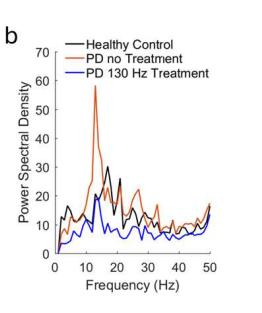

### Replication

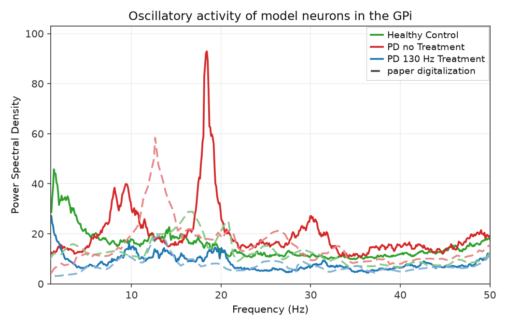

<!-- caption-1b:start -->
**Caption:** GPi PSD, 10 s sim, seeds 0–9 mean; β[13–35 Hz] healthy/PD/130 Hz = 13.3/22.2/8.1 (paper 15.3/17.7/7.9); PD peak 19 Hz (paper 13), v3, 2026-10-18

**Manifest:** `artifacts/figures/papers/mehregan/1b/manifest.json`
<!-- caption-1b:end -->

**Status:** Fail (upgraded gates, fresh run rep v3, Oct 18 2026, healthy runs now on pd=0 init draws) — beta-band ordering and the 130 Hz and healthy levels match (β healthy / PD / 130 Hz 13.3 / 22.2 / 8.1 vs paper 15.3 / 17.7 / 7.9), but our PD spectrum peaks at 18.5 Hz vs the paper's 12.6 Hz and its shape correlates poorly (r 0.19), the healthy/PD ratio sits at the 30% edge, and healthy / 130 Hz carry excess 1–12 Hz power. Seven spectral estimators (`scripts/probes/mehregan_fig1b_estimator.py`) and four candidate readings (`--dt-ms 0.02`, `--transient-s` on 30 s, seed 0 only, `--signal voltage`) all keep the PD peak at 18.4–18.8 Hz, so the gap is in our plant's PD dynamics, not the estimator or protocol — an author question.

<!-- gates-1b:start -->
**Gates set** (`fig1b_gates` → manifest `gates` / `gates_pass`). Overall **`gates_pass`**: no (from `artifacts/figures/papers/mehregan/1b/curves.json`, 2026-10-18). Every row is required for exit.

| Key | Description | Pass |
|-----|-------------|------|
| `pd_gt_healthy` | beta-band PD > healthy | yes |
| `pd_130_lt_pd` | 130 Hz cDBS < untreated PD | yes |
| `suppression_ratio_near_paper` | pd_130/pd ratio vs digitized paper | yes |
| `healthy_beta_near_paper` | healthy level within 30% of paper | yes |
| `pd_130hz_beta_near_paper` | treated level within 30% of paper | yes |
| `healthy_pd_ratio_near_paper` | healthy/PD beta ratio within 30% of digitized paper | no |
| `pd_beta_near_paper` | PD beta level within 30% of digitized paper | yes |
| `pd_peak_freq_near_paper` | PD spectral peak (1.5 Hz smoothed) within ±4 Hz of digitized paper | no |
| `low_over_beta_near_paper` | every series' [1,12]/[13,35] Hz power ratio within 35% of digitized paper | no |
| `pd_shape_r` | Pearson r PD PSD vs digitized paper on a common 1–50 Hz grid ≥ 0.6 | no |
| `pd130_shape_r` | Pearson r 130 Hz PSD vs digitized paper on a common 1–50 Hz grid ≥ 0.3 | no |
<!-- gates-1b:end -->

**Run:**

```bash
uv run python scripts/figures/papers/mehregan/1b/plot.py
uv run python scripts/figures/papers/mehregan/1b/plot.py --plot-only
```

**Defaults:** seeds `0–9` (mean PSD), 10 s segment, Python plant.

---

## Fig 2a — GPi $P_\beta$ time series

GPi beta-band power ($P_\beta$, Eq. 1, 13–35 Hz) over **12 s**: **PD no treatment** (red) vs **PD + 130 Hz cDBS** (blue). Shared baseline 0–2 s; dashed vertical at **2 s** (cDBS onset for blue). After onset, blue falls to a low plateau; red stays elevated.

### Paper (Mehregan et al.)

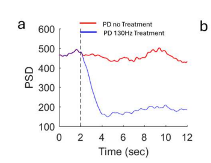

### Replication

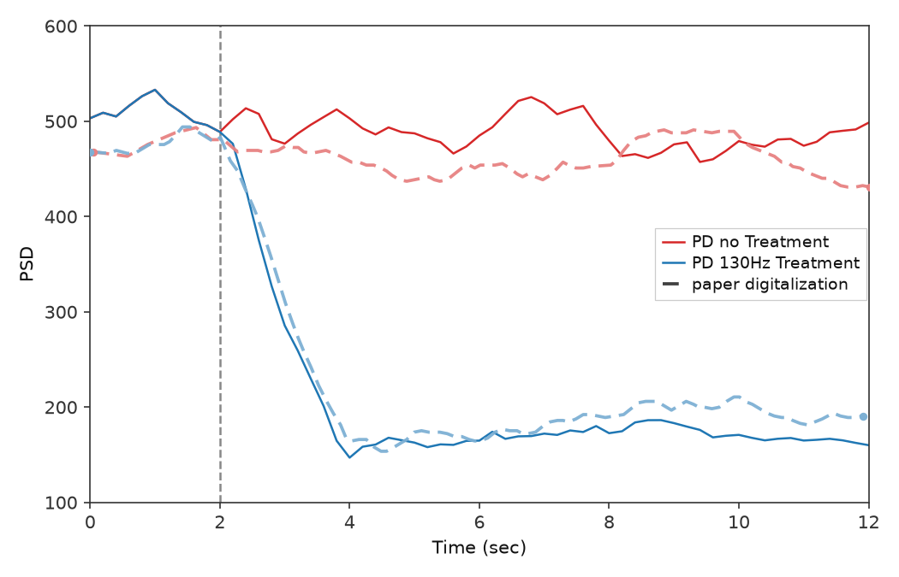

<!-- caption-2a:start -->
**Caption:** Fig 5a eval protocol (2 s pre-roll, 2 s reset, five 2 s carried steps; 0.2 s trailing / 2 s window), seed 0 (2026-10-17)

**Manifest:** `artifacts/figures/papers/mehregan/2a/manifest.json`
<!-- caption-2a:end -->

**Status:** Pass — every upgraded gate (pre-onset level 510 vs paper 478, late ratio 0.35 vs 0.42, half-drop 2.76 s vs 2.90 s, treated and gap shape r ≥ 0.7). Since Oct 17 2026 the traces come from the Fig 5a eval protocol (`--protocol eval`, default): the paper's Fig 2a curves are its Fig 5a "PD no stim" / "Periodic 130Hz" curves (r 0.987 / 0.999), so ours are now identical to our Fig 5a no-stim / 130 Hz traces. `--protocol single` keeps the earlier 14 s integrate. Single seed (0).

<!-- gates-2a:start -->
**Gates set** (`fig2_time_gates`, panel `2a`). Overall **`gates_pass`**: yes (from `artifacts/figures/papers/mehregan/2a/series.json`, 2026-10-18). Every row is required for exit.

| Key | Description | Pass |
|-----|-------------|------|
| `prestim_shared` | treated/untreated agree pre-onset (≤5% rel) | yes |
| `treated_below_untreated_late` | cDBS below no-treatment after t=2 | yes |
| `late_ratio_near_paper` | late treated/untreated ratio vs digitization | yes |
| `suppression_drop_near_paper` | drop magnitude vs digitization | yes |
| `untreated_flat` | untreated late (t ≥ 6 s) / pre within ±0.15 (absolute) of digitized paper | yes |
| `treated_late_over_pre_near_paper` | treated late / pre within 30% of digitized paper | yes |
| `prestim_level_near_paper` | untreated pre-onset level within 15% of digitized paper | yes |
| `treated_mid_ratio_near_paper` | treated/untreated mean on [4,7] s within 30% of digitized paper | yes |
| `t50_near_paper` | treated trace reaches half its pre→late drop within ±1 s of digitized paper | yes |
| `treated_shape_r` | Pearson r treated trace vs digitized paper on a common [0,12] s grid ≥ 0.7 | yes |
| `gap_shape_r` | Pearson r of the untreated − treated gap vs digitized paper on [0,12] s ≥ 0.7 | yes |
<!-- gates-2a:end -->

**Run:**

```bash
uv run python scripts/figures/papers/mehregan/2a/plot.py
uv run python scripts/figures/papers/mehregan/2a/plot.py --plot-only
uv run python scripts/figures/papers/mehregan/2a/plot.py --protocol single   # earlier 14 s integrate
```

**Defaults:** seed `0`, `--protocol eval` (Fig 5a eval protocol: 2 s no-stim pre-roll, 2 s reset, five 2 s carried steps), 0.2 s trailing samples, 2 s window. Writes versioned `beta_power_vN.png`; promote copies it to the ship name `beta_power.png`.

---

## Fig 2b — Error Index time series

Windowed Error Index (EI, Eq. 2) over **12 s** with **So-style SMC pulses into TH** (path A): BoC inverse-gamma on **Iappth**, `iappth_baseline=0`, `ggith=0.112`. **PD no treatment** (red) vs **PD + 130 Hz cDBS** (blue). Same timing as Fig 2a. Y-axis **Error Index** (replication default **0.10–0.4**; paper panel reads ~0–0.4).

### Paper (Mehregan et al.)

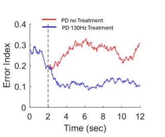

### Replication

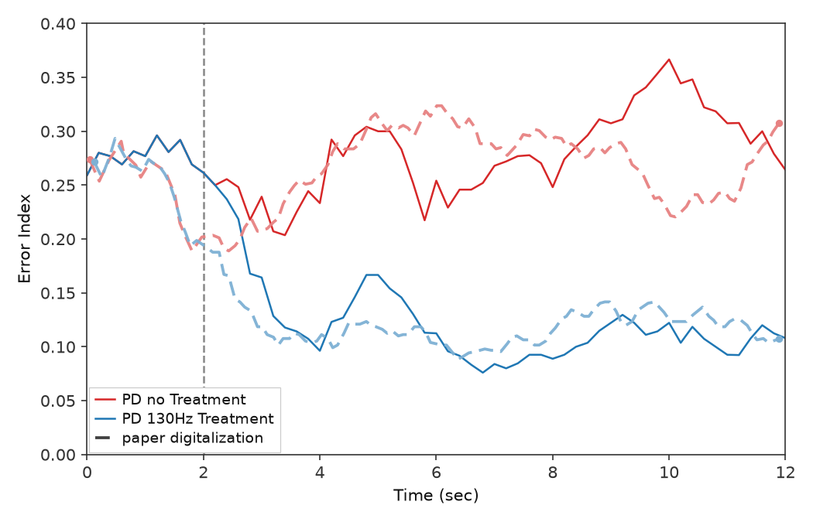

<!-- caption-2b:start -->
**Caption:** 14 s sim (2 s pre-roll), plot = sim − 2 s, 0.2 s trailing / 2 s EI window (end sim 14 s), SMC BoC inv-gamma Iappth, backend python, seed 0, v18 (2026-10-17)

**Manifest:** `artifacts/figures/papers/mehregan/2b/manifest.json`
<!-- caption-2b:end -->

**Status:** Pass — every upgraded gate on a fresh run of the current plant (rep v18, Oct 17 2026). The earlier failure (pre-onset EI 0.33 vs paper 0.25) came from a cached July series replotted under the new gates; plant changes since then moved the EI trace. Eight candidate readings (thalamic baseline kept, T_ω 1 s / 4 s, periodic or 10 / 20 Hz SMC timing, 15 / 40 ms misfire windows) did not beat the shipped convention. Single seed (0).

<!-- gates-2b:start -->
**Gates set** (`fig2_time_gates`, panel `2b`). Overall **`gates_pass`**: yes (from `artifacts/figures/papers/mehregan/2b/series.json`, 2026-10-18). Every row is required for exit.

| Key | Description | Pass |
|-----|-------------|------|
| `prestim_shared` | treated/untreated agree pre-onset (≤5% rel) | yes |
| `treated_below_untreated_late` | cDBS below no-treatment after t=2 | yes |
| `late_ratio_near_paper` | late treated/untreated ratio vs digitization | yes |
| `suppression_drop_near_paper` | drop magnitude vs digitization | yes |
| `untreated_flat` | untreated late (t ≥ 6 s) / pre within ±0.15 (absolute) of digitized paper | yes |
| `treated_late_over_pre_near_paper` | treated late / pre within 30% of digitized paper | yes |
| `prestim_level_near_paper` | untreated pre-onset level within 15% of digitized paper | yes |
| `treated_mid_ratio_near_paper` | treated/untreated mean on [4,7] s within 30% of digitized paper | yes |
| `t50_near_paper` | treated trace reaches half its pre→late drop within ±1 s of digitized paper | yes |
| `treated_shape_r` | Pearson r treated trace vs digitized paper on a common [0,12] s grid ≥ 0.7 | yes |
| `gap_shape_r` | Pearson r of the untreated − treated gap vs digitized paper on [0,12] s ≥ 0.7 | yes |
<!-- gates-2b:end -->

**Run:**

```bash
uv run --group figures python scripts/figures/papers/mehregan/2b/plot.py
uv run --group figures python scripts/figures/papers/mehregan/2b/plot.py --plot-only
```

Each run writes a new ``figures/mehregan/images/2b/error_index_vN.png`` (N auto-increments) and updates the replication image link above.

**Defaults:** seed `0`, `smc_site='thalamic'`, `iappth_baseline=0`, `ggith=0.112`, `smc_amplitude=3.5`, `smc_schedule='boc'`, `smc_pulse_source='drive'`, backend **python**.

### Convention (path A, 2026-07-12)

**Citations (split roles):** Gao et al. (ICCPS 2020) define the **EI metric** Mehregan uses (exactly one TH spike in $(\mathrm{SMC}_\tau,\mathrm{SMC}_\tau{+}25\,\mathrm{ms})$; windowed $T_\omega{=}2\,\mathrm{s}$). So et al. (2012) define the **TH drive** for that metric (SMC current pulses into TH; TH not spontaneously active). Kumaravelu replaced those pulses with constant $I_{\mathrm{appth}}=1.2$; Fig 2b restores So-style drive: **pulses only** (`iappth_baseline=0`) plus BoC inverse-gamma timing (~14 Hz mean). Cortical `Iappco` SMC remains available but does **not** produce paper ordering (no Cor→TH synapse). Sweep: `artifacts/probes/fig2b_ei_so_path_a_sweep.json`.

---

## Fig 4a — training beta power vs step

Per-step GPi beta-band power during DDPG training of the **45 Hz** model (§IV.A.1): **300** environment steps (10 episodes × 30 steps of 2 s). Y-axis **PSD(x10³)** = raw $P_\beta / 1000$. This run is the paper's one 45 Hz model: the same checkpoint feeds Fig 4b, Fig 5a and Fig 6a.

### Paper (Mehregan et al.)

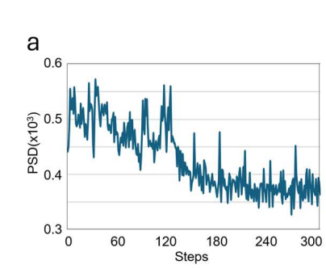

### Replication

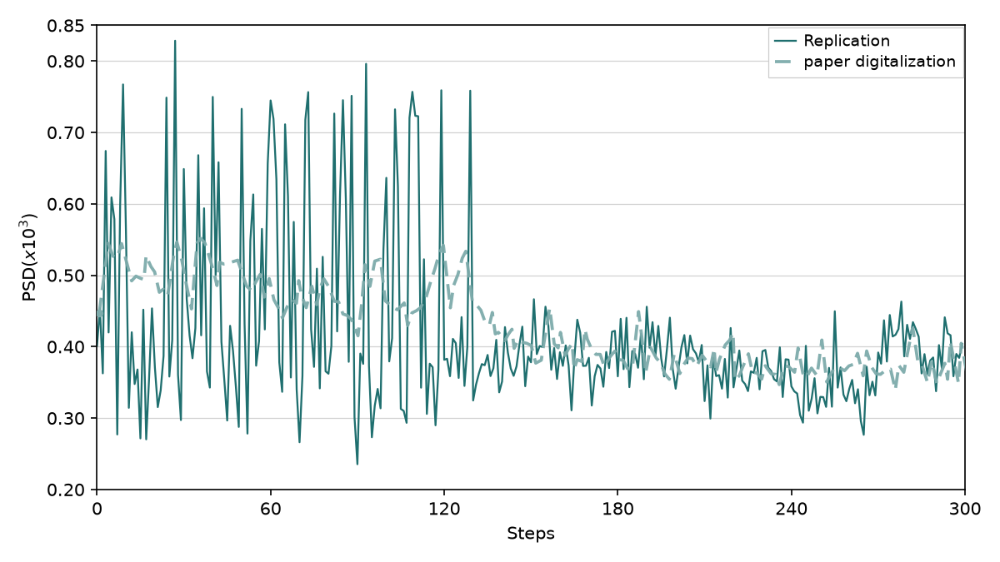

<!-- caption-4a:start -->
**Caption:** 45 Hz, paper Alg. 1 (critic on logits, lr 5e-4/1e-3), burst alphabet, logit noise σ=1, seed 0, v46, ep0=0.446, early=0.470 late=0.377 (2026-10-18)

**Manifest:** `artifacts/figures/papers/mehregan/4a/manifest.json`
<!-- caption-4a:end -->

**Status:** Fail — `early_swing_near_paper` (rep v46, same v44 training run replotted; v45 was a failed replot). Every mean-based gate still passes, but the per-step trace swings far wider than the paper's within each early episode: residual spread over episodes 0–3 is 4.99× the digitized paper's (gate band 0.5–2×), because the 21-pattern menu's patterns span 0.6×–1.58× no stim and σ = 1 exploration jumps between them; every menu run on file sits at 3.2–5.2×. Recipe: Fig 3c reward, one plant network per episode, exact-rate 21-pattern menu, regular-pulse init bias 1.0, `update_every=2` (agreed with the maintainer). Episode means 0.446 0.473 0.512 0.464 0.391 0.388 0.394 0.363 0.337 0.402 vs paper 0.507 0.506 0.464 0.477 0.445 0.397 0.382 0.375 0.372 0.374. Figure 3a's per-pulse head passes the swing gate (0.76–0.91×) but does not learn (Oct 18 candidates). **Labelled candidate D3 (Oct 19, deviates from paper — our best guess of what the authors may have done; not the default):** the per-pulse head with the critic scoring a 4-bin pulse-offset histogram and Gumbel-max exploration learns and passes every Fig 4a gate at 3 of 10 seeds (0, 4, 9; seeds 0 and 4 also every Fig 4b gate), 3 more miss one 4a gate, 4 do not learn within 10 episodes; swing 0.92–1.20× at every seed. Caveat: the 4-bin width was chosen from our plant calibration because it predicts the paper's late level (figure-informed). Closed-loop trained/no stim 0.70–0.79 (paper 0.81). `candidates/pp-D3-s*`. Details: [4a.md](../../docs/figures/mehregan/4a.md) § Early-swing gate, § Deviation candidates that learn (Oct 19 2026), § Per-pulse candidates (Oct 18 2026).

**Candidate D3 (labelled deviation, seed 0 and seed 9 — both pass every Fig 4a gate):**

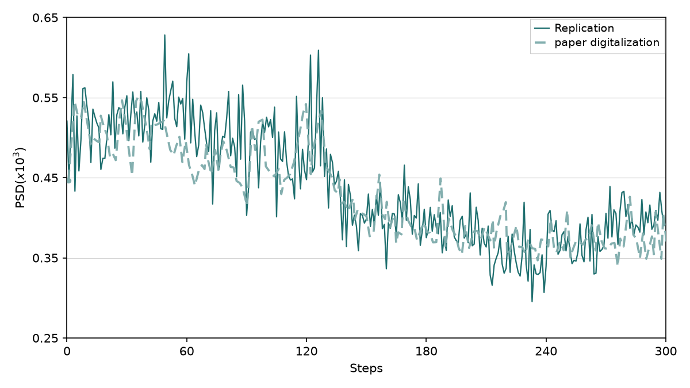

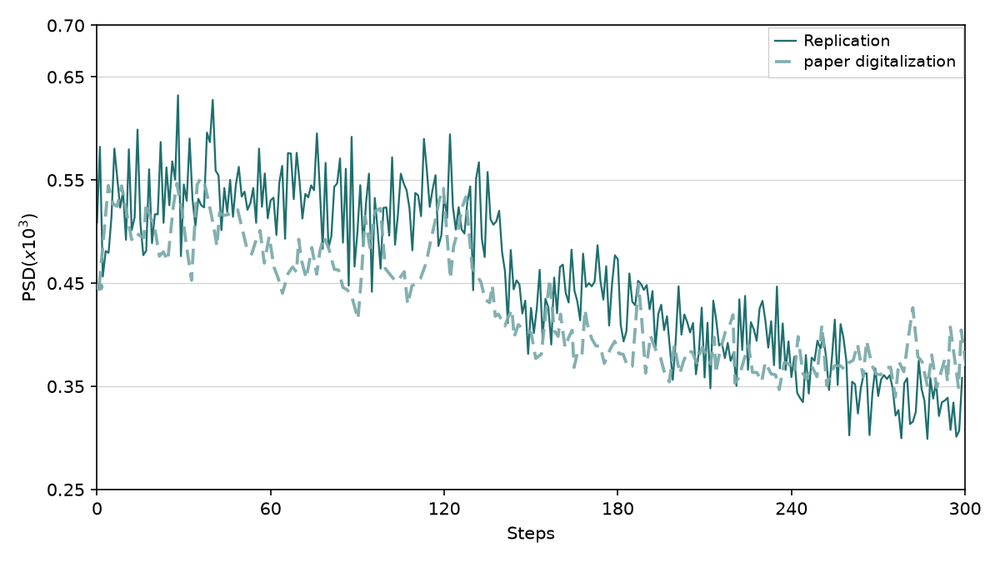

<!-- gates-4a:start -->
**Gates set** (`fig4a_gates` → live `series.json`). Overall **`gates_pass`**: no (from `artifacts/figures/papers/mehregan/4a/series.json`, 2026-10-18). Every row is required for exit.

| Key | Description | Pass |
|-----|-------------|------|
| `plot_style` | 300 training steps | yes |
| `overall_trend_down` | end window mean < start window mean | yes |
| `drop_vs_paper` | drop ≥ 70% of digitized paper drop | yes |
| `late_early_ratio_near_paper` | late/early ratio vs digitization | yes |
| `mid_fade_vs_paper` | mid [120,150] fade (vs [0,100]) within 0.5–2× the digitized paper mid fade | yes |
| `ep0_near_paper` | steps 0–29 mean within 15% of digitized paper ep0 (seed spread) | yes |
| `episode_shape_r` | Pearson r of the 10 episode (30-step) means vs digitized paper ≥ 0.7 | yes |
| `late_level_near_paper` | episodes 5–9 mean within 15% of digitized paper | yes |
| `episode_drop_near_paper` | drop eps 0–3 → eps 6–9 within 0.6–1.6× digitized paper | yes |
| `no_late_rebound` | eps 7–9 mean ≤ eps 5–6 mean + 0.02 | yes |
| `half_drop_episode_near_paper` | first episode at half the eps 0–3 → 6–9 drop within ±1 of digitized paper | yes |
| `per_episode_near_paper` | every episode mean within 20% of digitized paper | yes |
| `early_swing_near_paper` | Within-episode step-to-step spread over eps 0–3 (residual std, at the paper's digitized x) within 0.5–2× the digitized paper's | no |
<!-- gates-4a:end -->

**Run:**

```bash
uv run python -m rl_adaptive_dbs.run scripts/figures/papers/mehregan/4a/plot.py --export-notes --update-report
uv run python -m rl_adaptive_dbs.run scripts/figures/papers/mehregan/4a/plot.py --plot-only --export-notes --update-report
```

**Defaults:** seed `0`, 45 Hz `BurstPatternAlphabet`, 21 exact-rate patterns, logit-noise exploration σ = 1.0, regular-pulse init bias 1.0, one Alg. 1 update every 2nd step (`update_every=2`; `1` = the literal loop), Fig 3c reward (`reward_below=square`; `linear` = printed branch), one plant network per episode with state carried across its 2 s steps, `plant.dt_ms=0.02`. Paper-silent knobs: `--set FIELD=VALUE` (`alphabet` incl. `burst_legacy`, `jitter_fraction`, `logit_noise_std`, `init_bias_scale`, `gamma`, `tau`, `reward_below`, `update_every`, candidates `carry_plant`, `logit_noise_end`, `alphabet=burst_nobeta|burst_rand20|burst_nobeta_rand20`). Writes `series.json` + `checkpoint.pt` (fp32 actor for Fig 5a / 6a).

---

## Fig 4b — training reward vs episode

Episode **total reward** and **episode-mean PSD(x10³)** of the same **45 Hz** training run as Fig 4a (§IV.A.1), episodes **0–8**: reward rises from about **−80** toward **0**, episode-mean PSD falls ~0.50 → ~0.37. Plotted as two panels.

### Paper (Mehregan et al.)

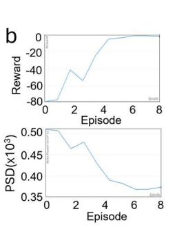

### Replication

**Reward vs episode**

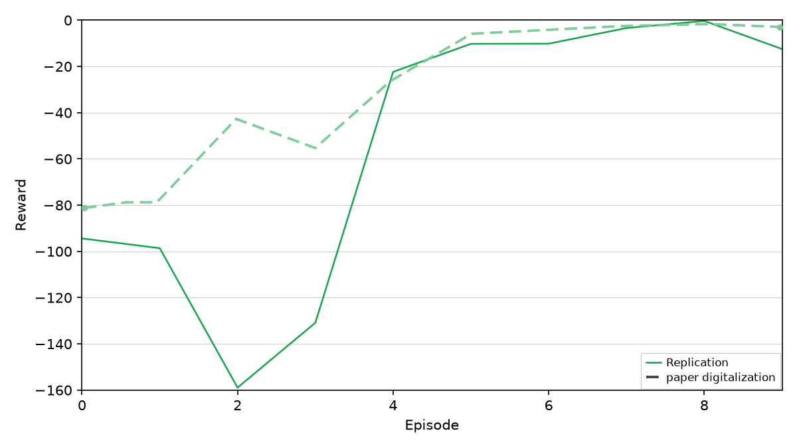

**Episode-mean PSD vs episode**

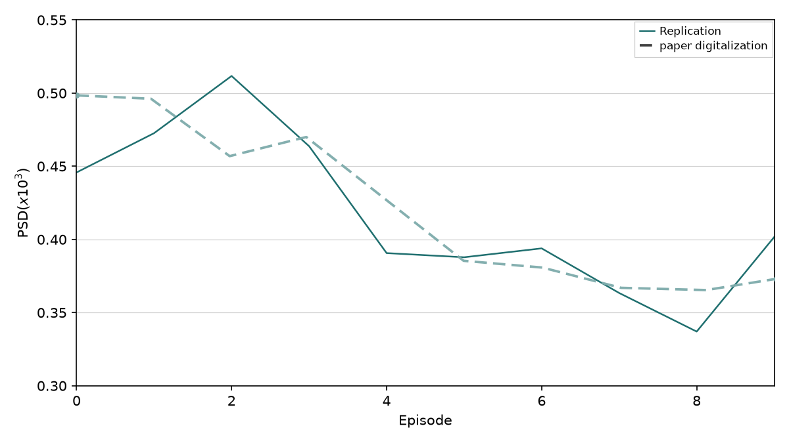

<!-- caption-4b:start -->
**Caption:** 10 episodes, 45 Hz fixed_mean_pattern (Fig 4a paired run), seed 0, source series.json, v51, reward ep0=-94.4 ep9=-12.5, rise_ep=4, psd 0.446→0.402, gate pass (2026-10-17)

**Manifest:** `artifacts/figures/papers/mehregan/4b/manifest.json`
<!-- caption-4b:end -->

**Status:** Fail (rep v51) — `early_reward_near_paper`, `reward_floor_not_deeper`; every other gate passes (reward rise, late plateau, late PSD, PSD shape, per-episode PSD). Rewards −94 −99 −159 −131 −22 −10 −10 −3 −0 −12 vs paper ≈ −81 −79 −43 −55 −16 … −2.4: episodes 2–3 explore beta-raising menu patterns (bursts of 2–3 pulses repeat at 22.5 / 15 Hz, inside the beta band; `artifacts/probes/mehregan_landscape_45_burst21.json`), so the quadratic penalty runs deeper than the paper's.

<!-- gates-4b:start -->
**Gates set** (`fig4b_gates` → Fig 4a `series.json` (10 episodes)). Overall **`gates_pass`**: no (from `artifacts/figures/papers/mehregan/4a/series.json`, 2026-10-18). Every row is required for exit.

| Key | Description | Pass |
|-----|-------------|------|
| `plot_style` | 10 episodes plotted (paper: 10 vertices on its 0–8 axis, x = 8i/9) | yes |
| `early_negative` | mean reward ep 0–2 < 0 | yes |
| `reward_rises` | late (eps 6–9) mean reward > early mean | yes |
| `late_plateau_improved` | late mean reward > −10 | yes |
| `rise_timing` | reward exceeds ep0 + 10 by ep ≤ 6 | yes |
| `beta_drops` | late episode-mean PSD < early | yes |
| `beta_drop_ratio_near_paper` | PSD late/early ratio vs digitization | yes |
| `reward_recovers_like_paper` | qualitative rise in ours and paper | yes |
| `late_beta_near_paper` | late PSD within 15% of digitized paper | yes |
| `late_reward_near_zero` | late mean reward in (−10, 2] (paper ~−3) | yes |
| `ep0_beta_near_paper` | episode 0 PSD within 15% of digitized paper (seed spread) | yes |
| `reward_shape_r` | Pearson r per-episode reward vs digitized paper ≥ 0.7 | yes |
| `psd_shape_r` | Pearson r per-episode PSD vs digitized paper ≥ 0.7 | yes |
| `early_reward_near_paper` | eps 0–2 mean reward within 50% of digitized paper | no |
| `reward_floor_not_deeper` | min episode reward ≥ 1.5× digitized paper min | no |
| `max_reward_le_cap` | max episode reward ≤ +5 (paper never above ≈ −2) | yes |
| `psd_floor_not_deeper` | min episode PSD ≥ 0.9× digitized paper min | yes |
| `per_episode_psd_near_paper` | every episode PSD within 20% of digitized paper | yes |
<!-- gates-4b:end -->

**Run:**

```bash
uv run python -m rl_adaptive_dbs.run scripts/figures/papers/mehregan/4b/plot.py --export-notes --update-report
```

**Defaults:** 10 episodes from Fig 4a `artifacts/figures/papers/mehregan/4a/series.json` (replot only; trains via Fig 4a).

---

## Fig 5a — post-train efficacy @ 45 Hz

Post-training evaluation of the **45 Hz** model (§IV.A.2) on a fixed seed: 2 s reset, then five 2 s steps of the trained policy, **closed loop** (each step plays $\arg\max$ of the actor on the previous step's $P_\beta$). Same seed for **PD no stim**, **fully trained 45 Hz**, **periodic 45 Hz** and **periodic 130 Hz**. Trace = trailing 2 s $P_\beta$ every 0.2 s (Fig 2a protocol). Paper: trained reduces beta vs no stim; periodic 45 Hz and 130 Hz are lower still.

### Paper (Mehregan et al.)

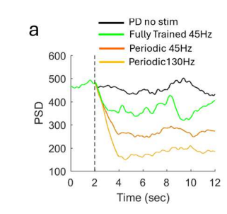

### Replication

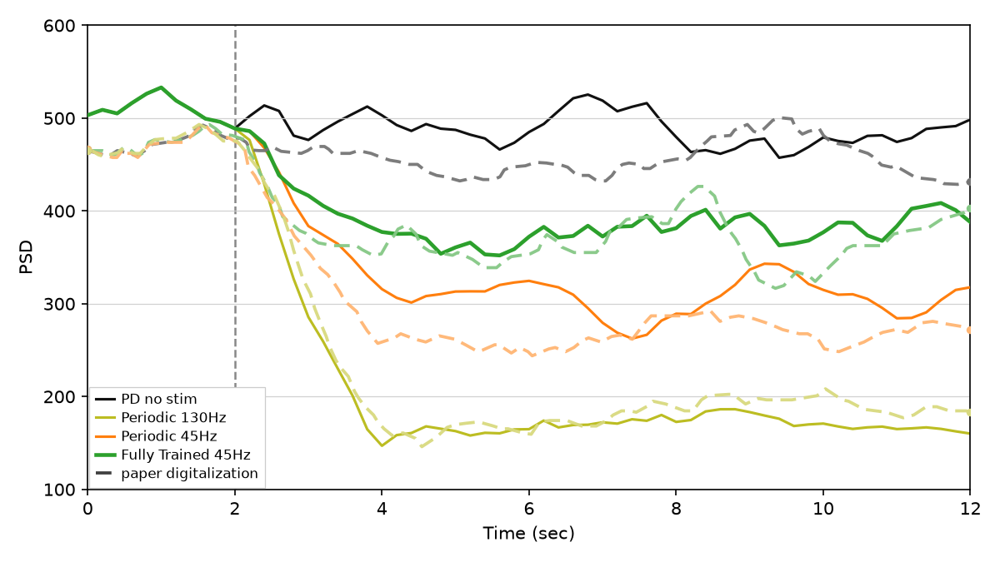

<!-- caption-5a:start -->
**Caption:** 45 Hz paper-protocol eval, seed 0, checkpoint=checkpoint.pt, 0.2s trailing, v26, trained_mean=379, no_stim_mean=486, periodic_mean=307, trained>periodic, gates pass (2026-10-17)

**Manifest:** `artifacts/figures/papers/mehregan/5a/manifest.json`
<!-- caption-5a:end -->

**Status:** Pass — every upgraded gate (rep v26). Evaluates the Fig 4a checkpoint (the paper's one 45 Hz model); the policy plays burst pattern 19: trained 379, periodic 45 Hz 307, no stim 486, 130 Hz 169 (late means, t ≥ 4 s); trained/no-stim 0.78 vs paper 0.81.

<!-- gates-5a:start -->
**Gates set** (`efficacy_gates` / `fig5_efficacy_gates` → `eval.json`). Overall **`pass`**: yes (from `artifacts/figures/papers/mehregan/5a/eval.json`, 2026-10-18). Every row is required for exit.

| Key | Description | Pass |
|-----|-------------|------|
| `shared_baseline` | pre-onset spread across all series (incl. trained) ≤ 3% of the level | yes |
| `trained_closed_loop` | trained series runs the actor closed loop (no replayed actions) | yes |
| `trained_below_no_stim` | trained mean (t ≥ 4 s) < no stim | yes |
| `trained_above_periodic` | trained > periodic 45 Hz | yes |
| `cdbs_lowest` | 130 Hz cDBS lowest of four series | yes |
| `trained_no_stim_ratio_near_paper` | trained/no-stim late ratio (t ≥ 4 s) within 15% of digitized paper | yes |
| `periodic_no_stim_ratio_near_paper` | periodic/no-stim late ratio (t ≥ 4 s) vs digitized paper | yes |
| `prestim_level_near_paper` | mean pre-onset level within 10% of digitized paper | yes |
| `trained_onset_ratio_near_paper` | trained/no-stim on [2,4] s within 30% of digitized paper (onset speed) | yes |
| `trained_shape_r` | Pearson r trained trace vs digitized paper on a common [0,12] s grid ≥ 0.6 | yes |
| `periodic_shape_r` | Pearson r periodic trace vs digitized paper on a common [0,12] s grid ≥ 0.6 | yes |
| `trained_periodic_gap_near_paper` | (trained − periodic)/no-stim late within 0.4–2× digitized paper | yes |
| `cdbs_no_stim_ratio_near_paper` | 130 Hz/no-stim late ratio within 30% of digitized paper | yes |
<!-- gates-5a:end -->

**Run:**

```bash
uv run python -m rl_adaptive_dbs.run scripts/figures/papers/mehregan/5a/plot.py --export-notes --update-report
uv run python -m rl_adaptive_dbs.run scripts/figures/papers/mehregan/5a/plot.py --plot-only --export-notes --update-report
```

**Defaults:** eval seed `0`, checkpoint `artifacts/figures/papers/mehregan/4a/checkpoint.pt`, `BurstPatternAlphabet`. Shared code: `scripts/figures/papers/mehregan/efficacy_panel.py`.

---

## Fig 5b — post-train efficacy @ 30 Hz

Same closed-loop eval for the **30 Hz** model (§IV.A.2), trained with the Fig 4a recipe ("all other parameters fixed"). Series: **PD no stim**, **fully trained 30 Hz**, **periodic 30 Hz**. Paper: periodic 30 Hz *raises* beta (inside the beta band); the trained irregular pattern lowers it below both.

### Paper (Mehregan et al.)

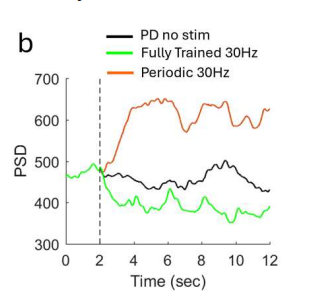

### Replication

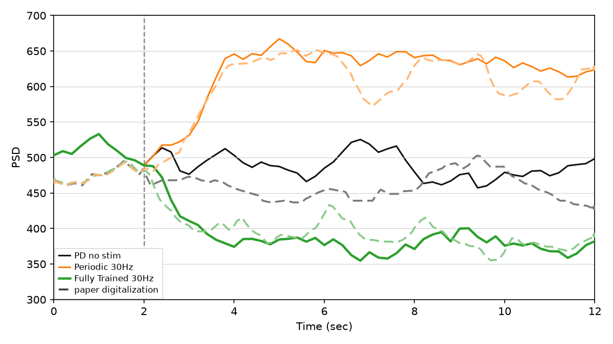

<!-- caption-5b:start -->
**Caption:** 30 Hz paper-protocol eval, seed 0, checkpoint=checkpoint.pt, 0.2s trailing, v27, trained_mean=378, no_stim_mean=486, periodic_mean=638, trained<both, gates pass (2026-10-17)

**Manifest:** `artifacts/figures/papers/mehregan/5b/manifest.json`
<!-- caption-5b:end -->

**Status:** Pass — every upgraded gate (rep v27). Trained 378 < no stim 486 < periodic 30 Hz 638; the 30 Hz model plays burst pattern 14 (clusters with silence — instantaneous rate outside the beta band, as the paper argues).

<!-- gates-5b:start -->
**Gates set** (`efficacy_gates` / `fig5_efficacy_gates` → `eval.json`). Overall **`pass`**: yes (from `artifacts/figures/papers/mehregan/5b/eval.json`, 2026-10-18). Every row is required for exit.

| Key | Description | Pass |
|-----|-------------|------|
| `shared_baseline` | pre-onset spread across all series (incl. trained) ≤ 3% of the level | yes |
| `trained_closed_loop` | trained series runs the actor closed loop (no replayed actions) | yes |
| `trained_below_no_stim` | trained mean (t ≥ 4 s) < no stim | yes |
| `trained_below_periodic` | trained < periodic 30 Hz | yes |
| `periodic_above_no_stim` | periodic 30 Hz elevates beta vs no stim | yes |
| `trained_no_stim_ratio_near_paper` | trained/no-stim late ratio (t ≥ 4 s) within 15% of digitized paper | yes |
| `periodic_no_stim_ratio_near_paper` | periodic/no-stim late ratio (t ≥ 4 s) vs digitized paper | yes |
| `prestim_level_near_paper` | mean pre-onset level within 10% of digitized paper | yes |
| `trained_onset_ratio_near_paper` | trained/no-stim on [2,4] s within 30% of digitized paper (onset speed) | yes |
| `trained_shape_r` | Pearson r trained trace vs digitized paper on a common [0,12] s grid ≥ 0.6 | yes |
| `periodic_shape_r` | Pearson r periodic trace vs digitized paper on a common [0,12] s grid ≥ 0.6 | yes |
| `trained_periodic_gap_near_paper` | trained-below-periodic gap (/no-stim, late) within 0.4–2× digitized paper | yes |
<!-- gates-5b:end -->

**Run:**

```bash
uv run python -m rl_adaptive_dbs.run scripts/figures/papers/mehregan/5b/plot.py --train --export-notes --update-report
uv run python -m rl_adaptive_dbs.run scripts/figures/papers/mehregan/5b/plot.py --plot-only --export-notes --update-report
```

**Defaults:** train + eval seed `0`, 30 Hz `BurstPatternAlphabet` (21 patterns, 60 pulses each; on the pre-Oct 2026 menu the ±1/3 jitter family had 0/40 irregular 30 Hz patterns below no stim), same paper-silent knobs as Fig 4a. Writes `artifacts/figures/papers/mehregan/5b/checkpoint.pt` (fp32 actor for Fig 6b).

---

## Fig 6a — PTQ / QAT @ 45 Hz

Quantization on the **45 Hz** model (§IV.A.3), same closed-loop eval and seed. **Fully trained** = Fig 4a fp32 checkpoint; **PTQ fp16** = fp16 cast; **PTQ int8** = PyTorch `quantize_dynamic`; **QAT** = separate 10-episode quantization-aware run with the same recipe (fake-quant stub on the input, dequant stub on the logits). Paper: PTQ tracks fp32 suppression; 10-episode QAT does not reduce beta (stays at or above the pre-stim level).

### Paper (Mehregan et al.)

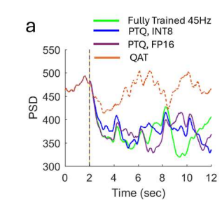

### Replication

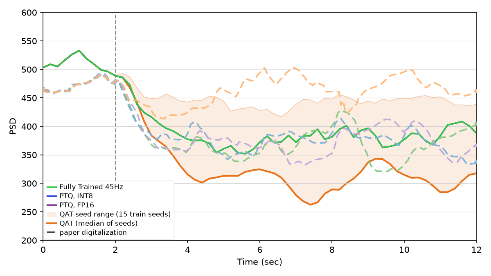

<!-- caption-6a:start -->
**Caption:** 45 Hz paper-protocol eval, eval seed 0, fp32_post=379, QAT median post=307, QAT paper-like 1/15 train seeds, QAT median late/pre 0.60, PTQ tracks fp32, v71, 2026-10-17

**Manifest:** `artifacts/figures/papers/mehregan/6a/manifest.json`
<!-- caption-6a:end -->

**Status:** Fail (rep v71, 15 QAT training seeds) — fp32 / PTQ fp16 / PTQ int8 all 379 (every fp32 level/onset/shape gate passes). PTQ is byte-identical to fp32 (the menu argmax never flips), so `ptq_*_alters_trace` fail: the paper's PTQ traces differ from fp32 by 22 / 28 PSD units with the same mean. QAT: 1/15 seeds paper-like; 14/15 deploy the regular 45 Hz train (late/pre 0.60 vs paper 0.995) — 10-episode int8 QAT saturates its fake-quant head and never learns, so the tie keeps the regular-pulse init, which suppresses at 45 Hz. Root cause: the menu action space; the per-pulse head of Figure 3a cannot learn Fig 4a under Alg. 1 (open question). [4a.md](../../docs/figures/mehregan/4a.md) § Fig 3a per-pulse head — bounded probe.

<!-- gates-6a:start -->
**Gates set** (`fig6_quant_gates` → `eval.json`). Overall **`all_pass`**: no (from `artifacts/figures/papers/mehregan/6a/eval.json`, 2026-10-18). Every row is required for exit.

| Key | Description | Pass |
|-----|-------------|------|
| `all_closed_loop` | fp32, PTQ and every QAT seed each run their own actor closed loop | yes |
| `prestim_shared` | all series and QAT seeds share the pre-onset level (spread ≤ 1%) | yes |
| `fp32_suppresses_vs_baseline` | fp32 late mean (t ≥ 4 s) < its pre-onset mean | yes |
| `ptq_fp16_near_fp32` | PTQ fp16 late mean within 15% of fp32 | yes |
| `ptq_int8_near_fp32` | PTQ int8 late mean within 20% of fp32 | yes |
| `qat_elevated_vs_fp32` | median-seed QAT late mean > fp32 | no |
| `fp32_level_near_paper` | fp32 late/pre within 20% of digitized paper | yes |
| `ptq_fp16_level_near_paper` | PTQ fp16 late/pre within 20% of digitized paper | yes |
| `ptq_int8_level_near_paper` | PTQ int8 late/pre within 20% of digitized paper | yes |
| `qat_majority_not_below_paper` | QAT late/pre ≥ 80% of digitized paper in a strict majority of QAT training seeds | no |
| `qat_median_near_paper` | median-seed QAT late/pre within 20% of digitized paper (figure: same range) | no |
| `qat_late_sustained` | median QAT trace [10,12] s mean ≥ 90% of its [2,8] s mean (no late fade) | no |
| `fp32_onset_near_paper` | fp32 [2,4] s mean / pre-onset within 20% of digitized paper (onset speed) | yes |
| `fp32_shape_r` | Pearson r fp32 trace vs digitized paper on a common [0,12] s grid ≥ 0.6 | yes |
| `prestim_level_near_paper` | fp32 pre-onset level within 10% of digitized paper | yes |
| `qat_fp32_gap_vs_paper` | (median-seed QAT − fp32) late / pre ≥ 0.5× the digitized paper gap | no |
| `ptq_int8_alters_trace` | mean |PTQ int8 − fp32| over t ≥ 2 s ≥ 0.5× digitized paper (quantization alters outputs) | no |
| `ptq_fp16_alters_trace` | mean |PTQ fp16 − fp32| over t ≥ 2 s ≥ 0.5× digitized paper (quantization alters outputs) | no |
<!-- gates-6a:end -->

**Run:**

```bash
uv run python -m rl_adaptive_dbs.run scripts/figures/papers/mehregan/6a/plot.py --train-qat --export-notes --update-report   # 15 QAT seeds, 3 at a time
uv run python -m rl_adaptive_dbs.run scripts/figures/papers/mehregan/6a/plot.py --export-notes --update-report      # re-eval existing QAT seed checkpoints
uv run python -m rl_adaptive_dbs.run scripts/figures/papers/mehregan/6a/plot.py --plot-only --export-notes --update-report
```

**Defaults:** fp32 `artifacts/figures/papers/mehregan/4a/checkpoint.pt`, QAT `artifacts/figures/papers/mehregan/6a/qat/qat_checkpoint_seed{0..14}.pt` (train seeds `0-14`, `--qat-seeds`), eval seed `0`. Shared code: `scripts/figures/papers/mehregan/quant_panel.py`.

---

## Fig 6b — PTQ / QAT @ 30 Hz

Same quantization panel for the **30 Hz** model (§IV.A.3): Fig 5b fp32 checkpoint, PTQ fp16 / int8, and a 10-episode QAT run with the same recipe.

### Paper (Mehregan et al.)

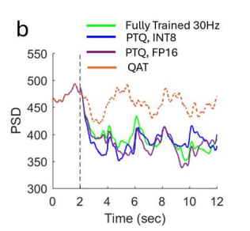

### Replication

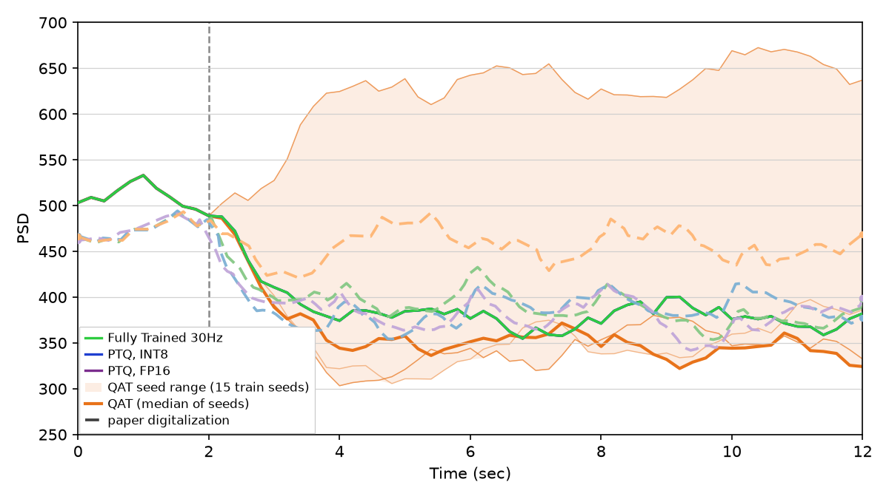

<!-- caption-6b:start -->
**Caption:** 30 Hz paper-protocol eval, eval seed 0, fp32_post=378, QAT median post=347, QAT paper-like 2/15 train seeds, QAT median late/pre 0.68, PTQ tracks fp32, v49, 2026-10-17

**Manifest:** `artifacts/figures/papers/mehregan/6b/manifest.json`
<!-- caption-6b:end -->

**Status:** Fail (rep v49, 15 QAT training seeds) — fp32 / PTQ fp16 / PTQ int8 all 378; PTQ byte-identical to fp32 (`ptq_*_alters_trace` fail). QAT: 2/15 seeds paper-like (the ones that keep the regular 30 Hz train, which raises beta as the paper's QAT does); median late/pre 0.68 vs paper 0.974. Same action-space root cause as Fig 6a.

<!-- gates-6b:start -->
**Gates set** (`fig6_quant_gates` → `eval.json`). Overall **`all_pass`**: no (from `artifacts/figures/papers/mehregan/6b/eval.json`, 2026-10-18). Every row is required for exit.

| Key | Description | Pass |
|-----|-------------|------|
| `all_closed_loop` | fp32, PTQ and every QAT seed each run their own actor closed loop | yes |
| `prestim_shared` | all series and QAT seeds share the pre-onset level (spread ≤ 1%) | yes |
| `fp32_suppresses_vs_baseline` | fp32 late mean (t ≥ 4 s) < its pre-onset mean | yes |
| `ptq_fp16_near_fp32` | PTQ fp16 late mean within 15% of fp32 | yes |
| `ptq_int8_near_fp32` | PTQ int8 late mean within 20% of fp32 | yes |
| `qat_elevated_vs_fp32` | median-seed QAT late mean > fp32 | no |
| `fp32_level_near_paper` | fp32 late/pre within 20% of digitized paper | yes |
| `ptq_fp16_level_near_paper` | PTQ fp16 late/pre within 20% of digitized paper | yes |
| `ptq_int8_level_near_paper` | PTQ int8 late/pre within 20% of digitized paper | yes |
| `qat_majority_not_below_paper` | QAT late/pre ≥ 80% of digitized paper in a strict majority of QAT training seeds | no |
| `qat_median_near_paper` | median-seed QAT late/pre within 20% of digitized paper (figure: same range) | no |
| `qat_late_sustained` | median QAT trace [10,12] s mean ≥ 90% of its [2,8] s mean (no late fade) | yes |
| `fp32_onset_near_paper` | fp32 [2,4] s mean / pre-onset within 20% of digitized paper (onset speed) | yes |
| `fp32_shape_r` | Pearson r fp32 trace vs digitized paper on a common [0,12] s grid ≥ 0.6 | yes |
| `prestim_level_near_paper` | fp32 pre-onset level within 10% of digitized paper | yes |
| `qat_fp32_gap_vs_paper` | (median-seed QAT − fp32) late / pre ≥ 0.5× the digitized paper gap | no |
| `ptq_int8_alters_trace` | mean |PTQ int8 − fp32| over t ≥ 2 s ≥ 0.5× digitized paper (quantization alters outputs) | no |
| `ptq_fp16_alters_trace` | mean |PTQ fp16 − fp32| over t ≥ 2 s ≥ 0.5× digitized paper (quantization alters outputs) | no |
<!-- gates-6b:end -->

**Run:**

```bash
uv run python -m rl_adaptive_dbs.run scripts/figures/papers/mehregan/6b/plot.py --train-qat --export-notes --update-report   # 15 QAT seeds, 3 at a time
uv run python -m rl_adaptive_dbs.run scripts/figures/papers/mehregan/6b/plot.py --plot-only --export-notes --update-report
```

**Defaults:** fp32 `artifacts/figures/papers/mehregan/5b/checkpoint.pt`, QAT `artifacts/figures/papers/mehregan/6b/qat/qat_checkpoint_seed{0..14}.pt` (train seeds `0-14`, `--qat-seeds`), eval seed `0`.
