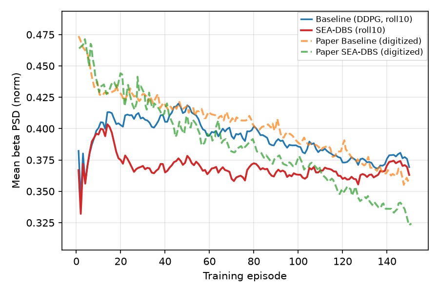
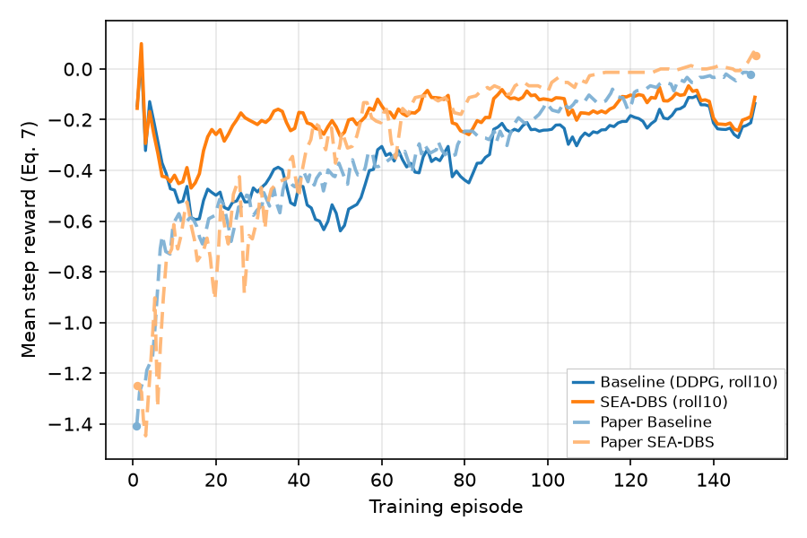
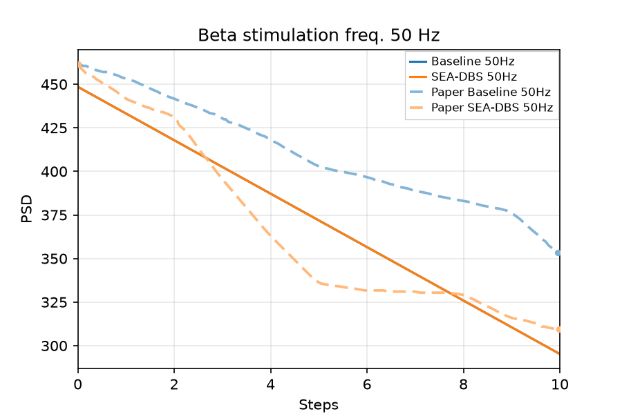
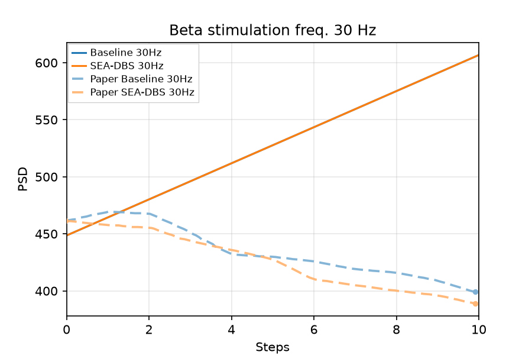
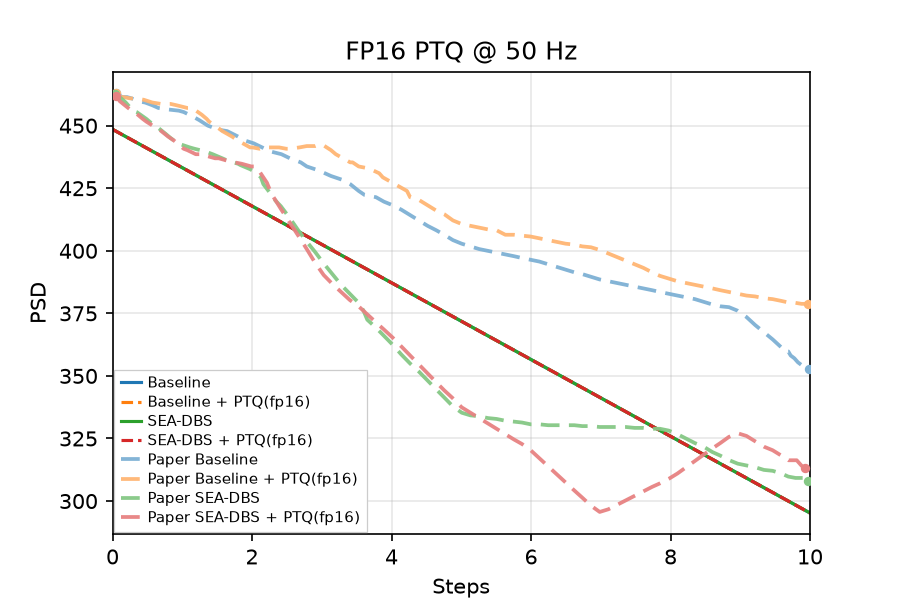
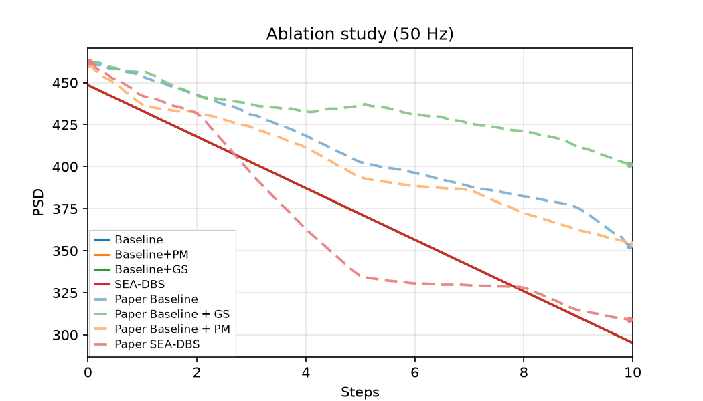

# Ravivarapu et al. — figure comparisons

**Primary replication tracker** for SEA-DBS (*Sample-Efficient Reinforcement Learning Controller for Deep Brain Stimulation in Parkinson’s Disease*). Work is scheduled by **panel**, not by roadmap phase: each row below is an exit criterion with qualitative gates, a committed `plot.py` (planned until Phase 6 lands), and side-by-side PNGs.

Side-by-side **paper panel** vs **our replication**. Plot scripts write replication PNGs to `figures/ravivarapu/images/`; JSON caches to `artifacts/figures/papers/`. Per-panel gate tables show live **Pass** per check (all required; refreshed by `scripts/digitization/ravivarapu_gate_status.py` on promote / `--plot-only`).

**Honest replication (oct 12 2026).** Every panel used to be marked Pass, but those passes rested on mechanisms the paper doesn't describe (episode-scheduled actor logit boosts, a no-stim init bias, per-variant plants and learning rates, eval-only windows, hand-picked eval seeds, per-step pulse schedules, PTQ weight noise, loosened gates). All were removed ([sea_dbs/replication.md](../../docs/controllers/sea_dbs/replication.md) §15). Every variant now trains with one config (Table I, random init, Eq. (9) as written), and Figs 5–7 evaluate on the training plant setup with only the paper's stimulation frequency changed. Every panel now fails, with the gaps documented in each lab notebook. The two root causes: Eq. (7) has no stimulation cost, so all four variants learn to stimulate every step and their deterministic rollouts coincide; and on Kumaravelu, 30 Hz raises beta. A second pass the same day screened the remaining paper-silent knobs (the Mehregan et al. logits-critic DDPG backbone, Gumbel-max, slow τ annealing, a network the size of the paper's 65 MB, the observation window) and fixed one gate: Fig 4b now compares rewards to the paper in absolute units instead of rescaling the paper by our Baseline's early level. Only the observation window changed the result: $n_{\mathrm{obs}} = 10$ (the paper's 10-step inference horizon) lets the inference traces fall through step 10 ([4a.md](../../docs/figures/ravivarapu/4a.md) § Convention screen).

<!-- summary:start -->
| Panel | Description | Status |
|-------|-------------|--------|
| Fig 4a | Training PSD vs episode | Fail — 15 of 27 gates (rep v80) |
| Fig 4b | Training reward vs episode | Fail — 11 of 19 gates (rep v18) |
| Fig 5a | Inference @ 50 Hz | Fail — 12 of 17 gates (rep v22) |
| Fig 5b | Inference @ 30 Hz | Fail — 7 of 18 gates (rep v22) |
| Fig 6 | FP16 PTQ @ 50 Hz | Fail — 8 of 11 gates (rep v22) |
| Fig 7 | Ablation (Baseline / +PM / +GS / SEA-DBS) | Fail — 6 of 10 gates (rep v27) |
<!-- summary:end -->

Replication PNGs: `figures/ravivarapu/images/`. JSON caches: `artifacts/figures/papers/`. Paper crops: `figures/ravivarapu/images/<panel>/paper.png` (from KB paper-note embeds; Fig 4/5 split from combined panels). Full composites also under `figures/ravivarapu/images/_full/`. Controller spec: [sea_dbs/replication.md](../../docs/controllers/sea_dbs/replication.md). Schematics (paper Figs 1, 3) are **out of scope**. Fig 2 (reward curve) is optional polish, not a gate.

---

## Fig 4a — training PSD vs episode

Panel lab notebook: [docs/figures/ravivarapu/4a.md](../../docs/figures/ravivarapu/4a.md).

Average **beta-band PSD** across **training episodes** for **Baseline (DDPG)** vs **SEA-DBS** (§V.B / Fig. 4(a)). Paper claim: SEA-DBS shows a **more pronounced and consistent** beta suppression over episodes; Baseline declines only modestly.

Related numeric protocol (not a separate panel): **Table II** — seed change every $n \in \{10, 20, 50, 75\}$ steps; SEA-DBS lower avg PSD and higher avg reward than Baseline at each $n$. Track with `sea_dbs_eval` / harness once training exists.

### Paper (Ravivarapu et al.)


### Replication



<!-- caption-4a:start -->
**Caption:** Training mean GPi beta PSD vs episode (seed 0); shape_pass=False pass=False; Baseline vs full SEA-DBS (PM+GS); one shared training config; display roll10 (gates on raw). (v80)

**Manifest:** `artifacts/figures/papers/ravivarapu/4/manifest_4a.json`
<!-- caption-4a:end -->

**Status:** Fail (rep v80) — 15 of 27 gates. Both curves start at ~0.39–0.40 (a random two-action policy already stimulates half the time; paper ~0.45), SEA-DBS reaches full stimulation by episode ~40 and sits on the plant floor (late 0.366 vs paper 0.340), and the late gap is 0.008 vs the paper's 0.028. Notes [4a.md](../../docs/figures/ravivarapu/4a.md). Manifest `artifacts/figures/papers/ravivarapu/4/manifest_4a.json`.

<!-- gates-4a:start -->
**Gates set** (`artifacts/figures/papers/ravivarapu/4/manifest_4a.json`; **`shape_pass`**: no, **`pass`**: no, 2026-10-12). Phase 1: **`shape_pass`** (trajectory shape / ordering). Ship exit: **`pass`** (adds digitization level polish).

| Key | Description | Shape | Full |
|-----|-------------|-------|------|
| `n_episodes_ok` | ≥ 150 training episodes | yes | yes |
| `shared_start` | baseline and SEA-DBS agree at episode start | yes | yes |
| `baseline_declines` | baseline PSD declines over training | yes | yes |
| `sea_declines` | SEA-DBS PSD declines over training | no | no |
| `sea_below_baseline_mid` | SEA-DBS mid PSD below baseline | yes | yes |
| `sea_below_baseline_midlate` | SEA-DBS ep 70–110 PSD below baseline | yes | yes |
| `sea_below_baseline_late` | SEA-DBS late PSD below baseline | yes | yes |
| `sea_steeper_drop_than_baseline` | SEA-DBS drop steeper than baseline | no | no |
| `gap_widens_over_training` | baseline − SEA-DBS gap widens over training | no | no |
| `late_gap_substantial` | late baseline − SEA-DBS gap in [0.015, 0.050] | no | no |
| `drop_timing_baseline` | baseline drop not front-loaded by ep 50 | yes | yes |
| `drop_timing_sea` | SEA-DBS drop not front-loaded by ep 50 | no | no |
| `gradual_decline_baseline` | gradual baseline mid→late drop | yes | yes |
| `gradual_decline_sea` | gradual SEA-DBS mid→late drop | no | no |
| `pearson_baseline_min` | baseline trajectory shape (Pearson r) | no | no |
| `pearson_sea_min` | SEA-DBS trajectory shape (Pearson r) | no | no |
| `shared_start_near_paper` | shared start vs paper | — | yes |
| `baseline_drop_vs_paper` | baseline drop vs paper | — | no |
| `sea_drop_vs_paper` | SEA-DBS drop vs paper | — | no |
| `sea_mid_near_paper` | SEA-DBS mid-training level vs paper | — | yes |
| `sea_midlate_near_paper` | SEA-DBS ep 70–110 level vs paper | — | yes |
| `sea_late_near_paper` | SEA-DBS late level vs paper | — | yes |
| `mid_gap_near_paper` | mid-training gap vs paper (bounded) | — | no |
| `midlate_gap_near_paper` | ep 70–110 gap vs paper (bounded) | — | yes |
| `late_gap_near_paper` | late gap vs paper (bounded) | — | no |
| `late_early_ratio_baseline_near_paper` | baseline late/early ratio vs paper | — | yes |
| `late_early_ratio_sea_near_paper` | SEA-DBS late/early ratio vs paper | — | yes |
<!-- gates-4a:end -->

**Run:**

```bash
uv run python -m rl_adaptive_dbs.run scripts/figures/papers/ravivarapu/4a/plot.py
uv run python -m rl_adaptive_dbs.run scripts/figures/papers/ravivarapu/4a/plot.py --plot-only
```

**Defaults (paper §V.A / Table I):** seed `0` (paper seed unspecified — lock one seed for gates), **30** steps/episode × **150** episodes, $\gamma=0.99$, buffer **8192**, batch **32**, $\alpha_a=5\times10^{-4}$, $\alpha_c=10^{-3}$, variants `baseline` vs `paper` with one shared config (`fig4_ravivarapu_config`). Conventions: 150 ms plant shot per step at 50 Hz, scale 472, $n_{\mathrm{obs}}=5$ prefilled, plant reseeded per episode, Gumbel $\tau$ 200 → 1 and Baseline ε 1.0 → 0.05 over the run.

**Gap (honest, oct 12 2026):** SEA-DBS stimulates every step by ep ~40 and sits on the full-stimulation floor (late 0.357 vs paper 0.340); the Baseline's late level matches (0.366 vs 0.368). Both start at 0.38–0.40, not the paper's untreated 0.45 (random init stimulates half the time). 12 of 27 gates fail — [4a.md](../../docs/figures/ravivarapu/4a.md) § Honest replication.

---

## Fig 4b — training reward vs episode

**Cumulative / episode reward** during the same training comparison as Fig 4a (§V.B / Fig. 4(b)). Paper claim: SEA-DBS reaches **higher** rewards with a **faster** early rise than Baseline.

### Paper (Ravivarapu et al.)


### Replication



<!-- caption-4b:start -->
**Caption:** Training episode reward vs episode (seed 0); mean Eq. (7) reward per step; paired with Fig 4a cache; display roll10 (gates on raw). (v18)

**Manifest:** `artifacts/figures/papers/ravivarapu/4/manifest_4b.json`
<!-- caption-4b:end -->

**Status:** Fail (rep v18) — 11 of 19 gates. Mean Eq. (7) reward per step (the paper's y-range is one step's reward), compared to the paper in absolute units. Fails: SEA-DBS rise timing / steepness / gradual rise, both Pearson, `shared_start_near_paper` and both rise-vs-paper gates (both curves start at −0.4 to −0.5 instead of the paper's −0.9, because a randomly initialized policy already stimulates about half the time). See [4a.md](../../docs/figures/ravivarapu/4a.md).

<!-- gates-4b:start -->
**Gates set** (`artifacts/figures/papers/ravivarapu/4/manifest_4b.json`; **`shape_pass`**: no, **`pass`**: no, 2026-10-12). Phase 1: **`shape_pass`** (trajectory shape / ordering). Ship exit: **`pass`** (adds digitization level polish).

| Key | Description | Shape | Full |
|-----|-------------|-------|------|
| `n_episodes_ok` | ≥ 150 training episodes | yes | yes |
| `shared_start` | baseline and SEA-DBS agree at episode start | yes | yes |
| `baseline_rises` | baseline reward rises over training | yes | yes |
| `sea_rises` | SEA-DBS reward rises over training | yes | yes |
| `sea_above_baseline_late` | SEA-DBS late reward above baseline | yes | yes |
| `sea_steeper_rise_than_baseline` | SEA-DBS rise steeper than baseline | no | no |
| `paper_pull_ahead_mid` | SEA-DBS ahead in mid training window | yes | yes |
| `late_gap_substantial` | late SEA-DBS − baseline gap substantial | yes | yes |
| `rise_timing_baseline` | baseline rise not front-loaded by ep 50 | yes | yes |
| `rise_timing_sea` | SEA-DBS rise not front-loaded by ep 50 | no | no |
| `gradual_rise_baseline` | gradual baseline mid→late rise | yes | yes |
| `gradual_rise_sea` | gradual SEA-DBS mid→late rise | no | no |
| `pearson_baseline_min` | baseline trajectory shape (Pearson r) | no | no |
| `pearson_sea_min` | SEA-DBS trajectory shape (Pearson r) | no | no |
| `shared_start_near_paper` | shared start vs paper | — | no |
| `baseline_rise_vs_paper` | baseline rise vs paper | — | no |
| `sea_rise_vs_paper` | SEA-DBS rise vs paper | — | no |
| `late_gap_near_paper` | late gap vs paper (scaled) | — | yes |
| `midlate_gap_near_paper` | ep 70–110 gap vs paper (scaled) | — | yes |
<!-- gates-4b:end -->

**Run:**

```bash
uv run python -m rl_adaptive_dbs.run scripts/figures/papers/ravivarapu/4b/plot.py
uv run python -m rl_adaptive_dbs.run scripts/figures/papers/ravivarapu/4b/plot.py --plot-only
```

**Defaults:** paired Fig 4a cache / checkpoint; seed `0`; reward from Eq. (7) ($\beta_t = 0.35$), plotted as the mean per step.

---

## Fig 5a — inference @ 50 Hz

Panel lab notebook: [docs/figures/ravivarapu/5a.md](../../docs/figures/ravivarapu/5a.md).

Post-train **inference** comparison of SEA-DBS vs Baseline with stimulation **carrier frequency 50 Hz** (above beta band; Fig. 5(a)). Paper claim: **50 Hz** more effectively disrupts pathological oscillations → **greater PSD reduction** than the 30 Hz panel; SEA-DBS **below** Baseline on PSD (and higher reward).

Carrier frequency is a **fixed eval setting**, not a per-step RL action ([sea_dbs/replication.md](../../docs/controllers/sea_dbs/replication.md) §14.10). Figs 5–7 roll out the Fig 4 checkpoints on their training plant setup; the paper's stimulation frequency is the only override.

### Paper (Ravivarapu et al.)


### Replication



<!-- caption-5a:start -->
**Caption:** Inference GPi beta PSD vs step @ 50 Hz (seed 0, argmax actions, training plant setup); pass=False; Baseline vs SEA-DBS. (v22)

**Manifest:** `artifacts/figures/papers/ravivarapu/5a/manifest.json`
<!-- caption-5a:end -->

**Status:** Fail (rep v22) — 12 of 17 gates. Baseline and SEA-DBS both stimulate on all 10 steps, so the traces coincide (0.449 falling to 0.295 at step 10 as the 10-sample window fills; paper SEA 0.462 → 0.309, Baseline 0.461 → 0.354). Fails: the three Baseline–SEA split gates, SEA steps 3–5 MAE and steps 4–10 MAE (a straight ramp vs the paper's fast-then-slow SEA curve). Manifest `artifacts/figures/papers/ravivarapu/5a/manifest.json`; notes [5a.md](../../docs/figures/ravivarapu/5a.md).

<!-- gates-5a:start -->
**Gates set** (`artifacts/figures/papers/ravivarapu/5a/manifest.json`; overall **`pass`**: no, 2026-10-12). Every row is required for exit.

| Key | Description | Pass |
|-----|-------------|------|
| `n_steps_ok` | 11 PSD samples (t=0 + 10 stim steps) | yes |
| `shared_start` | baseline and SEA-DBS agree at step 0 | yes |
| `baseline_declines` | baseline PSD net drop step 0→10 | yes |
| `paper_declines` | SEA-DBS PSD net drop step 0→10 | yes |
| `paper_end_below_baseline` | SEA-DBS end PSD below baseline | no |
| `paper_steeper_drop` | SEA-DBS drop steeper than baseline | no |
| `carrier_hz_ok` | carrier frequency 50 Hz | yes |
| `shared_start_near_paper` | shared start vs paper ~462.5 | yes |
| `early_mae_baseline` | steps 0–5 MAE vs digitized Baseline ≤ 0.03 | yes |
| `early_mae_sea` | steps 0–5 MAE vs digitized SEA-DBS ≤ 0.03 | yes |
| `early_mae_sea_3_5` | steps 3–5 MAE vs digitized SEA-DBS ≤ 0.015 | no |
| `early_sea_declines` | SEA-DBS drop steps 0→5 > 0.05 | yes |
| `early_baseline_declines` | Baseline drop steps 0→5 | yes |
| `early_sea_below_baseline` | SEA-DBS below Baseline at every step 1–5 | no |
| `late_baseline_declines` | Baseline keeps declining steps 5→10 | yes |
| `late_sea_declines` | SEA-DBS keeps declining steps 5→10 | yes |
| `mid_mae_sea` | steps 4–10 MAE vs digitized SEA-DBS ≤ 0.012 | no |
<!-- gates-5a:end -->

**Run:**

```bash
uv run python -m rl_adaptive_dbs.run scripts/figures/papers/ravivarapu/5a/plot.py --export-notes --update-report
uv run python -m rl_adaptive_dbs.run scripts/figures/papers/ravivarapu/5a/plot.py --plot-only --export-notes --update-report
```

**Defaults:** seed `0`; carrier **50 Hz**; argmax actions from the Fig 4 Baseline / SEA-DBS actors.

---

## Fig 5b — inference @ 30 Hz

Panel lab notebook: [docs/figures/ravivarapu/5b.md](../../docs/figures/ravivarapu/5b.md).

Same inference layout at **30 Hz** carrier (overlaps pathological beta; Fig. 5(b)). Paper claim: **less effective** than 50 Hz; SEA-DBS still **beats** Baseline on PSD / reward.

### Paper (Ravivarapu et al.)


### Replication



<!-- caption-5b:start -->
**Caption:** Inference GPi beta PSD vs step @ 30 Hz (seed 0, argmax actions, training plant setup); pass=False; Baseline vs SEA-DBS. (v22)

**Manifest:** `artifacts/figures/papers/ravivarapu/5b/manifest.json`
<!-- caption-5b:end -->

**Status:** Fail (rep v22) — 7 of 18 gates. On Kumaravelu 30 Hz raises beta, so both always-on policies climb 0.449 → 0.607 (paper: both decline to ~0.39–0.40). Manifest `artifacts/figures/papers/ravivarapu/5b/manifest.json`; notes [5b.md](../../docs/figures/ravivarapu/5b.md).

<!-- gates-5b:start -->
**Gates set** (`artifacts/figures/papers/ravivarapu/5b/manifest.json`; overall **`pass`**: no, 2026-10-12). Every row is required for exit.

| Key | Description | Pass |
|-----|-------------|------|
| `n_steps_ok` | 11 PSD samples (t=0 + 10 stim steps) | yes |
| `shared_start` | baseline and SEA-DBS agree at step 0 | yes |
| `baseline_declines` | baseline PSD net drop step 0→10 | no |
| `paper_declines` | SEA-DBS PSD net drop step 0→10 | no |
| `paper_end_below_baseline` | SEA-DBS end PSD below baseline | no |
| `paper_steeper_drop` | SEA-DBS drop steeper than baseline | no |
| `carrier_hz_ok` | carrier frequency 30 Hz | yes |
| `weaker_than_50hz_sea` | 30 Hz SEA-DBS weaker suppression than 50 Hz panel | yes |
| `weaker_than_50hz_baseline` | 30 Hz baseline weaker suppression than 50 Hz panel | yes |
| `early_baseline_rises` | baseline PSD initial rise at step 1-2 | yes |
| `early_sea_plateau` | SEA-DBS delayed drop / plateau on steps 0-2 | yes |
| `early_sea_below_baseline` | SEA-DBS below baseline on steps 1-5 (mean; ≤0.003 crossing) | no |
| `early_mae_baseline` | steps 0–5 MAE vs digitized baseline ≤ 0.025 | no |
| `early_mae_sea` | steps 0–5 MAE vs digitized SEA-DBS ≤ 0.025 | no |
| `late_baseline_declines` | baseline keeps declining steps 5→10 | no |
| `late_sea_declines` | SEA-DBS keeps declining steps 5→10 | no |
| `pearson_baseline_min` | baseline trajectory correlation vs paper (r ≥ 0.70) | no |
| `pearson_sea_min` | SEA-DBS trajectory correlation vs paper (r ≥ 0.70) | no |
<!-- gates-5b:end -->

**Run:**

```bash
uv run python -m rl_adaptive_dbs.run scripts/figures/papers/ravivarapu/5b/plot.py --export-notes --update-report
uv run python -m rl_adaptive_dbs.run scripts/figures/papers/ravivarapu/5b/plot.py --plot-only --export-notes --update-report
```

**Defaults:** seed `0`; carrier **30 Hz**; same checkpoints and rollout as Fig 5a.

---

## Fig 6 — FP16 PTQ @ 50 Hz

**FP16 post-training quantization** of SEA-DBS vs Baseline at **50 Hz** over **10 stimulation steps** (Fig. 6 / §V). Paper claim: quantized SEA-DBS **tracks** full-precision PSD reduction and still **beats** Baseline; model size **~65 MB → ~33 MB**.

QAT is **out of scope** for SEA-DBS (not reported).

### Paper (Ravivarapu et al.)


### Replication



<!-- caption-6:start -->
**Caption:** FP16 PTQ inference GPi beta PSD vs step @ 50 Hz (seed 0, argmax actions, plain .half() cast); pass=False; Baseline/SEA-DBS fp32 + PTQ; SEA-DBS networks 52 KB → 26 KB. (v22)

**Manifest:** `artifacts/figures/papers/ravivarapu/6/manifest.json`
<!-- caption-6:end -->

**Status:** Fail (rep v22) — 8 of 11 gates. All four series coincide: both policies stimulate every step and a plain fp16 cast flips no action. Fails: SEA below Baseline (fp32 and PTQ) and `ptq_traces_distinct`. Manifest `artifacts/figures/papers/ravivarapu/6/manifest.json`; notes [6.md](../../docs/figures/ravivarapu/6.md).

<!-- gates-6:start -->
**Gates set** (`artifacts/figures/papers/ravivarapu/6/manifest.json`; overall **`pass`**: no, 2026-10-12). Every row is required for exit.

| Key | Description | Pass |
|-----|-------------|------|
| `four_series_present` | fp32 + PTQ for baseline and SEA-DBS | yes |
| `n_steps_ok` | 11 PSD samples (t=0 + 10 stim steps) | yes |
| `shared_start` | paired series share pre-stim level | yes |
| `shared_start_near_paper` | shared start vs paper ~462.5 | yes |
| `early_mae_baseline` | steps 0–5 MAE vs digitized Baseline ≤ 0.03 | yes |
| `early_mae_sea` | steps 0–5 MAE vs digitized SEA-DBS ≤ 0.03 | yes |
| `sea_below_baseline` | SEA-DBS fp32 below baseline fp32 late | no |
| `sea_ptq_below_baseline` | SEA-DBS PTQ below baseline fp32 late | no |
| `sea_ptq_tracks_fp32` | SEA-DBS PTQ tracks fp32 | yes |
| `baseline_ptq_near_or_above_baseline` | baseline PTQ near/above baseline fp32 | yes |
| `ptq_traces_distinct` | PTQ traces not identical to paired fp32 | no |
<!-- gates-6:end -->

**Run:**

```bash
uv run python -m rl_adaptive_dbs.run scripts/figures/papers/ravivarapu/6/plot.py
uv run python -m rl_adaptive_dbs.run scripts/figures/papers/ravivarapu/6/plot.py --plot-only
```

**Defaults:** seed `0`; **FP16 PTQ** as a plain `.half()` cast (no QAT, no weight noise); 10-step eval; 50 Hz carrier.

---

## Fig 7 — ablation (Baseline / +PM / +GS / SEA-DBS)

**PSD over 10 stimulation steps** for four variants (Fig. 7): **Baseline**, **Baseline+PM**, **Baseline+GS**, **SEA-DBS (PM+GS)**. Paper claim: SEA-DBS strongest / most stable suppression; +PM alone noisy early (~**4,500** samples cited); +GS alone limited gains.

Map to trainer `variant`: `baseline`, `baseline-pm`, `baseline-gs`, `paper` ([sea_dbs/replication.md](../../docs/controllers/sea_dbs/replication.md) §12).

### Paper (Ravivarapu et al.)


### Replication



<!-- caption-7:start -->
**Caption:** Ablation GPi beta PSD over 10 steps @ 50 Hz (seed 0, argmax actions); pass=False; Baseline vs +PM vs +GS vs SEA-DBS, one shared training config. (v27)

**Manifest:** `artifacts/figures/papers/ravivarapu/7/manifest.json`
<!-- caption-7:end -->

**Status:** Fail (rep v27) — 6 of 10 gates. All four variants deploy as always-on, so the traces tie; fails `baseline_above_pm_early` and the three tail-ordering gates. Manifest `artifacts/figures/papers/ravivarapu/7/manifest.json`; notes [7.md](../../docs/figures/ravivarapu/7.md).

<!-- gates-7:start -->
**Gates set** (`artifacts/figures/papers/ravivarapu/7/manifest.json`; overall **`pass`**: no, 2026-10-12). Every row is required for exit.

| Key | Description | Pass |
|-----|-------------|------|
| `four_variants_present` | baseline / +PM / +GS / SEA-DBS | yes |
| `n_steps_ok` | 11 PSD samples (t=0 + 10 stim steps) | yes |
| `shared_start` | baseline and SEA-DBS agree at step 0 | yes |
| `shared_start_near_paper` | shared start vs paper ~462.5 | yes |
| `early_mae_baseline` | steps 0–5 MAE vs digitized Baseline ≤ 0.03 | yes |
| `early_mae_sea` | steps 0–5 MAE vs digitized SEA-DBS ≤ 0.03 | yes |
| `baseline_above_pm_early` | Baseline above Baseline+PM early (steps 0-4) | no |
| `sea_dbs_lowest_tail` | SEA-DBS tail ≥ 0.005 below every other variant | no |
| `gs_highest_tail` | Baseline+GS tail ≥ 0.005 above every other variant (paper 0.419 vs ≤ 0.380) | no |
| `pm_not_sea` | PM closer to baseline than to SEA-DBS | no |
<!-- gates-7:end -->

**Run:**

```bash
uv run python -m rl_adaptive_dbs.run scripts/figures/papers/ravivarapu/7/plot.py --export-notes --update-report
uv run python -m rl_adaptive_dbs.run scripts/figures/papers/ravivarapu/7/plot.py --plot-only --export-notes --update-report
```

**Defaults:** seed `0`; Baseline / SEA-DBS checkpoints from Fig 4; +PM / +GS train 150 episodes with the same `fig4_ravivarapu_config`; Fig 5a rollout (50 Hz, argmax, 11 PSD samples).
