# Ravivarapu et al. — figure comparisons

**Primary replication tracker** for SEA-DBS (*Sample-Efficient Reinforcement Learning Controller for Deep Brain Stimulation in Parkinson’s Disease*). Work is scheduled by **panel**, not by roadmap phase: each row below is an exit criterion with paper-anchored gates, a committed `plot.py`, and side-by-side PNGs.

Side-by-side **paper panel** vs **our replication**. Plot scripts write replication PNGs to `figures/ravivarapu/images/`; JSON caches to `artifacts/figures/papers/`. Per-panel gate tables show live **Pass** per check (all required; refreshed by `scripts/digitization/ravivarapu_gate_status.py` on promote / `--plot-only`).

**Honest replication (oct 12 2026).** Every panel used to be marked Pass, but those passes rested on mechanisms the paper doesn't describe (episode-scheduled actor logit boosts, a no-stim init bias, per-variant plants and learning rates, eval-only windows, hand-picked eval seeds, per-step pulse schedules, PTQ weight noise, loosened gates). All were removed ([sea_dbs/replication.md](../../docs/controllers/sea_dbs/replication.md) §15). Every variant now trains with one config (Table I, random init, Eq. (9) as written), and Figs 5–7 evaluate on the training plant setup with only the paper's stimulation frequency changed. Every panel now fails, with the gaps documented in each lab notebook. The two root causes: Eq. (7) has no stimulation cost, so all four variants learn to stimulate every step and their deterministic rollouts coincide; and on Kumaravelu, 30 Hz raises beta. A second pass the same day screened the remaining paper-silent knobs (the Mehregan et al. logits-critic DDPG backbone, Gumbel-max, slow τ annealing, a network the size of the paper's 65 MB, the observation window) and fixed one gate: Fig 4b now compares rewards to the paper in absolute units instead of rescaling the paper by our Baseline's early level. Only the observation window changed the result: $n_{\mathrm{obs}} = 10$ (the paper's 10-step inference horizon) lets the inference traces fall through step 10 ([4a.md](../../docs/figures/ravivarapu/4a.md) § Convention screen).

**Why every panel fails — five root causes (oct 14 2026).** Most failed gates trace to one of these, so the per-panel counts overlap:

1. **Every variant stimulates on every step.** Eq. (7) has no stimulation cost, so always-on is optimal; Baseline, +PM, +GS and SEA-DBS deploy as the same always-on policy and every gate that needs them to differ fails (Figs 5a, 5b, 6, 7, Table II).
2. **SEA-DBS reaches full stimulation by episode ~40** and then sits on the plant's full-stimulation floor, instead of the paper's gradual 150-episode decline (Fig 4a drop, timing and gap gates; Fig 4b rise gates).
3. **Training starts at ~0.40, not the paper's untreated ~0.45**, because a randomly initialized two-action policy already stimulates about half the time (start-level gates in Figs 4a and 4b).
4. **30 Hz raises beta on Kumaravelu**, so the Fig 5b curves rise where the paper's fall.
5. **The 50 Hz always-on trace is a straight ramp** (the 10-step observation window filling), not the paper's fast-then-slow SEA-DBS curve (Fig 5a SEA-DBS MAE gates).

Separately, our Fig 4b (mean Eq. (7) reward per step) is not Eq. (7) of our Fig 4a PSD the way the paper's is, because P̄ ramps within each episode (`eq7_consistent_with_4a`; [4a.md](../../docs/figures/ravivarapu/4a.md) § Gate audit).

**Gate audit (oct 14 2026).** Every gate is anchored on the paper digitization, and the paper's own curves pass every gate on every panel under both window-mean and linear resampling. Duplicates, coin-flip gates, a gate that tested something the paper doesn't claim (`ptq_traces_distinct`), and gates loose enough to pass clearly wrong curves were removed or tightened; gates that need digitization or paired data fail closed. Details and the noise check: [4a.md](../../docs/figures/ravivarapu/4a.md) § Gate audit.

**Audit pass (oct 17 2026).** The plant now integrates at the paper's 0.02 ms (it ran at the 0.01 ms reference step; same levels, so gate counts move only by realization noise), Table II gives every interval the same 30 plant seeds (the old fixed horizon confounded $n$ with the seed pool), and the Fig 4a/4b plots draw the raw episodes under the rolling mean. Plant probes answered or narrowed several open questions: amplitude and pulse width can't make 30 Hz suppress, and always-on stays optimal under Eq. (7) on a continuous plant too, so root causes 1 and 4 stand under every reading tried ([4a.md](../../docs/figures/ravivarapu/4a.md) § Open-question probes).

**The paper's 2 ms step (oct 17 2026).** A trailing-window mode (`step_mode="trailing"`) runs the paper's literal timing: 30 steps of 2 ms in one continuous 60 ms episode. On Kumaravelu no stimulation lowers beta within 60 ms, both learners stop stimulating, and Fig 4a candidates pass 11–14 of 28 gates (vs 15 for the 150 ms shot), so the 150 ms shot stays the labeled convention ([4a.md](../../docs/figures/ravivarapu/4a.md) § The paper's 2 ms step).

**Candidate readings (oct 17 2026).** Readings beyond the text, behind config flags that default off: the plant carried across episodes (2 ms steps), a stimulation cost in the training reward, and one update per episode. The cost is the only one that splits Baseline and SEA-DBS at inference, and one update per episode gives the best Fig 4a (17 of 28), but none clears a panel, so the shipped default stays as written ([4a.md](../../docs/figures/ravivarapu/4a.md) § Candidate readings, § The paper's 2 ms step).

**Candidate screen (oct 19 2026).** Labelled candidates (each deviates from the paper as we read it, or fills a gap it leaves — our best guess of what the authors may have done; shipped defaults unchanged). Best: **one hidden layer of 32 units** (topology is paper-silent) slows SEA-DBS's saturation without destabilizing it. Single seeds pass 18–21 / 28 on Fig 4a and 16–18 / 20 on Fig 4b (shipped 11–19 and 9–15 over seeds 0–4). Gated on the **mean over training seeds 0–4** (a display/aggregation reading of the paper's smooth curve, same gates), it reaches **Fig 4a 21 / 28, Fig 4b 18 / 20**; seed averaging alone takes the shipped config to 18 / 28 and 12 / 20. Entropy regularization and a lower actor lr slow SEA-DBS too, but on some seeds it settles on never stimulating. PM lr, Polyak τ, more updates per step, a deeper net and richer state inputs don't help. Every candidate actor still stimulates on every inference step, so Figs 5a–7 don't move. Hardened Gumbel-Softmax inference and static int8 PTQ change no action (logit margins 4–620). A partial window carry across Table II reseeds gives the paper's 1/n transient and 3 / 6 gates. Details: [4a.md](../../docs/figures/ravivarapu/4a.md) § Candidate screen (oct 19 2026).

<!-- summary:start -->
| Panel | Description | Status |
|-------|-------------|--------|
| Fig 4a | Training PSD vs episode | Fail — 15/28 gates pass (rep v83) |
| Fig 4b | Training reward vs episode | Fail — 12/20 gates pass (rep v21) |
| Fig 5a | Inference @ 50 Hz | Fail — 12/20 gates pass (rep v25) |
| Fig 5b | Inference @ 30 Hz | Fail — 6/22 gates pass (rep v25) |
| Fig 6 | FP16 PTQ @ 50 Hz | Fail — 10/15 gates pass (rep v25) |
| Fig 7 | Ablation (Baseline / +PM / +GS / SEA-DBS) | Fail — 7/17 gates pass (rep v30) |
| Table II | Avg PSD with the plant reseeded every n steps | Fail — 2/6 gates pass (rep v2) |
<!-- summary:end -->

Replication PNGs: `figures/ravivarapu/images/`. JSON caches: `artifacts/figures/papers/`. Paper crops: `figures/ravivarapu/images/<panel>/paper.png` (from KB paper-note embeds; Fig 4/5 split from combined panels). Full composites also under `figures/ravivarapu/images/_full/`. Controller spec: [sea_dbs/replication.md](../../docs/controllers/sea_dbs/replication.md). Schematics (paper Figs 1, 3) are **out of scope**. Fig 2 (reward curve) is optional polish, not a gate.

---

## Fig 4a — training PSD vs episode

Panel lab notebook: [docs/figures/ravivarapu/4a.md](../../docs/figures/ravivarapu/4a.md).

Average **beta-band PSD** across **training episodes** for **Baseline (DDPG)** vs **SEA-DBS** (§V.B / Fig. 4(a)). Paper claim: SEA-DBS shows a **more pronounced and consistent** beta suppression over episodes; Baseline declines only modestly.

Related numeric protocol: **Table II** (seed change every $n \in \{10, 20, 50, 75\}$ steps) — [own section below](#table-ii--avg-psd-with-the-plant-reseeded-every-n-steps).

### Paper (Ravivarapu et al.)

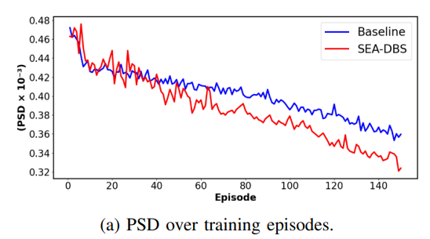

### Replication

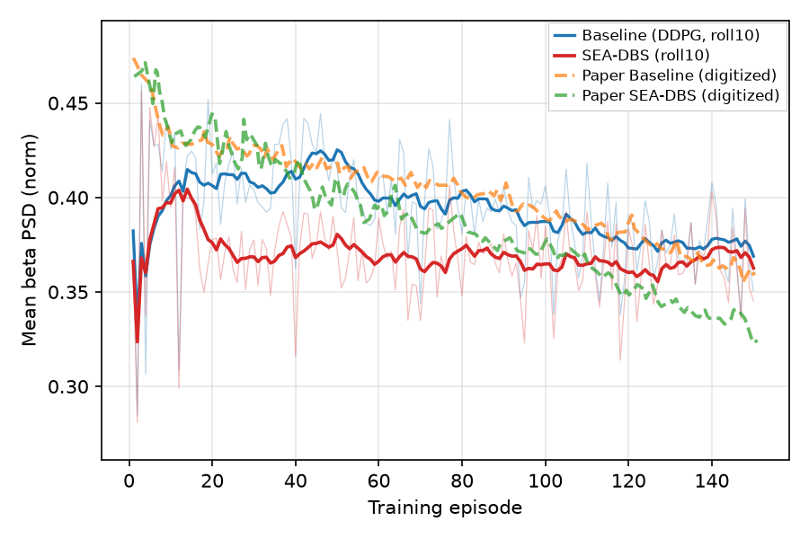

<!-- caption-4a:start -->
**Caption:** Training mean GPi beta PSD vs episode (seed 0); shape_pass=False pass=False; Baseline vs full SEA-DBS (PM+GS); one shared training config; display roll10 (gates on raw). (v83)

**Manifest:** `artifacts/figures/papers/ravivarapu/4/manifest_4a.json`
<!-- caption-4a:end -->

**Status:** Fail (rep v83, plant step 0.02 ms) — 15 of 28 gates pass, the same 13 failing as at 0.01 ms (rep v82). Both curves start at ~0.39–0.40 instead of the paper's untreated ~0.45 (root cause 3), and SEA-DBS reaches full stimulation by episode ~40 and sits on the plant floor (late 0.366 vs paper 0.340; root cause 2), so the SEA-DBS drop, timing, gradual-decline and gap gates, both Pearson gates (0.50 / 0.42 vs 0.58) and both late/early ratios fail. The Baseline's decline is its ε schedule. The plot now draws the raw episodes faintly under the 10-episode rolling mean. Manifest `artifacts/figures/papers/ravivarapu/4/manifest_4a.json`; notes [4a.md](../../docs/figures/ravivarapu/4a.md).

<!-- gates-4a:start -->
**Gates set** (`artifacts/figures/papers/ravivarapu/4/manifest_4a.json`; **`shape_pass`**: no, **`pass`**: no, 2026-10-17). Phase 1: **`shape_pass`** (trajectory shape / ordering). Ship exit: **`pass`** (adds digitization level polish).

| Key | Description | Shape | Full |
|-----|-------------|-------|------|
| `n_episodes_ok` | ≥ 150 training episodes | yes | yes |
| `shared_start` | baseline and SEA-DBS agree at episode start (ep 0–15, ≤ 0.05) | yes | yes |
| `baseline_declines` | baseline PSD declines over training (≥ 0.02) | yes | yes |
| `sea_below_baseline_mid` | SEA-DBS ep 40–80 PSD below baseline | yes | yes |
| `sea_below_baseline_midlate` | SEA-DBS ep 70–110 PSD below baseline | yes | yes |
| `sea_below_baseline_late` | SEA-DBS ep 120–150 PSD below baseline | yes | yes |
| `sea_steeper_drop_than_baseline` | SEA-DBS drop steeper than baseline | no | no |
| `gap_widens_over_training` | baseline − SEA-DBS gap widens over training | no | no |
| `drop_timing_baseline` | baseline drop not front-loaded by ep 50 vs paper | yes | yes |
| `drop_timing_sea` | SEA-DBS drop not front-loaded by ep 50 vs paper | no | no |
| `gradual_decline_baseline` | baseline mid→late drop ≥ 30 % of paper's | yes | yes |
| `gradual_decline_sea` | SEA-DBS mid→late drop ≥ 30 % of paper's | no | no |
| `pearson_baseline_min` | baseline trajectory shape vs paper (Pearson r ≥ 0.58) | no | no |
| `pearson_sea_min` | SEA-DBS trajectory shape vs paper (Pearson r ≥ 0.58) | no | no |
| `shared_start_near_paper` | ep 0–15 level within 0.02 of paper (0.443 / 0.448) | — | no |
| `baseline_drop_vs_paper` | baseline early→late drop ≥ 40 % of paper's | — | no |
| `sea_drop_vs_paper` | SEA-DBS early→late drop ≥ 40 % of paper's | — | no |
| `baseline_mid_near_paper` | baseline ep 40–80 level within 12 % of paper | — | yes |
| `baseline_midlate_near_paper` | baseline ep 70–110 level within 12 % of paper | — | yes |
| `baseline_late_near_paper` | baseline ep 120–150 level within 12 % of paper | — | yes |
| `sea_mid_near_paper` | SEA-DBS ep 40–80 level within 12 % of paper | — | yes |
| `sea_midlate_near_paper` | SEA-DBS ep 70–110 level within 12 % of paper | — | yes |
| `sea_late_near_paper` | SEA-DBS ep 120–150 level within 12 % of paper | — | yes |
| `mid_gap_near_paper` | ep 40–80 gap in [0.40, 1.80] × paper | — | no |
| `midlate_gap_near_paper` | ep 70–110 gap in [0.40, 1.75] × paper | — | yes |
| `late_gap_near_paper` | ep 120–150 gap in [0.50, 1.60] × paper (0.028) | — | no |
| `late_early_ratio_baseline_near_paper` | baseline late/early ratio within 8 % of paper (0.833) | — | no |
| `late_early_ratio_sea_near_paper` | SEA-DBS late/early ratio within 8 % of paper (0.762) | — | no |
<!-- gates-4a:end -->

**Run:**

```bash
uv run python -m rl_adaptive_dbs.run scripts/figures/papers/ravivarapu/4a/plot.py
uv run python -m rl_adaptive_dbs.run scripts/figures/papers/ravivarapu/4a/plot.py --plot-only
```

**Defaults (paper §V.A / Table I):** seed `0` (paper seed unspecified — lock one seed for gates), **30** steps/episode × **150** episodes, $\gamma=0.99$, buffer **8192**, batch **32**, $\alpha_a=5\times10^{-4}$, $\alpha_c=10^{-3}$, variants `baseline` vs `paper` with one shared config (`fig4_ravivarapu_config`). Conventions: 150 ms plant shot per step at 50 Hz, plant step 0.02 ms (the paper's), scale 472, $n_{\mathrm{obs}}=10$ prefilled, plant reseeded per episode, Gumbel $\tau$ 200 → 1 and Baseline ε 1.0 → 0.05 over the run.

**Gap (honest; rep v83):** SEA-DBS stimulates every step by ep ~40 and sits on the full-stimulation floor (late 0.366 vs paper 0.340); the Baseline's late level is close (0.374 vs 0.368). Both start at 0.39–0.40, not the paper's untreated 0.44–0.45 (random init stimulates half the time), and the late gap is 0.008 vs the paper's 0.028 — [4a.md](../../docs/figures/ravivarapu/4a.md) § Honest replication, § Open-question probes.

---

## Fig 4b — training reward vs episode

**Cumulative / episode reward** during the same training comparison as Fig 4a (§V.B / Fig. 4(b)). Paper claim: SEA-DBS reaches **higher** rewards with a **faster** early rise than Baseline.

### Paper (Ravivarapu et al.)

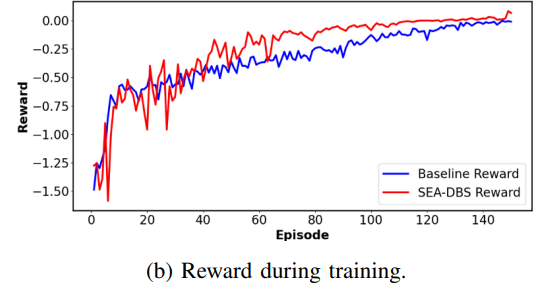

### Replication

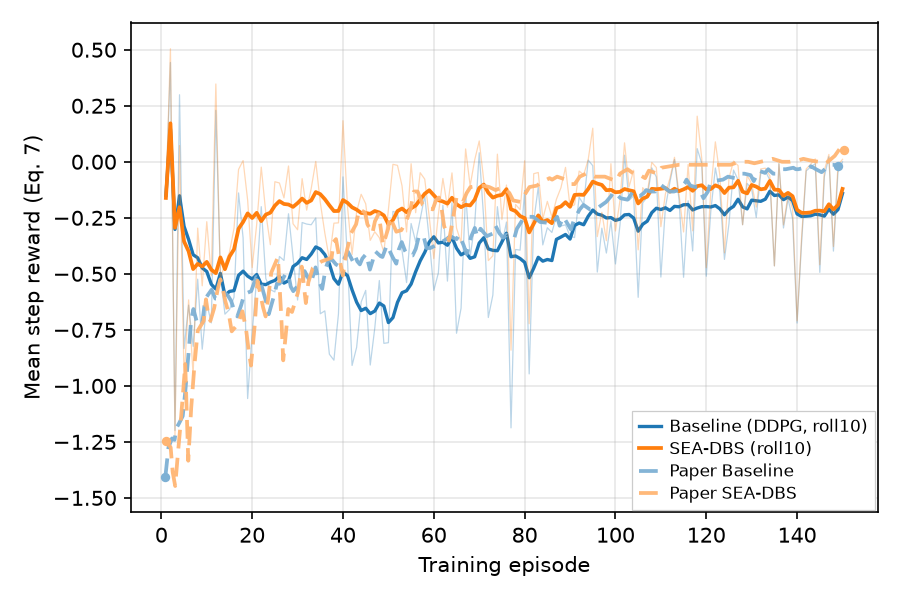

<!-- caption-4b:start -->
**Caption:** Training episode reward vs episode (seed 0); mean Eq. (7) reward per step; paired with Fig 4a cache; display roll10 (gates on raw). (v21)

**Manifest:** `artifacts/figures/papers/ravivarapu/4/manifest_4b.json`
<!-- caption-4b:end -->

**Status:** Fail (rep v21, plant step 0.02 ms) — 12 of 20 gates pass (v20: 11; `gradual_rise_sea` passes on the new realization). Mean Eq. (7) reward per step, compared to the paper in absolute units. Both curves start at −0.49 / −0.39 instead of the paper's −0.89 / −0.92 (root cause 3), so the start and rise-vs-paper gates fail; SEA-DBS saturates by episode ~40 (root cause 2: rise timing, steepness); both Pearson gates fail; and the curve isn't Eq. (7) of our Fig 4a PSD the way the paper's is (`eq7_consistent_with_4a`, max error 0.13 / 0.14 vs ≤ 0.05) because P̄ ramps within each episode. Raw episodes drawn faintly under the rolling mean. See [4a.md](../../docs/figures/ravivarapu/4a.md) § Gate audit.

<!-- gates-4b:start -->
**Gates set** (`artifacts/figures/papers/ravivarapu/4/manifest_4b.json`; **`shape_pass`**: no, **`pass`**: no, 2026-10-17). Phase 1: **`shape_pass`** (trajectory shape / ordering). Ship exit: **`pass`** (adds digitization level polish).

| Key | Description | Shape | Full |
|-----|-------------|-------|------|
| `n_episodes_ok` | ≥ 150 training episodes | yes | yes |
| `shared_start` | baseline and SEA-DBS agree at episode start (ep 0–15, ≤ 25 %) | yes | yes |
| `baseline_rises` | baseline reward rises ≥ 25 % of paper's rise | yes | yes |
| `sea_rises` | SEA-DBS reward rises ≥ 25 % of paper's rise | yes | yes |
| `sea_above_baseline_late` | SEA-DBS ep 90–150 reward above baseline | yes | yes |
| `sea_steeper_rise_than_baseline` | SEA-DBS rise to ep 90–150 steeper than baseline | no | no |
| `paper_pull_ahead_mid` | SEA-DBS ahead in ep 40–80 | yes | yes |
| `sea_faster_initial_rise` | SEA-DBS covers more of its rise by ep 40–80 (paper 0.79 vs 0.66) | yes | yes |
| `rise_timing_baseline` | baseline rise not front-loaded by ep 50 vs paper | yes | yes |
| `rise_timing_sea` | SEA-DBS rise not front-loaded by ep 50 vs paper | no | no |
| `gradual_rise_baseline` | baseline mid→late rise ≥ 25 % of paper's | yes | yes |
| `gradual_rise_sea` | SEA-DBS mid→late rise ≥ 25 % of paper's | yes | yes |
| `pearson_baseline_min` | baseline trajectory shape vs paper (Pearson r ≥ 0.55) | no | no |
| `pearson_sea_min` | SEA-DBS trajectory shape vs paper (Pearson r ≥ 0.55) | no | no |
| `eq7_consistent_with_4a` | reward = Eq. (7) of the Fig 4a PSD, episode by episode (≤ 0.05; paper 0.038) | — | no |
| `shared_start_near_paper` | ep 0–15 reward within 30 % of paper (−0.88 / −0.94) | — | no |
| `baseline_rise_vs_paper` | baseline rise ≥ 40 % of paper's | — | no |
| `sea_rise_vs_paper` | SEA-DBS rise ≥ 40 % of paper's | — | no |
| `late_gap_near_paper` | ep 90–150 gap ≥ 35 % of paper's (0.081) | — | yes |
| `midlate_gap_near_paper` | ep 70–110 gap ≥ 40 % of paper's (0.144) | — | yes |
<!-- gates-4b:end -->

**Run:**

```bash
uv run python -m rl_adaptive_dbs.run scripts/figures/papers/ravivarapu/4b/plot.py
uv run python -m rl_adaptive_dbs.run scripts/figures/papers/ravivarapu/4b/plot.py --plot-only
```

**Defaults:** paired Fig 4a cache / checkpoint; seed `0`; reward from Eq. (7) ($\beta_t = 0.35$), plotted as the mean per step.

---

## Fig 5a — inference @ 50 Hz

Panel lab notebook: [docs/figures/ravivarapu/5a.md](../../docs/figures/ravivarapu/5a.md).

Post-train **inference** comparison of SEA-DBS vs Baseline with stimulation **carrier frequency 50 Hz** (above beta band; Fig. 5(a)). Paper claim: **50 Hz** more effectively disrupts pathological oscillations → **greater PSD reduction** than the 30 Hz panel; SEA-DBS **below** Baseline on PSD (and higher reward).

Carrier frequency is a **fixed eval setting**, not a per-step RL action ([sea_dbs/replication.md](../../docs/controllers/sea_dbs/replication.md) §14.10). Figs 5–7 roll out the Fig 4 checkpoints on their training plant setup; the paper's stimulation frequency is the only override.

### Paper (Ravivarapu et al.)

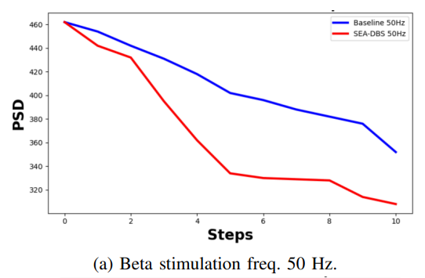

### Replication


<!-- caption-5a:start -->
**Caption:** Inference GPi beta PSD vs step @ 50 Hz (seed 0, argmax actions, training plant setup); pass=False; Baseline vs SEA-DBS. (v25)

**Manifest:** `artifacts/figures/papers/ravivarapu/5a/manifest.json`
<!-- caption-5a:end -->

**Status:** Fail (rep v25, plant step 0.02 ms) — 12 of 20 gates pass (v24: 13). Baseline and SEA-DBS both stimulate on all 10 steps, so the traces coincide (root cause 1: the Baseline–SEA split gates), and the always-on trace is a straight 0.452 → 0.291 ramp instead of the paper's fast-then-slow SEA-DBS curve and slower Baseline (root cause 5: the MAE gates). `baseline_drop_near_paper` now just misses: the always-on drop is 0.161 against a cap of 1.5 × the paper's 0.104 (0.154 at 0.01 ms). Manifest `artifacts/figures/papers/ravivarapu/5a/manifest.json`; notes [5a.md](../../docs/figures/ravivarapu/5a.md).

<!-- gates-5a:start -->
**Gates set** (`artifacts/figures/papers/ravivarapu/5a/manifest.json`; overall **`pass`**: no, 2026-10-17). Every row is required for exit.

| Key | Description | Pass |
|-----|-------------|------|
| `n_steps_ok` | 11 PSD samples (t=0 + 10 stim steps) | yes |
| `shared_start` | baseline and SEA-DBS agree at step 0 | yes |
| `baseline_declines` | baseline PSD net drop step 0→10 | yes |
| `paper_declines` | SEA-DBS PSD net drop step 0→10 | yes |
| `paper_end_below_baseline` | SEA-DBS end PSD below baseline | no |
| `paper_steeper_drop` | SEA-DBS drop steeper than baseline | no |
| `carrier_hz_ok` | carrier frequency 50 Hz | yes |
| `shared_start_near_paper` | step 0 within 0.02 of paper (~0.46) | yes |
| `early_mae_baseline` | steps 0–5 MAE vs paper Baseline ≤ 20 % of its drop (0.021) | no |
| `early_mae_sea` | steps 0–5 MAE vs paper SEA-DBS ≤ 20 % of its drop (0.030) | yes |
| `baseline_drop_near_paper` | Baseline step 0→10 drop in [0.5, 1.5] × paper (0.104) | no |
| `sea_drop_near_paper` | SEA-DBS step 0→10 drop in [0.5, 1.5] × paper (0.148) | yes |
| `tail_gap_near_paper` | steps 6–10 Baseline − SEA-DBS gap in [0.5, 1.6] × paper (0.056) | no |
| `early_mae_sea_3_5` | steps 3–5 MAE vs paper SEA-DBS ≤ 10 % of its drop (0.015) | no |
| `early_sea_declines` | SEA-DBS drop steps 0→5 ≥ 40 % of paper's (0.048) | yes |
| `early_baseline_declines` | Baseline drop steps 0→5 | yes |
| `early_sea_below_baseline` | SEA-DBS below Baseline at every step 1–5 | no |
| `mid_mae_sea` | steps 4–10 MAE vs paper SEA-DBS ≤ 10 % of its drop (0.015) | no |
| `late_baseline_declines` | Baseline keeps declining steps 5→10 | yes |
| `late_sea_declines` | SEA-DBS keeps declining steps 5→10 | yes |
<!-- gates-5a:end -->

**Run:**

```bash
uv run python -m rl_adaptive_dbs.run scripts/figures/papers/ravivarapu/5a/plot.py --export-notes --update-report
uv run python -m rl_adaptive_dbs.run scripts/figures/papers/ravivarapu/5a/plot.py --plot-only --export-notes --update-report
```

**Defaults:** seed `0`; carrier **50 Hz**; argmax actions from the Fig 4 Baseline / SEA-DBS actors.

---

## Fig 5b — inference @ 30 Hz

Panel lab notebook: [docs/figures/ravivarapu/5b.md](../../docs/figures/ravivarapu/5b.md).

Same inference layout at **30 Hz** carrier (overlaps pathological beta; Fig. 5(b)). Paper claim: **less effective** than 50 Hz; SEA-DBS still **beats** Baseline on PSD / reward.

### Paper (Ravivarapu et al.)

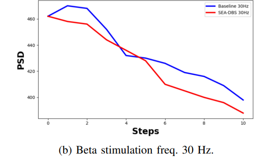

### Replication

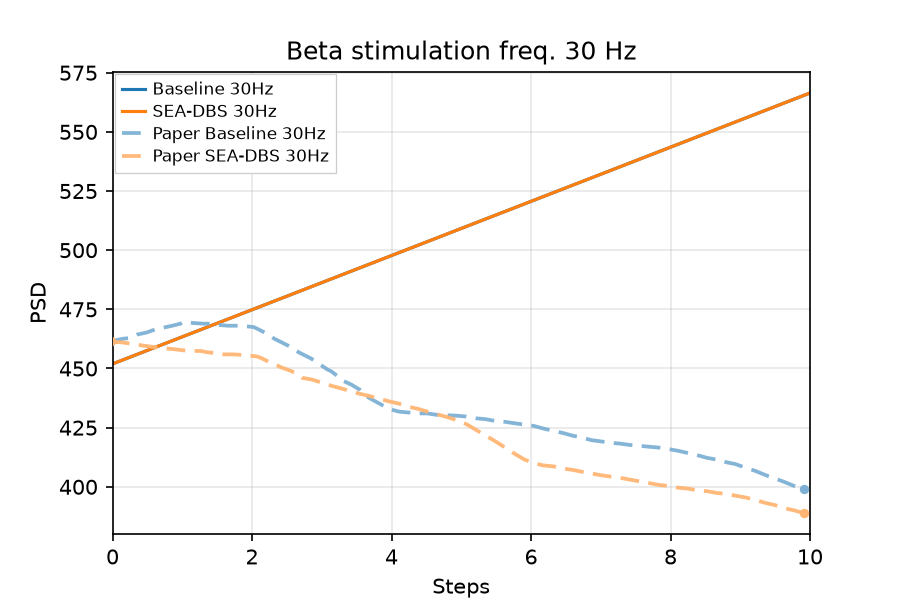

<!-- caption-5b:start -->
**Caption:** Inference GPi beta PSD vs step @ 30 Hz (seed 0, argmax actions, training plant setup); pass=False; Baseline vs SEA-DBS. (v25)

**Manifest:** `artifacts/figures/papers/ravivarapu/5b/manifest.json`
<!-- caption-5b:end -->

**Status:** Fail (rep v25, plant step 0.02 ms) — 6 of 22 gates pass, unchanged. On Kumaravelu 30 Hz raises beta, so both always-on policies climb 0.452 → 0.566 where the paper's curves fall to ~0.39–0.40 (root cause 4), and they tie (root cause 1). No DBS amplitude or pulse width makes 30 Hz suppress ([5b.md](../../docs/figures/ravivarapu/5b.md)). Manifest `artifacts/figures/papers/ravivarapu/5b/manifest.json`.

<!-- gates-5b:start -->
**Gates set** (`artifacts/figures/papers/ravivarapu/5b/manifest.json`; overall **`pass`**: no, 2026-10-17). Every row is required for exit.

| Key | Description | Pass |
|-----|-------------|------|
| `n_steps_ok` | 11 PSD samples (t=0 + 10 stim steps) | yes |
| `shared_start` | baseline and SEA-DBS agree at step 0 | yes |
| `baseline_declines` | baseline PSD net drop step 0→10 | no |
| `paper_declines` | SEA-DBS PSD net drop step 0→10 | no |
| `paper_end_below_baseline` | SEA-DBS end PSD below baseline | no |
| `paper_steeper_drop` | SEA-DBS drop steeper than baseline | no |
| `carrier_hz_ok` | carrier frequency 30 Hz | yes |
| `shared_start_near_paper` | step 0 within 0.02 of paper (~0.46) | yes |
| `early_mae_baseline` | steps 0–5 MAE vs paper Baseline ≤ 20 % of its drop (0.012) | no |
| `early_mae_sea` | steps 0–5 MAE vs paper SEA-DBS ≤ 20 % of its drop (0.014) | no |
| `baseline_drop_near_paper` | Baseline step 0→10 drop in [0.5, 1.5] × paper (0.062) | no |
| `sea_drop_near_paper` | SEA-DBS step 0→10 drop in [0.5, 1.5] × paper (0.072) | no |
| `tail_gap_near_paper` | steps 6–10 Baseline − SEA-DBS gap in [0.5, 1.6] × paper (0.014) | no |
| `weaker_than_50hz_baseline` | Baseline 30 Hz drop positive but smaller than its 50 Hz drop | no |
| `weaker_than_50hz_sea` | SEA-DBS 30 Hz drop positive but smaller than its 50 Hz drop | no |
| `early_baseline_rises` | baseline PSD initial rise at step 1-2 | yes |
| `early_sea_plateau` | SEA-DBS delayed drop / plateau on steps 0-2 | yes |
| `early_sea_below_baseline` | SEA-DBS below baseline on steps 1-5 (mean; ≤ 0.006 crossing) | no |
| `pearson_baseline_min` | baseline trajectory correlation vs paper (r ≥ 0.70) | no |
| `pearson_sea_min` | SEA-DBS trajectory correlation vs paper (r ≥ 0.70) | no |
| `late_baseline_declines` | baseline keeps declining steps 5→10 | no |
| `late_sea_declines` | SEA-DBS keeps declining steps 5→10 | no |
<!-- gates-5b:end -->

**Run:**

```bash
uv run python -m rl_adaptive_dbs.run scripts/figures/papers/ravivarapu/5b/plot.py --export-notes --update-report
uv run python -m rl_adaptive_dbs.run scripts/figures/papers/ravivarapu/5b/plot.py --plot-only --export-notes --update-report
```

**Defaults:** seed `0`; carrier **30 Hz**; same checkpoints and rollout as Fig 5a.

---

## Fig 6 — FP16 PTQ @ 50 Hz

**FP16 post-training quantization** of SEA-DBS vs Baseline at **50 Hz** over **10 stimulation steps** (Fig. 6 / §V). Paper claim: quantized SEA-DBS **tracks** full-precision PSD reduction and still **beats** Baseline; model size **~65 MB → ~33 MB**.

QAT is **out of scope** for SEA-DBS (not reported).

### Paper (Ravivarapu et al.)

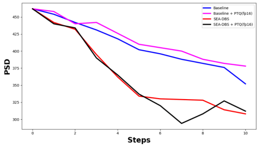

### Replication

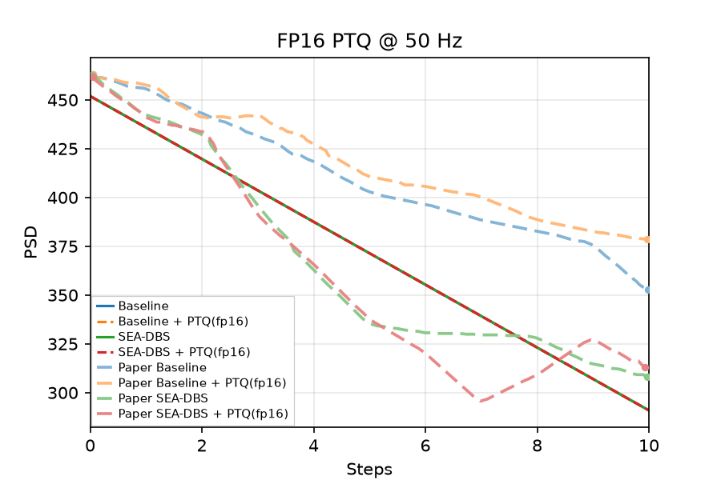

<!-- caption-6:start -->
**Caption:** FP16 PTQ inference GPi beta PSD vs step @ 50 Hz (seed 0, argmax actions, plain .half() cast); pass=False; Baseline/SEA-DBS fp32 + PTQ; SEA-DBS networks 52 KB → 26 KB. (v25)

**Manifest:** `artifacts/figures/papers/ravivarapu/6/manifest.json`
<!-- caption-6:end -->

**Status:** Fail (rep v25, plant step 0.02 ms) — 10 of 15 gates pass, unchanged. All four series coincide: both policies stimulate every step (root cause 1) and a plain fp16 cast flips no action. PTQ tracking fp32 passes (the paper's claim); the fails are SEA-DBS below Baseline (fp32 and PTQ), the Baseline early MAE and the Baseline tails (ours is the always-on tail vs the paper's 0.380 / 0.391). Manifest `artifacts/figures/papers/ravivarapu/6/manifest.json`; notes [6.md](../../docs/figures/ravivarapu/6.md).

<!-- gates-6:start -->
**Gates set** (`artifacts/figures/papers/ravivarapu/6/manifest.json`; overall **`pass`**: no, 2026-10-17). Every row is required for exit.

| Key | Description | Pass |
|-----|-------------|------|
| `four_series_present` | fp32 + PTQ for baseline and SEA-DBS | yes |
| `n_steps_ok` | 11 PSD samples (t=0 + 10 stim steps) | yes |
| `shared_start` | paired series share pre-stim level | yes |
| `shared_start_near_paper` | step 0 within 0.02 of paper (~0.46) | yes |
| `early_mae_baseline` | steps 0–5 MAE vs paper Baseline ≤ 20 % of its drop (0.021) | no |
| `early_mae_sea` | steps 0–5 MAE vs paper SEA-DBS ≤ 20 % of its drop (0.030) | yes |
| `fp32_matches_fig5a` | fp32 traces equal the Fig 5a rollout (≤ 0.005; paper 0.0024) | yes |
| `sea_below_baseline` | SEA-DBS fp32 tail below baseline fp32 | no |
| `sea_ptq_below_baseline` | SEA-DBS PTQ tail below baseline fp32 | no |
| `sea_ptq_tracks_fp32` | SEA-DBS PTQ within 0.03 of fp32 (tail) and 0.04 (any step) | yes |
| `baseline_ptq_tracks_fp32` | Baseline PTQ within 0.03 of fp32 (tail) and 0.04 (any step) | yes |
| `baseline_tail_near_paper` | Baseline fp32 steps 6–10 within 0.02 of paper (0.380) | no |
| `sea_tail_near_paper` | SEA-DBS fp32 steps 6–10 within 0.02 of paper (0.322) | yes |
| `baseline_ptq_tail_near_paper` | Baseline PTQ steps 6–10 within 0.02 of paper (0.391) | no |
| `sea_ptq_tail_near_paper` | SEA-DBS PTQ steps 6–10 within 0.02 of paper (0.314) | yes |
<!-- gates-6:end -->

**Run:**

```bash
uv run python -m rl_adaptive_dbs.run scripts/figures/papers/ravivarapu/6/plot.py
uv run python -m rl_adaptive_dbs.run scripts/figures/papers/ravivarapu/6/plot.py --plot-only
```

**Defaults:** seed `0`; **FP16 PTQ** as a plain `.half()` cast (no QAT, no weight noise); 10-step eval; 50 Hz carrier.

---

## Fig 7 — ablation (Baseline / +PM / +GS / SEA-DBS)

**PSD over 10 stimulation steps** for four variants (Fig. 7): **Baseline**, **Baseline+PM**, **Baseline+GS**, **SEA-DBS (PM+GS)**. Paper claim: SEA-DBS strongest / most stable suppression; +PM alone noisy early (~**4,500** samples cited); +GS alone limited gains.

Map to trainer `variant`: `baseline`, `baseline-pm`, `baseline-gs`, `paper` ([sea_dbs/replication.md](../../docs/controllers/sea_dbs/replication.md) §12).

### Paper (Ravivarapu et al.)

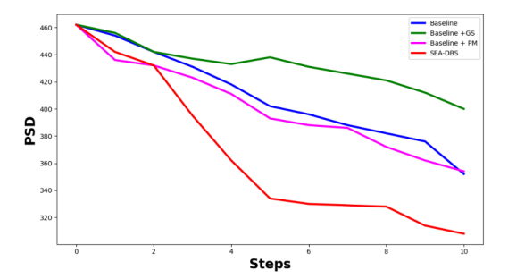

### Replication

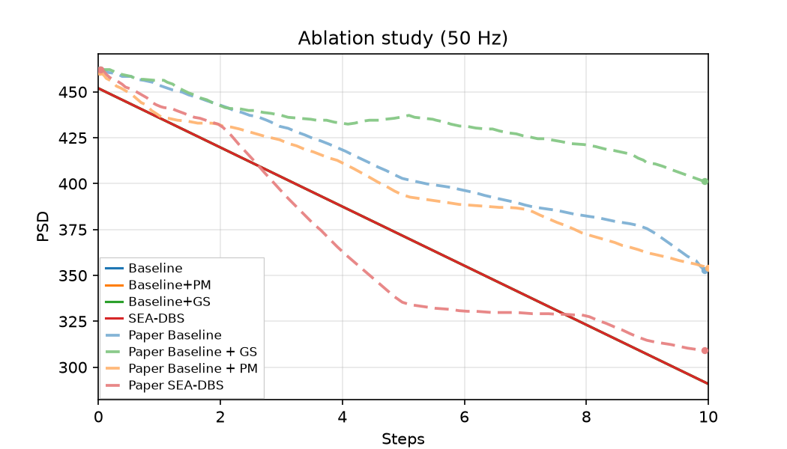

<!-- caption-7:start -->
**Caption:** Ablation GPi beta PSD over 10 steps @ 50 Hz (seed 0, argmax actions); pass=False; Baseline vs +PM vs +GS vs SEA-DBS, one shared training config. (v30)

**Manifest:** `artifacts/figures/papers/ravivarapu/7/manifest.json`
<!-- caption-7:end -->

**Status:** Fail (rep v30, plant step 0.02 ms; +PM / +GS retrained) — 7 of 17 gates pass, unchanged. In training +PM is identical to the Baseline (same greedy action, same ε draws) and +GS matches SEA-DBS once both reach full stimulation; at inference all four deploy as always-on and tie at the Fig 5a trace (root cause 1), so the ordering gates, the Baseline / +PM / +GS tails and the +PM / +GS curve MAEs fail. Manifest `artifacts/figures/papers/ravivarapu/7/manifest.json`; notes [7.md](../../docs/figures/ravivarapu/7.md).

<!-- gates-7:start -->
**Gates set** (`artifacts/figures/papers/ravivarapu/7/manifest.json`; overall **`pass`**: no, 2026-10-17). Every row is required for exit.

| Key | Description | Pass |
|-----|-------------|------|
| `four_variants_present` | baseline / +PM / +GS / SEA-DBS | yes |
| `n_steps_ok` | 11 PSD samples (t=0 + 10 stim steps) | yes |
| `shared_start` | baseline and SEA-DBS agree at step 0 | yes |
| `shared_start_near_paper` | step 0 within 0.02 of paper (~0.46) | yes |
| `early_mae_baseline` | steps 0–5 MAE vs paper Baseline ≤ 20 % of its drop (0.021) | no |
| `early_mae_sea` | steps 0–5 MAE vs paper SEA-DBS ≤ 20 % of its drop (0.030) | yes |
| `mae_pm` | steps 0–10 MAE vs paper +PM ≤ 20 % of its drop (0.020) | no |
| `mae_gs` | steps 0–10 MAE vs paper +GS ≤ 20 % of its drop (0.012) | no |
| `fp32_matches_fig5a` | Baseline / SEA-DBS equal the Fig 5a rollout (≤ 0.005) | yes |
| `baseline_above_pm_early` | Baseline above Baseline+PM early (steps 0-4) | no |
| `sea_dbs_lowest_tail` | SEA-DBS tail ≥ 0.005 below every other variant | no |
| `gs_highest_tail` | Baseline+GS tail ≥ 0.005 above every other variant | no |
| `pm_not_sea` | PM closer to baseline than to SEA-DBS | no |
| `baseline_tail_near_paper` | Baseline steps 6–10 within 0.02 of paper (0.380) | no |
| `pm_tail_near_paper` | +PM steps 6–10 within 0.02 of paper (0.373) | no |
| `gs_tail_near_paper` | +GS steps 6–10 within 0.02 of paper (0.419) | no |
| `sea_tail_near_paper` | SEA-DBS steps 6–10 within 0.02 of paper (0.323) | yes |
<!-- gates-7:end -->

**Run:**

```bash
uv run python -m rl_adaptive_dbs.run scripts/figures/papers/ravivarapu/7/plot.py --export-notes --update-report
uv run python -m rl_adaptive_dbs.run scripts/figures/papers/ravivarapu/7/plot.py --plot-only --export-notes --update-report
```

**Defaults:** seed `0`; Baseline / SEA-DBS checkpoints from Fig 4; +PM / +GS train 150 episodes with the same `fig4_ravivarapu_config`; Fig 5a rollout (50 Hz, argmax, 11 PSD samples).

---

## Table II — avg PSD with the plant reseeded every n steps

**Table II** (§V.B): average PSD and average reward for Baseline and SEA-DBS when the environment seed changes every $n \in \{10, 20, 50, 75\}$ steps (simulated PD progression). Paper claim: SEA-DBS has the lower PSD at every $n$ (Baseline 364 / 366 / 332 / 328 vs SEA-DBS 326 / 309 / 304 / 302). The Avg Reward column is Eq. (7) of Avg PSD / 1000 in all eight cells, so only PSD is gated.

Protocol convention (the paper gives only the interval): one deterministic rollout of 30 blocks of $n$ steps per variant and $n$ at 50 Hz on the Fig 4 checkpoints, the plant reset with the next seed (0–29) at each block (which re-prefills the Eq. (5) window), so every $n$ visits the same plant seeds; Avg PSD = mean Eq. (5) observation × 1000 ([sea_dbs/replication.md](../../docs/controllers/sea_dbs/replication.md) §14.13).

### Replication

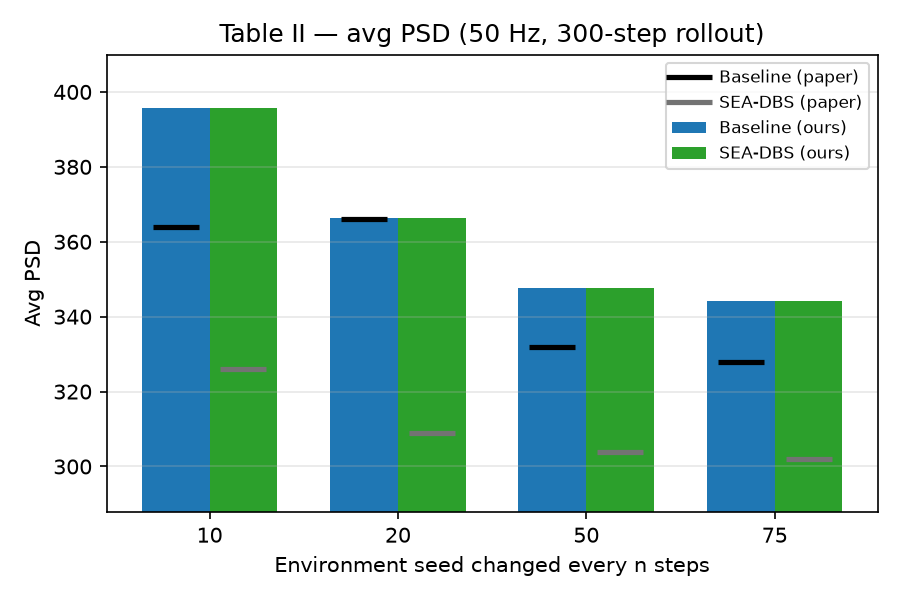

<!-- caption-t2:start -->
**Caption:** Table II avg PSD (×1000 normalized) with the plant reseeded every n steps; plant seeds 0–29 once per n (30 blocks of n steps), argmax rollout @ 50 Hz on the Fig 4 checkpoints; pass=False; bars ours, dashes paper. (v2)

**Manifest:** `artifacts/figures/papers/ravivarapu/table2/manifest.json`
<!-- caption-t2:end -->

**Status:** Fail (rep v2, equal-seed protocol, plant step 0.02 ms) — 2 of 6 gates pass. Both always-on policies give the same average PSD at every interval (root cause 1): 396 / 366 / 348 / 344 for n = 10 / 20 / 50 / 75, vs the paper's Baseline 364 / 366 / 332 / 328 and SEA-DBS 326 / 309 / 304 / 302. PSD falls with n as in the paper; each reseed costs a fixed transient (avg ≈ F + A/n with A ≈ 600 PSD·steps vs the paper's SEA-DBS ≈ 273), because a reseed re-prefills the 10-sample window with untreated values. v1's 397 / 357 / 326 / 296 used a fixed 300-step horizon, which visited seeds 0–3 for n = 75 but 0–29 for n = 10; the full-stimulation floor ranges 221–479 across those seeds, so most of that trend was the seed pool. Manifest `artifacts/figures/papers/ravivarapu/table2/manifest.json`.

**Candidate — partial window carry (oct 19 2026; deviates from the paper as we read it — our best guess of what the authors may have done):** keep the newest share of the Eq. (4) window across a reseed and re-prefill only the rest with the new seed's untreated level (`evaluate_reseeded(keep_window_frac=…)`, shipped checkpoints). The share sets the per-reseed transient: A ≈ 596 / 286 / 158 / 55 PSD·steps at keep 0 / 0.3 / 0.5 / 0.8 (n = 10 vs 75 fit; paper SEA-DBS 273). At 0.3 — picked after fitting A at the other shares, so tuned toward the paper's number — avg PSD is 365 / 351 / 342 / 340 for n = 10 / 20 / 50 / 75, inside 20 of the paper's Baseline at every n: 3 of 6 gates (adds `baseline_near_paper_every_n`). The SEA-DBS gates still fail because both policies stimulate every step (root cause 1). Not promoted ([4a.md](../../docs/figures/ravivarapu/4a.md) § Candidate screen (oct 19 2026); author question 14).

<!-- gates-t2:start -->
**Gates set** (`artifacts/figures/papers/ravivarapu/table2/manifest.json`; overall **`pass`**: no, 2026-10-17). Every row is required for exit.

| Key | Description | Pass |
|-----|-------------|------|
| `all_intervals_present` | rows for n = 10, 20, 50, 75 | yes |
| `sea_below_baseline_every_n` | SEA-DBS avg PSD below Baseline at every n | no |
| `gap_near_paper_every_n` | Baseline − SEA-DBS gap in [0.5, 1.6] × paper (38 / 57 / 28 / 26) | no |
| `baseline_near_paper_every_n` | Baseline avg PSD within 20 of paper (364 / 366 / 332 / 328) | no |
| `sea_near_paper_every_n` | SEA-DBS avg PSD within 20 of paper (326 / 309 / 304 / 302) | no |
| `psd_falls_with_interval` | avg PSD lower at n = 75 than n = 10 (both) | yes |
<!-- gates-t2:end -->

**Run:**

```bash
uv run python -m rl_adaptive_dbs.run scripts/figures/papers/ravivarapu/table2/plot.py --export-notes --update-report
uv run python -m rl_adaptive_dbs.run scripts/figures/papers/ravivarapu/table2/plot.py --plot-only --export-notes --update-report
```

**Defaults:** seed `0`; carrier **50 Hz**; argmax actions from the Fig 4 Baseline / SEA-DBS actors; 30 blocks of n steps per interval, block seeds 0–29 for every n.
